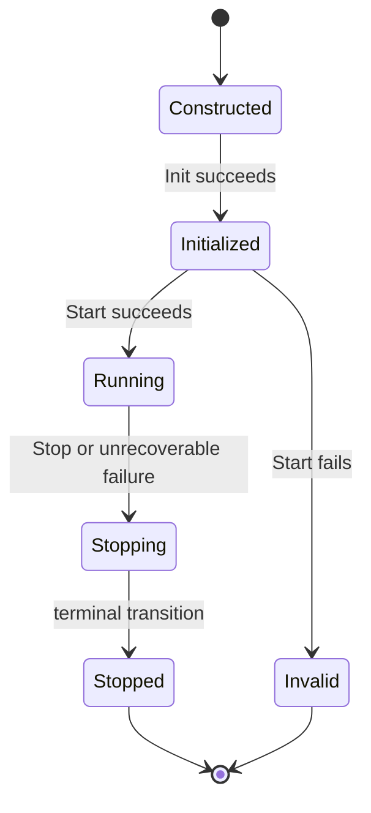
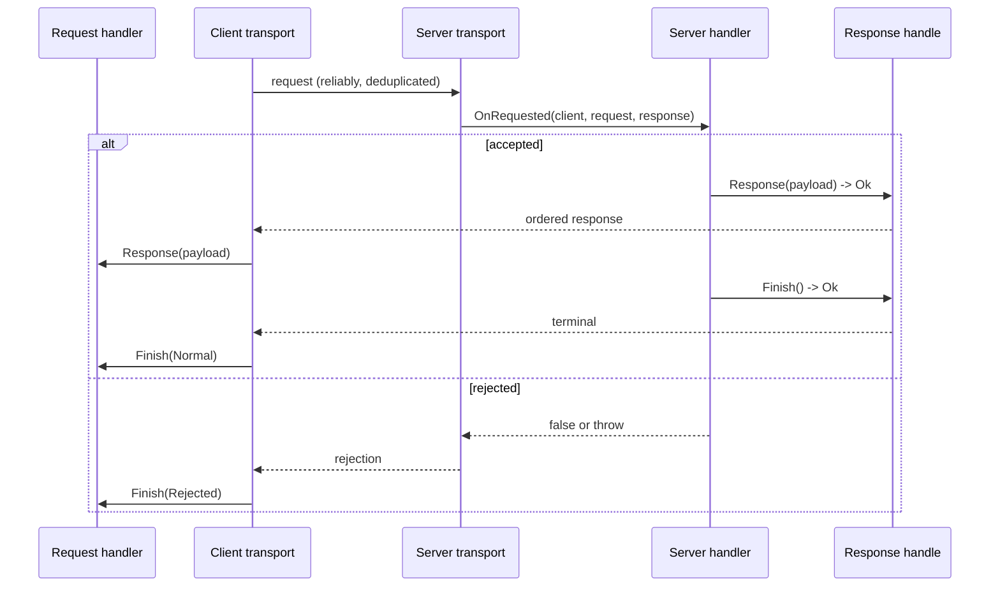

# RRReliable Transport Specification

## 1. Scope

`RRReliable` is the single reliable request/response (RR) transport contract.
A client sends a request bound to a per-request handler. The server handler
accepts or rejects the request and may answer it with zero or more responses
followed by one explicit completion. The client may cancel the request.

This specification defines:

- the public client/server, request-handler, server-handler, and response
  contracts;
- the reliability, ordering, correlation, and duplicate-suppression model;
- request and response TTLs;
- cancellation, rejection, and completion semantics;
- transport and callback lifecycles;
- ownership, concurrency, and failure rules; and
- send-result meanings and implementation-defined behavior.

It does **not** define a wire format, interoperability between implementations,
configuration syntax, discovery, authentication, authorization,
confidentiality, integrity protection, replay protection, queue capacity, or
cross-request ordering. Those concerns belong to a selected implementation or
to a protocol layered above this transport.

RRReliable is intended to be implemented by several carrier families,
including a `RawReliable` wrapper, SMS, SMTP/POP3 mail, and message-queue
transports. No implementation is part of this specification.

## 2. Normative language

The key words **MUST**, **MUST NOT**, **REQUIRED**, **SHOULD**, **SHOULD NOT**,
and **MAY** in this document are to be interpreted as described in
[RFC 2119](https://datatracker.ietf.org/doc/html/rfc2119).

## 3. Public contract

```csharp
public interface IRRTransport : ITransport
{
    int MessageMaxByteSize { get; }
}

public interface IRRReliableTransport : IRRTransport
{
}

public interface IRRReliableClientTransport : IRRReliableTransport
{
    TimeSpan RequestTtl { get; }
    bool Init();
    SendResult Request(UnionDataList request, IRRReliableRequestHandler handler);
    void CancelRequest(IRRReliableRequestHandler handler);
}

public interface IRRReliableRequestHandler
{
    void Response(UnionDataList response);
    void Finish(RRReliableCompletionType type);
}

public interface IRRReliableServerTransport : IRRReliableTransport
{
    TimeSpan ResponseTtl { get; }
    bool Init(IRRReliableServerHandler handler);
}

public interface IRRReliableServerHandler : IHandler
{
    bool OnRequested(IEndPoint client, UnionDataList request,
        IRRReliableResponse response);
}

public interface IRRReliableResponse
{
    long RequestId { get; }
    SendResult Response(UnionDataList response);
    SendResult Finish();
}

public enum RRReliableCompletionType
{
    Normal,
    Canceled,
    Rejected,
    Failed
}
```

`ITransport` supplies `Type`, `Name`, `IsValid`, `IsStarted`,
`Start(Action<StopReason>)`, `Stop(StopReason?)`, `Log`, `Memory`, and
`GetControls`. `IRRTransport` adds `MessageMaxByteSize`.

The client binds no handler; each `Request` binds its own
`IRRReliableRequestHandler`. The server binds one `IRRReliableServerHandler`
through `Init`. Neither handler has `Started` or `Stopped` callbacks; transport
lifecycle is observed through `Start`/`Stop` and the `onStopped` callback.

## 4. Terms and roles

| Term | Meaning |
| --- | --- |
| **client** | An `IRRReliableClientTransport` instance. |
| **server** | An `IRRReliableServerTransport` instance. |
| **transport** | One client or one server transport instance. |
| **request** | One `UnionDataList` passed to `Request`. |
| **response** | One `UnionDataList` passed to `IRRReliableResponse.Response` and delivered through `IRRReliableRequestHandler.Response`. |
| **request handler** | The per-request `IRRReliableRequestHandler` bound by `Request`. |
| **response handle** | The `IRRReliableResponse` supplied to `OnRequested`. |
| **request id** | The server-global `IRRReliableResponse.RequestId`, unique across all clients. |
| **accepted request** | A `Request` call that returned `SendResult.Ok`. |
| **accepted response** | A `IRRReliableResponse.Response` call that returned `SendResult.Ok`. |
| **pending request** | An accepted request whose handler has not yet received `Finish`. |
| **rejected request** | An `OnRequested` call that returned `false` or threw. |
| **request TTL** | `IRRReliableClientTransport.RequestTtl`. |
| **response TTL** | `IRRReliableServerTransport.ResponseTtl`. |
| **running** | The period after a successful `Start` and before stopping begins. |

`IEndPoint` is routing metadata, not a session or security principal.

## 5. Responsibilities at a glance

| Topic | Guaranteed by RRReliable | Application responsibility | Implementation-defined |
| --- | --- | --- | --- |
| Request delivery | Retries until the request is delivered, rejected, cancelled, or failed. If `OnRequested` runs for a request, it runs exactly once. | Handle every completion type; make server work idempotent only if a carrier can redeliver after an implementation-defined persistence boundary. | Carrier, retry schedule, persistence, and deduplication. |
| Response delivery | Delivers each accepted response exactly once to the request handler, in acceptance order, unless the request stops being live first. | Handle zero or more responses; do not assume any response arrives. | Retry schedule and queue capacity. |
| Completion | Delivers exactly one `Finish` for every accepted request. | Never wait for a second `Finish`; do not call `Response` after it. | Timing only. |
| Correlation | Per-request handler identity; server `RequestId` is unique across clients. | Never bind one handler to two pending requests. | Id encoding and wire correlation. |
| Cancellation | `CancelRequest` produces one `Finish(Canceled)` and suppresses later responses. | Treat server-side cancellation as best effort. | Whether and how cancellation reaches the server. |
| Server rejection | Rejected requests complete as `Rejected` and cannot be answered. | Return `false` only for a definite decision; a throw is also a rejection. | Logging. |
| TTLs | A pending request finishes `Failed` at `RequestTtl`; a response stream stops accepting at `ResponseTtl`. | Choose TTLs appropriate to the carrier's latency. | Clock source and timer implementation. |
| Handler callbacks | Per-request serialization and non-reentrancy; different requests may run concurrently. | Protect state shared by handlers. | Scheduler and thread. |
| Security | No authentication, authorization, confidentiality, integrity, or replay protection. | Add protection above this layer or use a protected carrier. | Any protection outside this contract. |

## 6. Reliability model

RRReliable presents an exactly-once, ordered stream **per request** to the
application, while allowing implementations to retry, reorder, and duplicate
frames internally.

For each request accepted with `SendResult.Ok`:

1. The transport **MUST** attempt delivery until the request is delivered,
   rejected, cancelled, completed, or failed.
2. `IRRReliableServerHandler.OnRequested` **MUST** be invoked at most once for
   that request. If it is invoked, it is invoked exactly once.
3. The transport **MUST** deliver every response accepted with `Ok` to the
   request handler exactly once, in the order in which those `Response` calls
   returned `Ok`, unless the request completes before the response can be
   delivered. A response that cannot be delivered because the request
   completed is discarded.
4. The transport **MUST** deliver exactly one `Finish` for the request, after
   every response that precedes its completion has been delivered.
5. The transport **MUST** suppress duplicates. The application **MUST NOT**
   observe the same request or response twice, even when the carrier
   retransmits.

The transport **MUST NOT** claim exactly-once delivery across an
implementation-defined persistence boundary it cannot support. A stopped
transport finishes its pending requests with `Failed`; requests and responses
from a previous transport lifetime are not part of the new instance's pending
set. Implementations that persist work across restarts **MUST** document and
preserve their duplicate-suppression scope.

No ordering is guaranteed between different requests. Requests from one
client, requests from different clients, and responses for different requests
may be interleaved, delayed, or processed concurrently.

## 7. Initialization and transport lifecycle

### 7.1 Initialization

The client `Init()` and the server `Init(handler)` bind the transport for a
start. `Init` is one-time and pre-start. Concurrent calls are safe, and at most
one call **MAY** return `true`; every later or racing call **MUST** return
`false` without changing the bound state. A successful `Init` **MUST NOT**
start carrier activity.

The server `Init` **MUST** throw `ArgumentNullException` for a null handler
without changing state. The client `Init` takes no handler.

`Init` **MUST** return `false` after a start has been attempted, after the
transport is invalid, or after stopping begins. `Start` before a successful
`Init` **MUST** return `false` and invalidate the transport.

### 7.2 Transport state



`Start` requires a non-null `onStopped` callback; `null` **MUST** throw
`ArgumentNullException` without changing the lifecycle state.

`Start` is one-time. Concurrent calls are safe, but at most one **MAY** return
`true`. A failed initial start **MUST** invalidate the transport, **MUST NOT**
invoke `onStopped`, and **MUST NOT** deliver any handler callback.

A normal `Stop` does not invalidate the transport: `IsValid` remains `true`
while `IsStarted` becomes `false`. An unrecoverable internal or carrier failure
**MUST** invalidate it. A stopped transport **MUST NOT** be restarted or
reinitialized.

### 7.3 Stop and pending requests

When a started transport stops or fails, it **MUST**:

1. stop accepting new requests and responses;
2. deliver exactly one `Finish(Failed)` to every pending request handler;
3. make every live `IRRReliableResponse` handle return `Error` and release its
   payload;
4. stop the handler callbacks that are not part of the terminal notification;
   and
5. invoke `onStopped` exactly once after the terminal transition.

Pending `Finish(Failed)` notifications MUST be scheduled before the transport's
`onStopped` callback begins. They need not finish before `onStopped` is
invoked. No callback is delivered after the terminal `Finish` for that
request.

A normal stop, an unrecoverable failure, and a carrier loss are all `Failed`
for pending requests. `Canceled` is used only for an explicit
`CancelRequest`.

The transport has no handler `Started`/`Stopped` callbacks. A server
`IRRReliableResponse` that is still live when the server stops returns `Error`
after the stop begins.

## 8. Client contract

### 8.1 `Request`

```csharp
SendResult Request(UnionDataList request, IRRReliableRequestHandler handler);
```

`Request` is thread-safe and may be called from any callback. Concurrent
requests are allowed and each request binds its own handler.

The transport performs these checks in order:

1. `handler` is null → throw `ArgumentNullException`;
2. `handler` is already bound to a pending request → throw
   `InvalidOperationException`;
3. `request` is null or cannot be serialized → `InvalidMessage`;
4. the transport is not running → `NotConnected`;
5. the serialized payload exceeds `MessageMaxByteSize` → `MessageTooBig`; or
6. the carrier result, including `Ok`, `BufferOverflow`, `Error`, or another
   implementation-defined synchronous failure.

`ArgumentNullException` and `InvalidOperationException` are thrown before the
request payload is consumed; on those exceptions the caller retains the
request. For every `SendResult` other than `InvalidMessage`, the transport
owns and eventually releases the request payload. The caller **MUST NOT** read,
mutate, retain, release, or retry with that `UnionDataList` after such a call.
On `InvalidMessage`, the buffer is null or already dead and remains with the
caller.

A handler that is already bound to a pending request **MUST** be rejected with
`InvalidOperationException`; the method **MUST NOT** silently rebind it. After
its request finishes, the same handler instance **MAY** be used for a new
request.

If `Request` returns anything other than `Ok`, the handler receives **no**
callbacks for that call. In particular, a failed `Request` does not deliver
`Finish`.

If `Request` returns `Ok`, the request is pending and the handler **MUST**
receive exactly one `Finish` eventually. `Ok` is local acceptance, not proof
that the server has seen the request.

`IRRReliableRequestHandler.Response` or `Finish` **MAY** begin before `Request`
returns. The handler must tolerate that.

### 8.2 Request callbacks

`IRRReliableRequestHandler.Response(UnionDataList response)` is invoked for
each accepted response for the request. `IRRReliableRequestHandler.Finish(type)`
is invoked exactly once and terminates the request.

Callbacks for one request handler are serialized and non-reentrant. No
`Response` follows `Finish`. Callbacks for different request handlers may run
concurrently. The transport does not provide a global callback serialization
guarantee.

The handler owns each delivered response reference and **MUST** release it
exactly once. Responses that are dropped because the request is no longer live
remain owned by the transport.

A handler exception **MUST** be caught and logged. It **MUST NOT** stop or
invalidate the transport, and it **MUST NOT** cause a duplicate callback. A
`Finish` callback that throws is still considered delivered exactly once. The
throwing handler is responsible for releasing any response it owns.

### 8.3 `CancelRequest`

```csharp
void CancelRequest(IRRReliableRequestHandler handler);
```

`CancelRequest` is thread-safe and idempotent. A null handler **MUST** throw
`ArgumentNullException`. An unknown, completed, or already-cancelled handler is
a no-op. The method uses handler identity, not equality.

For a pending request, the transport **MUST**:

1. suppress every later `Response` for that request;
2. deliver exactly one `Finish(Canceled)`; and
3. make a best effort to inform the server so it stops producing responses.

The `Finish(Canceled)` notification **MUST** be delivered exactly once. If
`CancelRequest` is called outside a callback of that handler, the notification
**MUST** be scheduled before the call returns. If `CancelRequest` is called
from inside a callback of the same handler, the terminal `Finish` **MUST** be
delivered after the running callback returns, not reentrantly.

No server-side cancellation callback exists. If the transport can inform the
server, later `IRRReliableResponse.Response` and `Finish` calls on that request
**MUST** return `Error`. If the transport cannot inform the server, the server
observes the loss on its next response attempt or at its response TTL.

## 9. Server contract

### 9.1 `OnRequested`

```csharp
bool OnRequested(IEndPoint client, UnionDataList request,
    IRRReliableResponse response);
```

`OnRequested` is invoked for every accepted request, at most once per request.
It may run concurrently for different requests; the transport provides no
global serialization across requests. `client` identifies the source route.
Equal `IEndPoint` values **MUST** denote the same route while valid, and equal
values **MUST** return equal hash codes.

`IRRReliableResponse.RequestId` is the server-global request id. The first
accepted request of a running server transport is `1`; ids are strictly
increasing and unique across all clients. Duplicate suppression means the same
request is never presented twice, so each id appears at most once in
`OnRequested`.

The handler owns the request reference and **MUST** release it exactly once,
including when it rejects the request or throws.

Returning `true` accepts the request and keeps the response handle live.
Returning `false`, or throwing, rejects it. On rejection:

- the response handle **MUST** become invalid;
- the client request **MUST** complete with `Finish(Rejected)`;
- no response frame is delivered; and
- a later `IRRReliableResponse.Response` or `Finish` **MUST** return
  `Error`.

A throwing `OnRequested` **MUST** be caught and logged and treated as a
rejection. It **MUST NOT** stop or invalidate the transport.

### 9.2 `IRRReliableResponse`

The response handle stays usable after `OnRequested` returns and may be used
asynchronously. Different requests may use their handles concurrently. Calls
for one handle are serialized by the transport and may be made from any
thread.

`long RequestId { get; }` is the server-global request id and is immutable for
the handle lifetime.

`SendResult Response(UnionDataList response)` sends one response for the
request. Zero or more responses are allowed before `Finish`. The result
precedence is:

1. `InvalidMessage` — the response is null or cannot be serialized;
2. `MessageTooBig` — the serialized payload exceeds `MessageMaxByteSize`;
3. `Error` — the transport is stopping or stopped, the request was rejected,
   cancelled, has already finished, or the handle is otherwise invalid; or
4. the carrier result, including `Ok`, `BufferOverflow`, `Error`, or another
   implementation-defined synchronous failure.

On every result except `InvalidMessage`, the transport owns and eventually
releases the response payload. The caller **MUST NOT** access it afterwards.
A response accepted with `Ok` participates in the request's ordered delivery
guarantee. A non-`Ok` result carries no retry signal; the application chooses
its own retry and backpressure policy using a new payload buffer.

`SendResult Finish()` completes the request normally. The first call that
completes it returns `Ok`. Every later call, and every call after a rejection,
cancellation, stop, or expiry, returns `Error`. No `Response` call is allowed
after a successful `Finish`; such a call returns `Error`. `Finish` itself
participates in the ordered stream: the client's `Finish(Normal)` is delivered
after all responses that returned `Ok` before it.

### 9.3 Response TTL

`ResponseTtl` is a positive duration. It starts when `OnRequested` accepts the
request. When it expires, the response handle becomes invalid and every later
`Response` or `Finish` returns `Error`. The transport **MUST** complete the
client request with `Finish(Failed)` and **MUST** attempt to suppress later
responses. Expiry is a transport decision, not an application callback.

The server transport **MAY** drop a cancelled, failed, or expired client
connection or route. If it does, later handle calls return `Error`.

## 10. Completion model

Every request accepted by `Request` receives exactly one `Finish`:

| Trigger | `RRReliableCompletionType` |
| --- | --- |
| The server's `IRRReliableResponse.Finish()` completed normally and its completion reached the client | `Normal` |
| `OnRequested` returned `false` or threw | `Rejected` |
| The client called `CancelRequest` | `Canceled` |
| The client or server transport stopped or failed, the carrier lost the request, or the request TTL expired | `Failed` |
| The server response TTL expired | `Failed` |

`Finish(Normal)` **MUST** follow every response of the request that was
accepted before the server's `Finish`. No `Response` follows any `Finish`.

`Finish(Rejected)` is delivered after the server rejects the request. It is
delivered even when the server sent no responses.

`Finish(Canceled)` is delivered exactly once by `CancelRequest`. The server
does not receive a cancellation callback. `Finish(Failed)` covers every other
terminal path, including a normal local stop.

## 11. Request TTL

`RequestTtl` is a positive duration exposed by
`IRRReliableClientTransport.RequestTtl`. It starts when `Request` accepts the
request.

The transport **MUST** monitor the pending request for the whole TTL; expiry
does not depend on further traffic. On expiry the transport **MUST**:

1. remove the request from the pending set;
2. deliver exactly one `Finish(Failed)` if it has not already finished; and
3. suppress every later response for that request.

A late response after expiry is released and dropped. Request TTL expiry does
not require a server callback. The client and server TTLs are independent:
either side may expire first, and the transport **MUST** still provide exactly
one completion to the client handler.

The TTL values are configured by the implementation. The abstraction exposes
them through the getters; it defines no default value.

## 12. Message model

`MessageMaxByteSize` is an inclusive limit on the serialized `UnionDataList`
payload, including list and element encoding, but excluding transport framing.
It applies to requests and responses on both sides. Empty `UnionDataList`
values are valid.

The transport **MUST** preserve complete-message boundaries and logical
content. It **MUST NOT** fragment one message across callbacks or merge
messages. Internal retries, reordering, and duplicate suppression are
implementation details.

An implementation **MUST NOT** invoke a handler or a server callback for
inbound data that is malformed, cannot be decoded, or exceeds
`MessageMaxByteSize`. It **MUST** release and log such data and **MUST NOT**
stop or invalidate the transport solely because of it.

A server **MUST NOT** require a prior registration, connection, or admission
exchange beyond what its carrier mandates. A client **MUST** accept a response
only from the route associated with its request; this is routing, not
authentication.

## 13. Request path



`OnRequested` runs at most once per accepted request. `Response` callbacks for
one request are in the order the server's `Response` calls returned `Ok`.
`Finish` follows them. Different requests may interleave freely.

## 14. Callback concurrency and ownership

Callbacks for one `IRRReliableRequestHandler` are serialized and
non-reentrant. Callbacks for different request handlers may run concurrently.
The server's `OnRequested` callbacks for different requests may run
concurrently. The transport does not provide global callback serialization.

A transport method (`Request`, `CancelRequest`, `Stop`, or an
`IRRReliableResponse` call) may be invoked from a callback. A `CancelRequest`
from the same handler's callback defers its `Finish(Canceled)` until the
callback returns.

Each delivered response transfers one independently owned `UnionDataList`
reference to the handler. The handler **MUST** release it exactly once and
**MAY** retain it beyond callback return. Each request passed to
`OnRequested` is likewise owned by the server handler.

Handlers **SHOULD** return promptly. Slow handling delays later callbacks and
may contribute to TTL expiry.

## 15. Send results

### 15.1 `Request`

| Result | Required meaning |
| --- | --- |
| `Ok` | The request was accepted; exactly one `Finish` will follow. |
| `InvalidMessage` | The request is null or cannot be serialized. |
| `MessageTooBig` | The payload exceeds `MessageMaxByteSize`. |
| `NotConnected` | The client is not running. |
| `BufferOverflow` | The implementation cannot accept the request because local capacity is full. |
| `Error` | Another synchronous transport error occurred. |

`ArgumentNullException` (null handler) and `InvalidOperationException`
(handler already bound) are thrown before the payload is consumed. A non-`Ok`
`SendResult` delivers no callbacks.

### 15.2 `IRRReliableResponse`

| Result | Required meaning |
| --- | --- |
| `Ok` | The response or completion was accepted for reliable delivery. |
| `InvalidMessage` | The response is null or cannot be serialized. |
| `MessageTooBig` | The payload exceeds `MessageMaxByteSize`. |
| `BufferOverflow` | The implementation cannot accept the response because local capacity is full. |
| `Error` | The handle is invalid, the request completed, or the transport stopped. |

Every synchronous non-`Ok` result is non-fatal to the transport. It does not
imply that the request has completed; the application chooses whether to
retry with a new payload buffer or finish the request.

## 16. Failure, shutdown, and implementation-defined behavior

An unrecoverable internal or carrier failure after a successful start **MUST**
invalidate the transport, finish every pending request with `Finish(Failed)`,
invalidate every live response handle, and invoke `onStopped` exactly once. A
normal `Stop` follows the same pending-request and handle rules without
invalidating the transport.

No request or response callback is fabricated after its `Finish`. A handler
already running may complete asynchronously; its watchdog must not deliver a
second terminal notification.

The following are implementation-defined, provided they do not weaken this
specification:

- wire encoding, framing, id encoding, and interoperability;
- carrier, persistence, retry schedule, and duplicate-suppression mechanism;
- address configuration and endpoint representation;
- callback scheduler and execution thread;
- `onStopped` dispatch scheduler and timing after the terminal transition;
- outbound queue capacity, scheduling, and drain rate;
- how `RequestTtl` and `ResponseTtl` values are configured, provided both are
  positive;
- internal logging format and sink; and
- mechanisms and timing for unrecoverable failure detection.

## 17. Security considerations and conformance checklists

RRReliable provides no peer authentication, authorization, confidentiality,
cryptographic integrity, tamper detection, source-spoofing protection, or
replay protection. A server handler can receive requests from any route that
reaches the carrier, and a client-side route filter is not authentication.
Applications handling sensitive, privileged, or non-idempotent operations
**MUST** add the required protection above this transport or choose a
protected transport stack.

### 17.1 Application-author checklist

- [ ] Bind a distinct request handler to each pending request.
- [ ] Never reuse a handler while its request is pending.
- [ ] Expect zero or more `Response` calls followed by exactly one `Finish`.
- [ ] Treat `Ok` from `Request` or `Response` as local acceptance only.
- [ ] Handle every completion type, including `Rejected` and `Failed`.
- [ ] Never call `Response` after `Finish`.
- [ ] Release every delivered response exactly once.
- [ ] Keep request and server handlers prompt, non-blocking, and
      exception-safe.
- [ ] Choose TTLs that accommodate the carrier's latency.
- [ ] Treat request ids, endpoints, and payloads as unauthenticated input.
- [ ] Observe `onStopped`; do not restart a stopped or invalid transport.

### 17.2 Transport-implementer checklist

- [ ] Provide one-time `Init` and `Start` with no handler lifecycle callbacks.
- [ ] Preserve exactly-once request presentation, ordered responses, and one
      `Finish` per accepted request.
- [ ] Suppress duplicates across retries, within the documented persistence
      scope.
- [ ] Assign unique server-global request ids starting at `1`.
- [ ] Serialize callbacks per request handler and per response handle while
      allowing different requests to proceed concurrently.
- [ ] Enforce `RequestTtl` and `ResponseTtl` actively, independently of
      traffic, and complete pending requests with `Failed`.
- [ ] Finish every pending request with `Failed` on stop or failure.
- [ ] Invalidate response handles and return `Error` after completion,
      cancellation, rejection, expiry, or stop.
- [ ] Enforce `MessageMaxByteSize` on sent and received payloads.
- [ ] Drop and log malformed or oversized inbound data without stopping.
- [ ] Transfer and release buffers according to this specification.
- [ ] Treat throwing handlers as specified and keep unrelated requests
      running.
- [ ] Document carrier latency, persistence, TTL configuration, capacity, and
      failure behavior without weakening this contract.

## 18. Non-goals

- No cross-request ordering.
- No server-side cancellation callback or server-initiated completion type
  other than `Finish()`.
- No implicit acknowledgement, receipt, or response-status payload.
- No authentication, authorization, confidentiality, integrity, or replay
  protection.
- No cross-implementation wire compatibility.
- No durable persistence requirement unless an implementation documents one.
