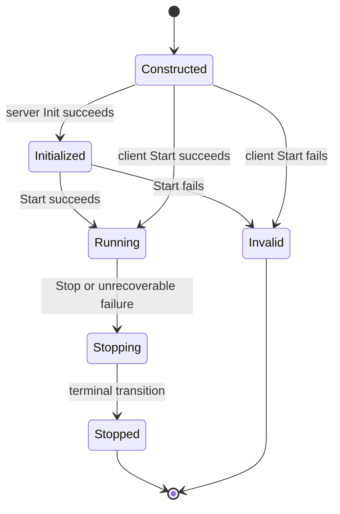
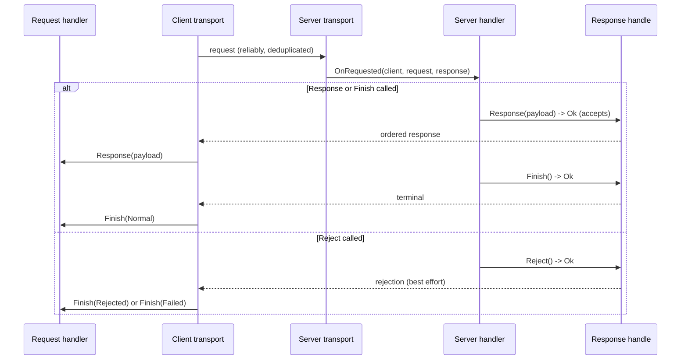

# RRReliable Transport Specification

## 1. Scope

`RRReliable` is the single reliable request/response (RR) transport contract.
A client sends a request bound to a per-request handler. The server handler
accepts the request by responding to it, or rejects it explicitly, and may
answer it with zero or more responses followed by one explicit completion. The
client may cancel the request.

This specification defines:

- the public client/server, request-handler, server-handler, and response
  contracts;
- the reliability, ordering, correlation, and duplicate-suppression model;
- request and response TTLs;
- cancellation, rejection, and completion semantics;
- transport and callback lifecycles;
- ownership, concurrency, and failure rules; and
- send-result meanings and implementation-defined behavior.

It does **not** define a wire format, interoperability between implementations,
configuration syntax, discovery, authentication, authorization,
confidentiality, integrity protection, replay protection, queue capacity, or
cross-request ordering. Those concerns belong to a selected implementation or
to a protocol layered above this transport.

RRReliable is intended to be implemented by several carrier families,
including a `RawReliable` wrapper, SMS, SMTP/POP3 mail, and message-queue
transports. No implementation is part of this specification.

## 2. Normative language

The key words **MUST**, **MUST NOT**, **REQUIRED**, **SHOULD**, **SHOULD NOT**,
and **MAY** in this document are to be interpreted as described in
[RFC 2119](https://datatracker.ietf.org/doc/html/rfc2119).

## 3. Public contract

```csharp
public interface IRRTransport : ITransport
{
    int MessageMaxByteSize { get; }
}

public interface IRRRequestHandler : IHandler
{
    long RequestId { get; }
    void Cancel();
}

public interface IRRResponse
{
    long RequestId { get; }
    SendResult Response(UnionDataList response);
}

public interface IRRClientTransport : IRRTransport
{
    IEndPoint ServerEndPoint { get; }
    TimeSpan RequestTtl { get; }
}

public interface IRRServerTransport : IRRTransport
{
    TimeSpan ResponseTtl { get; }
}

public interface IRRReliableTransport : IRRTransport
{
}

public interface IRRReliableClientTransport : IRRClientTransport
{
    SendResult Request(UnionDataList request, IRRReliableRequestHandler handler);
}

public interface IRRReliableRequestHandler : IRRRequestHandler
{
    void Response(UnionDataList response);
    void Finish(RRReliableCompletionType type);
}

public interface IRRReliableServerTransport : IRRServerTransport
{
    bool Init(IRRReliableServerHandler handler);
}

public interface IRRReliableServerHandler : IHandler
{
    void OnRequested(IEndPoint client, UnionDataList request,
        IRRReliableResponse response);
}

public interface IRRReliableResponse : IRRResponse
{
    SendResult Finish();
    SendResult Reject();
}

public enum RRReliableCompletionType
{
    Normal,
    Canceled,
    Rejected,
    Failed
}
```

`ITransport` supplies `Type`, `Name`, `IsValid`, `IsStarted`,
`Start(Action<StopReason>)`, `Stop(StopReason?)`, `Log`, `Memory`, and
`GetControls`. `IRRTransport` adds `MessageMaxByteSize`.

`IRRClientTransport`, `IRRServerTransport`, `IRRRequestHandler`, and
`IRRResponse` are shared with the unreliable family. A request handler **MUST**
derive from `RRRequestHandler`, which supplies `RequestId` and `Cancel`; a
transport **MUST** throw `ArgumentException` for any other handler.
`RRResponse` is the corresponding base for transport-supplied response handles.

The client binds no handler and has no `Init`; it is ready for `Start` after
construction, and `ServerEndPoint` is the route fixed at construction. Each
`Request` binds its own `IRRReliableRequestHandler`. The server binds one
`IRRReliableServerHandler` through `Init`. Neither handler has `Started` or
`Stopped` callbacks. The readiness signal is `Start` returning `true`; the stop
signals are `onStopped`, the terminal `Finish(Failed)` notifications, and closed
response handles. A handler that is created per request has no transport-level
lifecycle to observe.

A response handle starts **undecided**. The handler decides the outcome through
the handle: the first successful `Response` or `Finish` call accepts the
request, and `Reject` rejects it. There is no boolean acceptance result.

## 4. Terms and roles

| Term | Meaning |
| --- | --- |
| **client** | An `IRRReliableClientTransport` instance. |
| **server** | An `IRRReliableServerTransport` instance. |
| **transport** | One client or one server transport instance. |
| **request** | One `UnionDataList` passed to `Request`. |
| **response** | One `UnionDataList` passed to `IRRReliableResponse.Response` and delivered through `IRRReliableRequestHandler.Response`. |
| **request handler** | The per-request `IRRReliableRequestHandler` bound by `Request`. |
| **response handle** | The `IRRReliableResponse` supplied to `OnRequested`. |
| **client-local id** | `IRRRequestHandler.RequestId` while the handler is bound; unique within one client transport. |
| **request id** | The server-global `IRRReliableResponse.RequestId`, unique across all clients. |
| **server route** | The `ServerEndPoint` fixed at client construction. |
| **accepted request** | A `Request` call that returned `SendResult.Ok`. |
| **undecided handle** | A response handle on which no `Response`, `Finish`, or `Reject` call has succeeded yet. |
| **accepted response stream** | A response handle whose first successful `Response` or `Finish` call accepted the request. |
| **rejected request** | A response handle whose `Reject` call succeeded, or an `OnRequested` call that threw while its handle was undecided. |
| **closed handle** | A handle after `Finish`, response TTL expiry, or a transport stop. Every later `Response`, `Finish`, or `Reject` call returns `Error`. |
| **pending request** | An accepted request whose handler has not yet received `Finish`. |
| **request TTL** | `IRRReliableClientTransport.RequestTtl`. |
| **response TTL** | `IRRReliableServerTransport.ResponseTtl`. |
| **running** | The period after a successful `Start` and before stopping begins. |

A rejected handle is terminal but not closed: `Reject` returns `Ok` again,
while `Response` and `Finish` throw. A transport stop closes every handle.

`IEndPoint` is routing metadata, not a session or security principal.

## 5. Responsibilities at a glance

| Topic | Guaranteed by RRReliable | Application responsibility | Implementation-defined |
| --- | --- | --- | --- |
| Request delivery | Retries until the request is delivered, rejected, cancelled, or failed. If `OnRequested` runs for a request, it runs exactly once. | Handle every completion type; make server work idempotent only if a carrier can redeliver after an implementation-defined persistence boundary. | Carrier, retry schedule, persistence, and deduplication. |
| Response delivery | Attempts to deliver each response accepted with `Ok` exactly once to the request handler, in acceptance order, until the request stops being live. `Ok` is local acceptance, not proof of delivery. | Handle zero or more responses; do not assume any response arrives. | Retry schedule and queue capacity. |
| Completion | Delivers exactly one `Finish` for every accepted request, after the responses that precede it. The type reports the outcome the client observed; a rejection notification that is lost surfaces as `Failed`. | Never wait for a second `Finish`; do not call `Response` after it. | Timing only. |
| Correlation | Per-request handler identity and the fixed `ServerEndPoint`; server `RequestId` is unique across clients. | Never bind one handler to two pending requests. | Id encoding and wire correlation. |
| Cancellation | `handler.Cancel()` produces one `Finish(Canceled)` and suppresses later responses. | Treat server-side cancellation as best effort. | Whether and how cancellation reaches the server. |
| Server rejection | `Reject()` produces `Rejected` on the client when the notification arrives; otherwise the request completes as `Failed` at `RequestTtl`. A rejected handle cannot answer. | Reject only while the handle is undecided; never respond after `Reject`. | Whether and how the rejection reaches the client, and logging. |
| TTLs | A pending request finishes `Failed` at `RequestTtl`; a response stream stops accepting at `ResponseTtl`. | Choose TTLs appropriate to the carrier's latency. | Clock source and timer implementation. |
| Handler callbacks | Per-request serialization and non-reentrancy; different requests may run concurrently. | Protect state shared by handlers. | Scheduler and thread. |
| Security | No authentication, authorization, confidentiality, integrity, or replay protection. | Add protection above this layer or use a protected carrier. | Any protection outside this contract. |

## 6. Reliability model

RRReliable presents an exactly-once, ordered stream **per request** to the
application, while allowing implementations to retry, reorder, and duplicate
frames internally.

For each request accepted with `SendResult.Ok`:

1. The transport **MUST** attempt delivery until the request is delivered,
   rejected, cancelled, or failed.
2. `IRRReliableServerHandler.OnRequested` **MUST** be invoked at most once for
   that request. If it is invoked, it is invoked exactly once.
3. The transport **MUST** attempt to deliver every response accepted with `Ok`
   to the request handler exactly once, in the order in which those `Response`
   calls returned `Ok`, unless the request completes before the response can be
   delivered. A response that cannot be delivered because the request completed
   is discarded.
4. The transport **MUST** deliver exactly one `Finish` for the request, after
   every response that precedes its completion has been delivered.
5. The transport **MUST** suppress duplicates. The application **MUST NOT**
   observe the same request or response twice, even when the carrier
   retransmits.

Acceptance and rejection are decided by the server handler through the response
handle, not by a return value. A handler that calls neither `Response`, nor
`Finish`, nor `Reject` leaves the request undecided; `ResponseTtl` bounds that
state.

Rejection is a server decision communicated to the client on a best-effort
basis. The transport **MUST** attempt to deliver it, but **MUST NOT** claim that
the client always observes `Rejected`: if the notification does not arrive
before the client request TTL expires, the request completes as `Failed`.

The transport **MUST NOT** claim exactly-once delivery across an
implementation-defined persistence boundary it cannot support. A stopped
transport finishes its pending requests with `Failed`; requests and responses
from a previous transport lifetime are not part of the new instance's pending
set. Implementations that persist work across restarts **MUST** document and
preserve their duplicate-suppression scope.

No ordering is guaranteed between different requests. Requests from one
client, requests from different clients, and responses for different requests
may be interleaved, delayed, or processed concurrently.

## 7. Initialization and transport lifecycle

### 7.1 Initialization

The server `Init(handler)` binds the application handler for a start. The client
has no `Init`: it binds no handler and is ready to start after construction.
`Init` is one-time and pre-start. Concurrent calls are safe, and at most one
call **MAY** return `true`; every later or racing call **MUST** return `false`
without changing the bound state. A successful `Init` **MUST NOT** start
carrier activity.

The server `Init` **MUST** throw `ArgumentNullException` for a null handler
without changing state.

`Init` **MUST** return `false` after a start has been attempted, after the
transport is invalid, or after stopping begins. A server `Start` before a
successful `Init` **MUST** return `false` and invalidate the transport. The
client `Start` requires no initialization.

### 7.2 Transport state



`Start` requires a non-null `onStopped` callback; `null` **MUST** throw
`ArgumentNullException` without changing the lifecycle state.

`Start` is one-time. Concurrent calls are safe, but at most one **MAY** return
`true`. A failed initial start **MUST** invalidate the transport, **MUST NOT**
invoke `onStopped`, and **MUST NOT** deliver any handler callback.

No handler callback and no server callback **MUST** begin before `Start` has
returned `true`.

A normal `Stop` does not invalidate the transport: `IsValid` remains `true`
while `IsStarted` becomes `false`. An unrecoverable internal or carrier failure
**MUST** invalidate it. A stopped transport **MUST NOT** be restarted or
reinitialized.

### 7.3 Stop and pending requests

When a started transport stops or fails, it **MUST**:

1. stop accepting new requests and responses;
2. deliver exactly one `Finish(Failed)` to every pending request handler whose
   request has not already completed;
3. close every live response handle, so later `Response`, `Finish`, and
   `Reject` calls return `Error`;
4. stop the handler callbacks that are not part of the terminal notifications;
   and
5. invoke `onStopped` exactly once after the terminal transition.

Pending `Finish(Failed)` notifications MUST be scheduled before the transport's
`onStopped` callback begins. They need not finish before `onStopped` is
invoked. No callback is delivered after the terminal `Finish` for that
request.

A normal stop, an unrecoverable failure, and a carrier loss are all `Failed`
for pending requests. `Canceled` is used only for an explicit
`handler.Cancel()`.

A request that was undecided at stop is closed, not rejected: the client
completes it as `Failed` unless a rejection notification already reached it.

The transport has no handler `Started`/`Stopped` callbacks. A server response
handle that is still live when the server stops returns `Error` after the stop
begins.

## 8. Client contract

The client is configured with one fixed server route, exposed as
`ServerEndPoint`. The route is immutable for the client lifetime. The client
**MUST** accept a response only from that route and **MUST** drop and release a
response received from any other route. This is routing, not authentication.

### 8.1 `Request`

```csharp
SendResult Request(UnionDataList request, IRRReliableRequestHandler handler);
```

`Request` is thread-safe and may be called from any callback. Concurrent
requests are allowed and each request binds its own handler.

The transport performs these checks in order:

1. `handler` is null → throw `ArgumentNullException`;
2. `handler` does not derive from `RRRequestHandler` → throw `ArgumentException`;
3. `handler` is already bound to a pending request → throw
   `InvalidOperationException`;
4. `request` is null or cannot be serialized → `InvalidMessage`;
5. the transport is not running → `NotConnected`;
6. the serialized payload exceeds `MessageMaxByteSize` → `MessageTooBig`; or
7. the carrier result, including `Ok`, `BufferOverflow`, `Error`, or another
   implementation-defined synchronous failure.

`ArgumentNullException`, `ArgumentException`, and `InvalidOperationException`
are thrown before the request payload is consumed; on those exceptions the
caller retains the request. For every `SendResult` other than
`InvalidMessage`, the transport owns and eventually releases the request
payload. The caller **MUST NOT** read, mutate, retain, release, or retry with
that `UnionDataList` after such a call. On `InvalidMessage`, the buffer is null
or already dead and remains with the caller.

A handler that is already bound to a pending request **MUST** be rejected with
`InvalidOperationException`; the method **MUST NOT** silently rebind it. After
its request finishes, the same handler instance **MAY** be used for a new
request.

If `Request` returns anything other than `Ok`, the handler receives **no**
callbacks for that call. In particular, a failed `Request` does not deliver
`Finish`.

If `Request` returns `Ok`, the request is pending and the handler **MUST**
receive exactly one `Finish` eventually. `handler.RequestId` is the
client-local id of the request while the handler is bound; it is `-1` before
the first binding and keeps the last id after unbinding. `Ok` is local
acceptance, not proof that the server has seen the request.

`RequestTtl` starts when the call returns `Ok`. The transport **MUST NOT** count
the time spent inside `Request` against the TTL.

`IRRReliableRequestHandler.Response` or `Finish` **MAY** begin before `Request`
returns. The handler must tolerate that.

### 8.2 Request callbacks

`IRRReliableRequestHandler.Response(UnionDataList response)` is invoked for
each response accepted by the server for the request.
`IRRReliableRequestHandler.Finish(type)` is invoked exactly once and terminates
the request.

Callbacks for one request handler are serialized and non-reentrant. No
`Response` follows `Finish`. Callbacks for different request handlers may run
concurrently. The transport does not provide a global callback serialization
guarantee.

The handler owns each delivered response reference and **MUST** release it
exactly once. Responses that are dropped because the request is no longer live
remain owned by the transport.

A handler exception **MUST** be caught and logged. It **MUST NOT** stop or
invalidate the transport, and it **MUST NOT** cause a duplicate callback. A
`Finish` callback that throws is still considered delivered exactly once. The
throwing handler is responsible for releasing any response it owns.

### 8.3 `Cancel()`

```csharp
void Cancel();
```

`IRRRequestHandler.Cancel` is thread-safe and idempotent. An unknown,
completed, or already-cancelled handler is a no-op. The method uses handler
identity, not equality, and needs no transport reference: the handler delegates
to the transport that bound it.

For a pending request, cancellation **MUST**:

1. suppress every later `Response` for that request;
2. deliver exactly one `Finish(Canceled)`; and
3. make a best effort to inform the server so it stops producing responses.

The `Finish(Canceled)` notification **MUST** be delivered exactly once. If
`Cancel` is called outside a callback of that handler, the notification
**MUST** be scheduled before the call returns. If `Cancel` is called from
inside a callback of the same handler, the terminal `Finish` **MUST** be
delivered after the running callback returns, not reentrantly.

No server-side cancellation callback exists. If the transport can inform the
server, later `IRRReliableResponse.Response` and `Finish` calls on that request
**MUST** return `Error`. If the transport cannot inform the server, the server
observes the loss on its next response attempt or at its response TTL.

## 9. Server contract

### 9.1 `OnRequested`

```csharp
void OnRequested(IEndPoint client, UnionDataList request,
    IRRReliableResponse response);
```

`OnRequested` is invoked once for every request the transport presents. It may
run concurrently for different requests; the transport provides no global
serialization across requests. `client` identifies the source route. Equal
`IEndPoint` values **MUST** denote the same route while valid, and equal values
**MUST** return equal hash codes.

`IRRReliableResponse.RequestId` is the server-global request id. The first
request presented to a running server transport is `1`; ids are strictly
increasing and unique across all clients. Ids **MAY** have gaps: an id can be
consumed without being presented. Duplicate suppression means the same request
is never presented twice, so each id appears at most once in `OnRequested`.

The handler owns the request reference and **MUST** release it exactly once.

The handle starts undecided. The handler decides the outcome only through the
handle:

| First successful call | Resulting state | Client-visible effect |
| --- | --- | --- |
| `Response` | accepted response stream | responses may be delivered |
| `Finish` | accepted and completed | `Finish(Normal)` after the accepted responses |
| `Reject` | rejected | `Finish(Rejected)` when the notification arrives, otherwise `Finish(Failed)` at `RequestTtl` |

`Response` and `Finish` may be called inside `OnRequested` or later. Returning
without deciding leaves the handle undecided and live until it is answered or
`ResponseTtl` expires. An accepted or rejected handle keeps that state.

A throwing `OnRequested` **MUST** be caught and logged and **MUST NOT** stop or
invalidate the transport. If the handle was still undecided, the transport
**MUST** reject it. If it was already accepted or rejected, the throw changes
nothing and the request keeps its state.

### 9.2 `IRRReliableResponse`

The handle stays usable after `OnRequested` returns and may be used
asynchronously, including from inside `OnRequested`. Different requests may use
their handles concurrently. Calls for one handle are serialized by the
transport and may be made from any thread.

`long RequestId { get; }` is the server-global request id and is immutable for
the handle lifetime.

`SendResult Response(UnionDataList response)` sends one response for the
request. Zero or more responses are allowed before `Finish`. The result
precedence is:

1. the transport is stopping or stopped, or the handle is closed → `Error`;
2. the request was rejected → throw `InvalidOperationException`;
3. `InvalidMessage` — the response is null or cannot be serialized;
4. `MessageTooBig` — the serialized payload exceeds `MessageMaxByteSize`; or
5. the carrier result, including `Ok`, `BufferOverflow`, `Error`, or another
   implementation-defined synchronous failure.

The first successful `Response` call moves the handle from undecided to
accepted. On every result except `InvalidMessage`, the transport owns and
eventually releases the response payload. The caller **MUST NOT** access it
afterwards. A response accepted with `Ok` participates in the request's ordered
delivery guarantee: the transport attempts it until the request completes or
leaves the live set. `Ok` is local acceptance; it does not prove that the
client received the response. A non-`Ok` result carries no retry signal; the
application chooses its own retry and backpressure policy using a new payload
buffer.

`SendResult Finish()` completes the request normally and accepts the request if
it is still undecided. The first call that completes it returns `Ok`. Every
later call returns `Error`. `Finish` itself participates in the ordered stream:
the client's `Finish(Normal)` is delivered after all responses that returned
`Ok` before it.

`SendResult Reject()` rejects the request if it is still undecided. It returns
`Ok` for the first successful call and for a repeated call. It returns `Error`
when the transport is stopping or stopped. After a successful `Reject`, every
`Response` and `Finish` call throws `InvalidOperationException`; the payload
passed to a throwing `Response` is not consumed and remains with the caller.

Calling `Reject` after `Response` or `Finish` succeeded throws
`InvalidOperationException`. The rejection notification is best effort; the
client completes with `Rejected` only if the notification arrives before its
`RequestTtl` expires.

### 9.3 Response TTL

`ResponseTtl` is a positive duration exposed by
`IRRReliableServerTransport.ResponseTtl`. It starts when the request is
presented to `OnRequested` and bounds the time the stream may stay undecided or
open. When it expires, the handle is closed and every later `Response`,
`Finish`, or `Reject` returns `Error`. The transport **MUST** complete the
client request with `Finish(Failed)` and **MUST** attempt to suppress later
responses. Expiry is a transport decision, not an application callback. A
request whose TTL has already expired **SHOULD NOT** be presented to
`OnRequested`.

The server transport **MAY** drop a cancelled, failed, or expired client
connection or route. If it does, later handle calls return `Error`.

## 10. Completion model

Every request accepted by `Request` receives exactly one `Finish`:

| Trigger | `RRReliableCompletionType` |
| --- | --- |
| The server's `IRRReliableResponse.Finish()` completed normally and its completion reached the client | `Normal` |
| The server's `IRRReliableResponse.Reject()` succeeded and the rejection reached the client | `Rejected` |
| The client cancelled the request through `handler.Cancel()` | `Canceled` |
| The client or server transport stopped or failed, the carrier lost the request, the request TTL expired, or a rejection notification did not reach the client | `Failed` |
| The server response TTL expired | `Failed` |

`Finish(Normal)` **MUST** follow every response of the request that was
accepted before the server's `Finish`. No `Response` follows any `Finish`.

`Finish(Rejected)` is delivered when the rejection reaches the client. It is
delivered even when the server sent no responses.

`Finish(Canceled)` is delivered exactly once by `Cancel()`. The server
does not receive a cancellation callback. `Finish(Failed)` covers every other
terminal path, including a normal local stop and a lost rejection.

`Finish` is guaranteed; its type is the outcome the client actually observed,
not necessarily the server's decision.

## 11. Request TTL

`RequestTtl` is a positive duration exposed by
`IRRReliableClientTransport.RequestTtl`. It starts when `Request` returns
`SendResult.Ok`; the time spent inside the call is not counted.

The transport **MUST** monitor the pending request for the whole TTL; expiry
does not depend on further traffic. On expiry the transport **MUST**:

1. remove the request from the pending set;
2. deliver exactly one `Finish(Failed)` if it has not already finished; and
3. suppress every later response for that request.

A late response after expiry is released and dropped. Request TTL expiry does
not require a server callback. The client and server TTLs are independent:
either side may expire first, and the transport **MUST** still provide exactly
one completion to the client handler.

The TTL values are configured by the implementation. The abstraction exposes
them through the getters; it defines no default value.

## 12. Message model

`MessageMaxByteSize` is an inclusive limit on the serialized `UnionDataList`
payload, including list and element encoding, but excluding transport framing.
It applies to requests and responses on both sides. Empty `UnionDataList`
values are valid.

The transport **MUST** preserve complete-message boundaries and logical
content. It **MUST NOT** fragment one message across callbacks or merge
messages. Internal retries, reordering, and duplicate suppression are
implementation details.

An implementation **MUST NOT** invoke a handler or a server callback for
inbound data that is malformed, cannot be decoded, or exceeds
`MessageMaxByteSize`. It **MUST** release and log such data and **MUST NOT**
stop or invalidate the transport solely because of it.

A server **MUST NOT** require a prior registration, connection, or admission
exchange beyond what its carrier mandates. The client **MUST** accept a
response only from `ServerEndPoint`; this is routing, not authentication.

## 13. Request path



`OnRequested` runs at most once per accepted request. `Response` callbacks for
one request are in the order the server's `Response` calls returned `Ok`.
`Finish` follows them. Different requests may interleave freely.

## 14. Callback concurrency and ownership

Callbacks for one `IRRReliableRequestHandler` are serialized and
non-reentrant. Callbacks for different request handlers may run concurrently.
The server's `OnRequested` callbacks for different requests may run
concurrently. The transport does not provide global callback serialization.

A transport method (`Request`, `handler.Cancel()`, `Stop`, or an
`IRRReliableResponse` call) may be invoked from a callback. A `Cancel()` from
the same handler's callback defers its `Finish(Canceled)` until the callback
returns. While a request handler is bound, its `RequestId` identifies the
request; the transport publishes the id before the first callback for it and
keeps it readable after unbinding.

Each delivered response transfers one independently owned `UnionDataList`
reference to the handler. The handler **MUST** release it exactly once and
**MAY** retain it beyond callback return. Each request passed to
`OnRequested` is likewise owned by the server handler.

Handlers **SHOULD** return promptly. Slow handling delays later callbacks and
may contribute to TTL expiry.

## 15. Send results

### 15.1 `Request`

| Result | Required meaning |
| --- | --- |
| `Ok` | The request was accepted; exactly one `Finish` will follow. |
| `InvalidMessage` | The request is null or cannot be serialized. |
| `MessageTooBig` | The payload exceeds `MessageMaxByteSize`. |
| `NotConnected` | The client is not running. |
| `BufferOverflow` | The implementation cannot accept the request because local capacity is full. |
| `Error` | Another synchronous transport error occurred. |

`ArgumentNullException` (null handler), `ArgumentException` (handler does not
derive from `RRRequestHandler`), and `InvalidOperationException` (handler
already bound) are thrown before the payload is consumed. A non-`Ok`
`SendResult` delivers no callbacks.

### 15.2 `IRRReliableResponse`

| Result | Required meaning |
| --- | --- |
| `Ok` | The response, completion, or rejection was accepted locally. Delivery is attempted until the request leaves the live set; `Ok` does not prove client receipt. |
| `InvalidMessage` | The response is null or cannot be serialized. |
| `MessageTooBig` | The payload exceeds `MessageMaxByteSize`. |
| `BufferOverflow` | The implementation cannot accept the response because local capacity is full. |
| `Error` | The handle is closed or the transport stopped. |

`Reject` returns only `Ok` or `Error`. After a successful `Reject`, `Response`
and `Finish` throw `InvalidOperationException`; after a successful `Response`
or `Finish`, `Reject` throws. A throwing call does not consume its payload.

Every synchronous non-`Ok` result is non-fatal to the transport. It does not
imply that the request has completed; the application chooses whether to
retry with a new payload buffer or finish the request.

## 16. Failure, shutdown, and implementation-defined behavior

An unrecoverable internal or carrier failure after a successful start **MUST**
invalidate the transport, finish every pending request with `Finish(Failed)`,
close every live response handle, and invoke `onStopped` exactly once. A
normal `Stop` follows the same pending-request and handle rules without
invalidating the transport.

No request or response callback is fabricated after its `Finish`. A handler
already running may complete asynchronously; its watchdog must not deliver a
second terminal notification.

The following are implementation-defined, provided they do not weaken this
specification:

- wire encoding, framing, id encoding, and interoperability;
- carrier, persistence, retry schedule, and duplicate-suppression mechanism;
- address configuration and endpoint representation;
- callback scheduler and execution thread;
- `onStopped` dispatch scheduler and timing after the terminal transition;
- outbound queue capacity, scheduling, and drain rate;
- how `RequestTtl` and `ResponseTtl` values are configured, provided both are
  positive;
- internal logging format and sink; and
- mechanisms and timing for unrecoverable failure detection.

## 17. Security considerations and conformance checklists

RRReliable provides no peer authentication, authorization, confidentiality,
cryptographic integrity, tamper detection, source-spoofing protection, or
replay protection. A server handler can receive requests from any route that
reaches the carrier, and a client-side route filter is not authentication.
Applications handling sensitive, privileged, or non-idempotent operations
**MUST** add the required protection above this transport or choose a
protected transport stack.

### 17.1 Application-author checklist

- [ ] Bind a distinct request handler to each pending request.
- [ ] Derive every request handler from `RRRequestHandler`.
- [ ] Never reuse a handler while its request is pending.
- [ ] Use `handler.Cancel()` to cancel; do not expect callbacks after
      cancellation.
- [ ] Expect zero or more `Response` calls followed by exactly one `Finish`.
- [ ] Treat `Ok` from `Request`, `Response`, `Finish`, or `Reject` as local
      acceptance only.
- [ ] Handle every completion type; a rejection may surface as `Failed`.
- [ ] Decide every response handle exactly once: `Response`/`Finish` to accept,
      `Reject` to reject.
- [ ] Never call `Response` or `Finish` after `Reject`; they throw.
- [ ] Never call `Response` after `Finish`.
- [ ] Release every delivered response exactly once.
- [ ] Keep request and server handlers prompt, non-blocking, and
      exception-safe.
- [ ] Choose TTLs that accommodate the carrier's latency.
- [ ] Treat request ids, endpoints, and payloads as unauthenticated input.
- [ ] Observe `onStopped`; do not restart a stopped or invalid transport.

### 17.2 Transport-implementer checklist

- [ ] Provide one-time server `Init` and one-time `Start`; the client requires
      no `Init`.
- [ ] Provide no handler `Started`/`Stopped` callbacks.
- [ ] Preserve exactly-once request presentation, ordered responses, and one
      `Finish` per accepted request.
- [ ] Treat a rejection notification as best effort and report the
      client-observed outcome in `Finish`.
- [ ] Suppress duplicates across retries, within the documented persistence
      scope.
- [ ] Assign unique server-global request ids starting at `1`; gaps are allowed.
- [ ] Reject a handler that does not derive from `RRRequestHandler` with
      `ArgumentException`, and publish `RequestId` before the first callback.
- [ ] Accept responses only from `ServerEndPoint`.
- [ ] Serialize callbacks per request handler and per response handle while
      allowing different requests to proceed concurrently.
- [ ] Enforce `RequestTtl` from the moment `Request` returns `Ok`.
- [ ] Enforce `ResponseTtl` from the moment `OnRequested` is invoked.
- [ ] Finish every pending request with `Failed` on stop or failure.
- [ ] Close response handles and return `Error` after completion, expiry, or
      stop, and throw `InvalidOperationException` after `Reject`.
- [ ] Enforce `MessageMaxByteSize` on sent and received payloads.
- [ ] Drop and log malformed or oversized inbound data without stopping.
- [ ] Transfer and release buffers according to this specification.
- [ ] Treat throwing handlers as specified and keep unrelated requests
      running.
- [ ] Document carrier latency, persistence, TTL configuration, capacity, and
      failure behavior without weakening this contract.

## 18. Non-goals

- No cross-request ordering.
- No server-side cancellation callback or server-initiated completion type
  other than `Finish()`.
- No guarantee that a rejection notification reaches the client.
- No implicit acknowledgement, receipt, or response-status payload.
- No authentication, authorization, confidentiality, integrity, or replay
  protection.
- No cross-implementation wire compatibility.
- No durable persistence requirement unless an implementation documents one.
