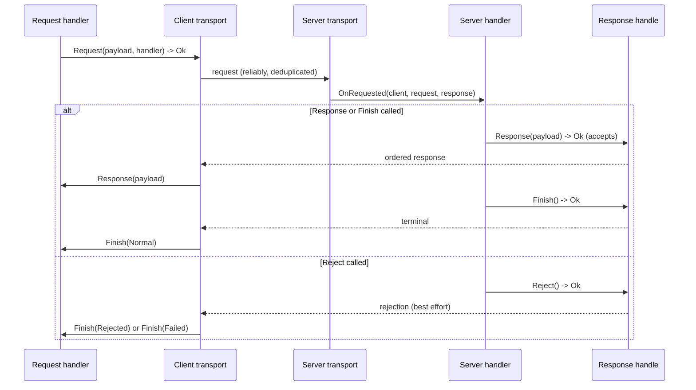

# RRReliable Transport Specification

## 1. Scope

`RRReliable` is the reliable family of the RR transport model. This document
includes the [RR Common Transport Specification](../Specification.md) by
reference. Requirements in the common specification are normative here; this
document defines only what the reliable family adds.

A client sends a request bound to a per-request handler. The server handler
accepts the request by responding to it, or rejects it explicitly, and may
answer it with zero or more responses followed by one explicit completion. The
client may cancel the request.

This specification defines:

- the family interfaces;
- the delivery, ordering, and duplicate-suppression model;
- request acceptance, rejection, and completion;
- response-stream states and results; and
- cancellation and the family send results.

The common specification defines handler binding, transport lifecycle, TTL
start points, id domains, the message model, server routing, callback
concurrency, buffer ownership, and the security baseline.

Neither document defines a wire format, interoperability between
implementations, configuration syntax, discovery, authentication,
authorization, confidentiality, integrity protection, replay protection, queue
capacity, or cross-request ordering.

RRReliable is intended to be implemented by several carrier families,
including a `RawReliable` wrapper, SMS, SMTP/POP3 mail, and message-queue
transports. No implementation is part of this specification.

## 2. Family contract

```csharp
public interface IRRReliableClientTransport : IRRClientTransport
{
    SendResult Request(UnionDataList request, IRRReliableRequestHandler handler);
}

public interface IRRReliableRequestHandler : IRRRequestHandler
{
    void Response(UnionDataList response);
    void Finish(RRReliableCompletionType type);
}

public interface IRRReliableServerTransport : IRRServerTransport
{
    bool Init(IRRReliableServerHandler handler);
}

public interface IRRReliableServerHandler : IHandler
{
    void OnRequested(IEndPoint client, UnionDataList request,
        IRRReliableResponse response);
}

public interface IRRReliableResponse : IRRResponse
{
    SendResult Finish();
    SendResult Reject();
}

public enum RRReliableCompletionType
{
    Normal,
    Canceled,
    Rejected,
    Failed
}
```

`IRRClientTransport`, `IRRServerTransport`, `IRRRequestHandler`,
`IRRResponse`, `RRRequestHandler`, and `RRResponse` come from the common
specification.

The client binds no transport-level handler and has no `Init`; it is ready to
start after construction. The server binds one `IRRReliableServerHandler`
through `Init`. Neither handler has `Started` or `Stopped` callbacks. The
readiness signal is `Start` returning `true`; the stop signals are `onStopped`,
the terminal `Finish` notifications, and closed response handles.

The family adds no correlation header. `MessageMaxByteSize` excludes transport
framing only.

## 3. Reliability model

RRReliable presents an exactly-once, ordered stream **per request** to the
application, while allowing implementations to retry, reorder, and duplicate
frames internally.

For each request accepted with `SendResult.Ok`:

1. The transport **MUST** attempt delivery until the request is delivered,
   rejected, cancelled, or failed.
2. `IRRReliableServerHandler.OnRequested` **MUST** be invoked at most once for
   that request. If it is invoked, it is invoked exactly once.
3. The transport **MUST** attempt to deliver every response accepted with `Ok`
   to the request handler exactly once, in the order in which those `Response`
   calls returned `Ok`, unless the request completes before the response can be
   delivered. A response that cannot be delivered because the request completed
   is discarded.
4. The transport **MUST** deliver exactly one `Finish` for the request, after
   every response that precedes its completion has been delivered.
5. The transport **MUST** suppress duplicates. The application **MUST NOT**
   observe the same request or response twice, even when the carrier
   retransmits.

The transport **MUST NOT** claim exactly-once delivery across an
implementation-defined persistence boundary it cannot support. A stopped
transport finishes its pending requests with `Failed`; requests and responses
from a previous transport lifetime are not part of the new instance's pending
set. Implementations that persist work across restarts **MUST** document and
preserve their duplicate-suppression scope.

No ordering is guaranteed between different requests. Requests from one client,
requests from different clients, and responses for different requests may be
interleaved, delayed, or processed concurrently.

The client-local request id is local bookkeeping in this family: the reliable
specification does not require it on the wire. Wire correlation is
implementation-defined and **MUST** respect the common cross-lifetime rule.

## 4. Server request acceptance

`OnRequested` is invoked once for every request the transport presents. It may
run concurrently for different requests; the transport provides no global
serialization across requests.

The handler owns the request reference and **MUST** release it exactly once.

The response handle starts undecided. The handler decides the outcome only
through the handle:

| First successful call | Resulting state | Client-visible effect |
| --- | --- | --- |
| `Response` | accepted response stream | responses may be delivered |
| `Finish` | accepted and completed | `Finish(Normal)` after the accepted responses |
| `Reject` | rejected | `Finish(Rejected)` when the notification arrives, otherwise `Finish(Failed)` at `RequestTtl` |

`Response` and `Finish` may be called inside `OnRequested` or later. Returning
without deciding leaves the handle undecided and live until it is answered or
`ResponseTtl` expires. An accepted or rejected handle keeps that state.

A throwing `OnRequested` **MUST** be caught and logged and **MUST NOT** stop or
invalidate the transport. If the handle was still undecided, the transport
**MUST** reject it. If it was already accepted or rejected, the throw changes
nothing and the request keeps its state.

## 5. Response stream and handle

The handle stays usable after `OnRequested` returns and may be used
asynchronously, including from inside `OnRequested`. Different requests may use
their handles concurrently. Calls for one handle are serialized by the
transport and may be made from any thread.

`Response`, `Finish`, and `Reject` follow these rules:

- **`Response`** sends one response. Zero or more responses are allowed before
  `Finish`. The first successful call accepts the request. Its result
  precedence is:
  1. the transport is stopping or stopped, or the handle is closed → `Error`;
  2. the request was rejected → throw `InvalidOperationException`;
  3. `InvalidMessage` — the response is null or cannot be serialized;
  4. `MessageTooBig` — the serialized payload exceeds `MessageMaxByteSize`; or
  5. the carrier result, including `Ok`, `BufferOverflow`, `Error`, or another
     implementation-defined synchronous failure.
- **`Finish`** completes the request normally and accepts it if it is still
  undecided. The first call that completes it returns `Ok`; every later call
  returns `Error`. `Finish` participates in the ordered stream: the client's
  `Finish(Normal)` follows every response that returned `Ok` before it.
- **`Reject`** rejects the request if it is still undecided. It returns `Ok` for
  the first successful call and for a repeated call, and `Error` when the
  transport is stopping or stopped. After a successful `Reject`, every
  `Response` and `Finish` call throws `InvalidOperationException`; if the
  transport later stops, all calls return `Error` instead. Calling `Reject`
  after `Response` or `Finish` succeeded throws.

A response accepted with `Ok` participates in the request's ordered delivery
guarantee: the transport attempts it until the request completes or leaves the
live set. `Ok` is local acceptance; it does not prove that the client received
the response. A non-`Ok` result carries no retry signal; the application
chooses its own retry and backpressure policy using a new payload buffer.

The response TTL follows the common start point. When it expires, the handle is
closed, every later `Response`, `Finish`, or `Reject` returns `Error`, and the
transport **MUST** complete the client request with `Finish(Failed)` unless
another terminal notification was already accepted. Expiry triggers no
application callback. The server transport **MAY** drop a cancelled, failed, or
expired client connection or route; if it does, later handle calls return
`Error`.

## 6. Completion model

Every request accepted by `Request` receives exactly one `Finish`:

| Trigger | `RRReliableCompletionType` |
| --- | --- |
| The server's `Finish()` completed normally and its completion reached the client | `Normal` |
| The server's `Reject()` succeeded and the rejection reached the client | `Rejected` |
| The client cancelled the request through `handler.Cancel()` | `Canceled` |
| The client or server transport stopped or failed, the carrier lost the request, the request TTL expired, or a rejection notification did not reach the client | `Failed` |
| The server response TTL expired | `Failed` |

`Finish(Normal)` **MUST** follow every response of the request that was accepted
before the server's `Finish`. No `Response` follows any `Finish`.

`Finish(Rejected)` is delivered when the rejection reaches the client. It is
delivered even when the server sent no responses.

`Finish(Canceled)` is delivered exactly once by `Cancel()`. The server does not
receive a cancellation callback. `Finish(Failed)` covers every other terminal
path, including a normal local stop and a lost rejection.

`Finish` is guaranteed; its type is the outcome the client actually observed,
not necessarily the server's decision. Several terminal causes may race. The
first cause the client transport commits wins; every later cause is suppressed
and produces no additional `Finish`.

## 7. Cancellation

For a pending request, `handler.Cancel()` **MUST**:

1. suppress every later `Response` for that request;
2. deliver exactly one `Finish(Canceled)`; and
3. make a best effort to inform the server so it stops producing responses.

The `Finish(Canceled)` notification **MUST** be delivered exactly once. If
`Cancel` is called outside a callback of that handler, the notification **MUST**
be scheduled before the call returns. If `Cancel` is called from inside a
callback of the same handler, the terminal `Finish` **MUST** be delivered after
the running callback returns, not reentrantly.

No server-side cancellation callback exists. If the transport can inform the
server, later `IRRReliableResponse.Response` and `Finish` calls on that request
**MUST** return `Error`. If the transport cannot inform the server, the server
observes the loss on its next response attempt or at its response TTL.

The handler remains bound until the `Finish` callback returns, as defined by the
common binding rule; cancellation does not unbind it early.

## 8. Request path



`Response` callbacks for one request are in the order the server's `Response`
calls returned `Ok`. `Finish` follows them. Different requests may interleave
freely.

## 9. Send results

After the shared handler checks of the common specification, `Request` returns:

| Result | Required meaning |
| --- | --- |
| `Ok` | The request was accepted; exactly one `Finish` will follow. |
| `InvalidMessage` | The request is null or cannot be serialized. |
| `MessageTooBig` | The payload exceeds `MessageMaxByteSize`. |
| `NotConnected` | The client is not running. |
| `BufferOverflow` | The implementation cannot accept the request because local capacity is full. |
| `Error` | Another synchronous transport error occurred. |

`IRRReliableResponse` uses `Ok`, `InvalidMessage`, `MessageTooBig`,
`BufferOverflow`, and `Error` as defined in section 5, plus the
`InvalidOperationException` cases. A non-`Ok` `SendResult` from `Request`
delivers no callbacks.

## 10. Application-author checklist

- [ ] Bind a distinct request handler to each pending request.
- [ ] Derive every request handler from `RRRequestHandler`.
- [ ] Never reuse a handler while its request is pending; reuse only after
      `Finish` returns.
- [ ] Expect zero or more `Response` calls followed by exactly one `Finish`.
- [ ] Treat `Ok` from `Request`, `Response`, `Finish`, or `Reject` as local
      acceptance only.
- [ ] Handle every completion type; a rejection may surface as `Failed`.
- [ ] Decide every response handle exactly once: `Response`/`Finish` to accept,
      `Reject` to reject.
- [ ] Never call `Response` or `Finish` after `Reject`; they throw.
- [ ] Never call `Response` after `Finish`.
- [ ] Use `handler.Cancel()` to cancel; do not expect callbacks after
      cancellation.
- [ ] Release every delivered payload exactly once.
- [ ] Keep request and server handlers prompt, non-blocking, and
      exception-safe.
- [ ] Choose TTLs that accommodate the carrier's latency.
- [ ] Observe `onStopped`; do not restart a stopped or invalid transport.

## 11. Transport-implementer checklist

- [ ] Provide one-time server `Init` and one-time `Start`; the client requires
      no `Init`.
- [ ] Provide no handler `Started`/`Stopped` callbacks.
- [ ] Preserve exactly-once request presentation, ordered responses, and one
      `Finish` per accepted request.
- [ ] Treat a rejection notification as best effort and report the
      client-observed outcome in `Finish`.
- [ ] Suppress duplicates across retries, within the documented persistence
      scope.
- [ ] Assign unique server-global request ids starting at `1`; gaps are allowed.
- [ ] Reject a handler that does not derive from `RRRequestHandler` with
      `ArgumentException`, and publish `RequestId` before the first callback.
- [ ] Accept responses only from `ServerEndPoint`.
- [ ] Serialize callbacks per request handler and per response handle while
      allowing different requests to proceed concurrently.
- [ ] Enforce `RequestTtl` from the moment `Request` returns `Ok`.
- [ ] Enforce `ResponseTtl` from the moment the request is received.
- [ ] Finish every pending request with `Failed` on stop or failure.
- [ ] Close response handles and return `Error` after completion, expiry, or
      stop, and throw `InvalidOperationException` after `Reject`.
- [ ] Enforce `MessageMaxByteSize` on sent and received payloads.
- [ ] Drop and log malformed or oversized inbound data without stopping.
- [ ] Transfer and release buffers according to the common specification.
- [ ] Treat throwing handlers as specified and keep unrelated requests running.
- [ ] Document carrier latency, persistence, TTL configuration, capacity, and
      failure behavior without weakening this contract.

## 12. Non-goals

- No cross-request ordering.
- No server-side cancellation callback or server-initiated completion type
  other than `Finish()`.
- No guarantee that a rejection notification reaches the client.
- No implicit acknowledgement, receipt, or response-status payload.
- No cross-implementation wire compatibility.
- No durable persistence requirement unless an implementation documents one.
- No authentication, authorization, confidentiality, integrity, or replay
  protection; see the common specification.
