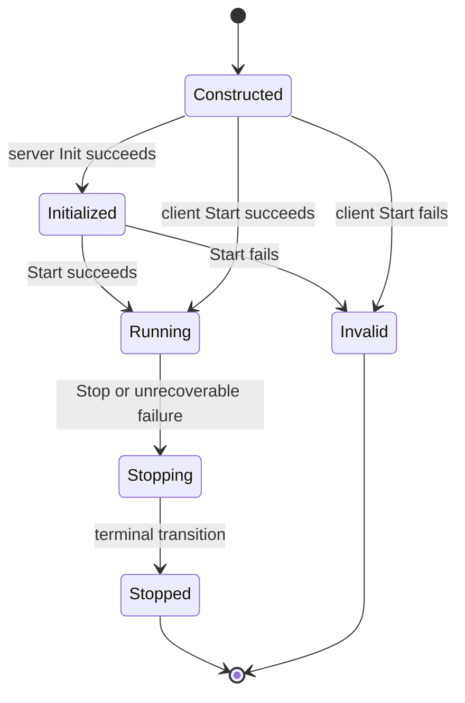

# RR Common Transport Specification

## 1. Scope

The request/response (RR) model has two type specifications: `RRReliable` and
`RRUnreliable`. This document defines the contract they share.

This specification defines:

- the common client, server, request-handler, and response-handle contracts;
- handler binding, request identifiers, and cancellation;
- transport initialization, start, stop, and failure;
- request and response TTLs;
- the message model and server route;
- callback concurrency and buffer ownership;
- the security boundary.

Each type specification defines the delivery model, the number of responses per
request, rejection and completion visibility, the observable effects of
cancellation and TTL expiry, and its send results. A type specification
**MUST** include this document by reference and **MUST NOT** weaken it.

Wire format, interoperability, configuration syntax, discovery, authentication,
authorization, confidentiality, integrity, replay protection, queue capacity,
and persistence lie outside this specification.

### 1.1 Applicability

| Section or topic | Included | Reason |
| --- | --- | --- |
| Client association | yes | The client has one immutable server route. |
| Server association and routing | yes | The server binds one application handler; routing is per client route. |
| Establishment and negotiation | no | The model has no handshake or in-band negotiation. |
| Rejection and timeout | no | Rejection is a per-request decision defined by each type specification. |
| Admission and handler binding | no | The server does not admit peers or create a handler per peer. |
| Request acceptance | yes | The shared handler checks and binding rules apply to every family request method. |
| Identifiers and correlation | yes | Client-local and server-global identifiers are shared. |
| Pending window and TTLs | yes | Both TTLs are shared; their observable effect is family-specific. |
| Responses and completion | no | Response multiplicity and completion types are family-specific. |
| Cancellation | yes | `Cancel()` is shared; its observable effect is family-specific. |

### 1.2 References

- [`ConformanceSpecification.md`](../ConformanceSpecification.md) — the stop
  semantics of section 7.3 follow its Carrier-Independent Core Conformance
  profile, section 5.3.

## 2. Normative language

The key words **MUST**, **MUST NOT**, **REQUIRED**, **SHOULD**, **SHOULD NOT**,
and **MAY** in this document are to be interpreted as described in
[RFC 2119](https://datatracker.ietf.org/doc/html/rfc2119).

## 3. Terms

| Term | Meaning |
| --- | --- |
| **client** | A client transport instance of one type. |
| **server** | A server transport instance of one type. |
| **transport** | One client or one server transport instance. |
| **request** | One `UnionDataList` passed to a family request method. |
| **response** | One `UnionDataList` passed to a response handle. |
| **request handler** | The per-request handler bound by a family request method. |
| **response handle** | The transport-supplied handle passed to the server callback. |
| **bound handler** | A request handler currently owning one request. |
| **client-local request id** | The 16-bit identifier exposed as `IRRRequestHandler.RequestId`, or `null` before the first binding. |
| **server-global id** | The 64-bit identifier exposed as `IRRResponse.RequestId`, unique across one running server transport. |
| **pending request** | A bound handler whose request has not reached its family terminal state. |
| **open response handle** | A handle that can still answer its request. |
| **closed response handle** | A handle that no longer answers. Every later call returns `Error` unless the family defines a terminal exception. |
| **request TTL** | `IRRClientTransport.RequestTtl`. |
| **response TTL** | `IRRServerTransport.ResponseTtl`. |
| **accepted request** | A family request call that returned `SendResult.Ok`. |
| **server route** | The `ServerEndPoint` fixed at client construction. |
| **running** | The period after a successful `Start` and before stopping begins. |

`IEndPoint` is routing metadata, not a session and not a security principal.

## 4. Public contract

```csharp
public interface IRRTransport : ITransport
{
    int MessageMaxByteSize { get; }
}

public interface IRRClientTransport : IRRTransport
{
    IEndPoint ServerEndPoint { get; }
    TimeSpan RequestTtl { get; }
}

public interface IRRServerTransport : IRRTransport
{
    TimeSpan ResponseTtl { get; }
}

public interface IRRRequestHandler : IHandler
{
    ushort? RequestId { get; }
    void Cancel();
}

public interface IRRResponse
{
    long RequestId { get; }
    SendResult Response(UnionDataList response);
}
```

`ITransport` supplies `Type`, `Name`, `IsValid`, `IsStarted`,
`Start(Action<StopReason>)`, `Stop(StopReason?)`, `Log`, `Memory`, and
`GetControls`.

`IRRRequestHandler` and `IRRResponse` are realized through the base classes
`RRRequestHandler` and `RRResponse`:

- `RRRequestHandler` supplies `RequestId` and `Cancel` and holds the binding
  state. The transport owns the binding. Application code **MUST** derive from
  this class; a transport **MUST** throw `ArgumentException` for a handler that
  does not.
- `RRResponse` supplies the immutable `RequestId` and the abstract response
  operation. Response handles are created by the transport; applications **MUST
  NOT** implement them.

A type specification adds its own client transport, server transport,
request-handler, and response-handle interfaces, each deriving from the
corresponding shared interface. The application implements the server handler and
the request handlers; the transport supplies the transports and response handles.

The client binds no transport-level handler and has no `Init`. The server binds
one handler through `Init`. Neither side exposes a transport-level receive event.

## 5. Model

The model is request/response. The unit of work is one request: a client sends a
payload bound to a per-request handler, and the server answers through a
response handle. Different requests are independent; the shared contract fixes
no ordering or delivery level between them.

### 5.1 Responsibility split

| Topic | Guaranteed by the shared contract | Application responsibility | Implementation-defined |
| --- | --- | --- | --- |
| Delivery | Complete messages and logical content; the family fixes the delivery level. | Handle loss, duplication, and completion according to the family. | Carrier and queue behavior. |
| Sending | `Ok` means local acceptance; the request id is published before the first callback. | Handle every `SendResult`; retry with a new payload. | Queue capacity and scheduling. |
| Handlers | Per-handler callbacks are serialized and non-reentrant; different requests may run concurrently. | Return promptly, release payloads, protect shared state. | Callback thread. |
| Routing | The client accepts a response only from `ServerEndPoint`. | Treat the route as unauthenticated input. | Addressing and endpoint representation. |
| Failure | A failed transport invalidates itself, terminates pending work, and invokes `onStopped` once. | Observe `onStopped`; do not restart. | Failure detection and timing. |
| Security | No authentication, authorization, confidentiality, integrity, or replay protection. | Add the required protection above the transport. | Protection layered outside this contract. |
| Lifecycle | One-time `Init` for the server, one-time `Start` for both; a failed start invalidates the transport. | Call `Init` once before `Start`. | Scheduler and timing of `onStopped`. |

## 6. Establishment and requests

### 6.1 Client association

`ServerEndPoint` is immutable for the client lifetime and is the route supplied
at construction.

The client **MUST** accept a response only from `ServerEndPoint`, and **MUST**
drop and release a response received from any other route. This is routing, not
authentication.

The client transport has no `Init` and is ready to start after construction.

### 6.2 Server association and routing

The server binds one application handler. It does not admit peers, create a
handler per peer, or create a session.

A server **MUST NOT** require a prior registration, connection, or admission
exchange beyond what its carrier mandates. A server callback can receive
requests from any route that reaches the carrier.

### 6.3 Request acceptance

The family request method **MUST** perform these checks in order before it
consumes the request payload:

1. `handler` is null → throw `ArgumentNullException`;
2. `handler` does not derive from `RRRequestHandler` → throw
   `ArgumentException`;
3. `handler` is already bound to a pending request → throw
   `InvalidOperationException`;
4. the family-specific payload and transport checks.

The three exceptions are thrown before the request payload is consumed; the
caller retains the request and the handler keeps its previous `RequestId`.

On `Ok`:

- the transport publishes `handler.RequestId` before the first callback for the
  request and before the request becomes visible to the carrier;
- the handler is bound until the family terminal callback returns, or until the
  request is cancelled, expires, or the transport stops;
- `RequestId` remains readable after unbinding and reports the last request
  bound to the handler.

`RequestId` is `null` before the handler's first successful binding. A handler
that is already bound **MUST NOT** be rebound; the same handler instance **MAY**
be used for a new request only after it is unbound. An implementation **MAY**
silently unbind a handler whose request expired, so that a later request can
reuse it without an intervening cancel. Expiry never produces a callback.

### 6.4 Identifiers and correlation

Client-local request ids are 16-bit unsigned integers assigned by the client
transport. Each client lifetime starts from a random id chosen when the transport
starts; every request takes the next value, incremented with unchecked 16-bit
wraparound. An id is unique until the counter wraps; the pending window is
bounded by TTLs and is expected to be far smaller than 65536 entries.

Server-global ids are 64-bit values assigned by the server transport. They start
at `1` and are strictly increasing and unique across all clients of one running
server transport. They **MAY** have gaps.

A response that belongs to a previous client transport lifetime is stale. The
fresh random starting id bounds the probability that such a response matches a
live id to at most n / 65536 for n pending requests.

Implementations **MUST** choose a fresh random starting id on every start,
**MUST NOT** use a fixed starting id, and **MUST** document the residual risk.
Each type specification defines which id travels on the wire and which id selects
the bound handler.

### 6.5 Pending window and TTLs

Both TTLs are positive, implementation-configured durations exposed through the
transport. The shared contract defines no default value. Expiry itself is a
transport decision; each type specification defines its observable effect,
including whether a completion callback results.

`RequestTtl` starts when the family request method returns `Ok`; the time spent
inside the method is not counted. The request id must enter the pending window
before the frame is submitted, so an implementation **MAY** insert it with a
provisional deadline and re-arm the deadline before returning.

`ResponseTtl` starts when the server receives the request, before the application
callback is invoked. It bounds the whole response stream.

A request whose response TTL has already expired **SHOULD NOT** be presented to
the application callback.

### 6.6 Cancellation

`Cancel()` is thread-safe and idempotent. It cancels only the request bound to
that handler, needs no transport reference, and is a no-op when the handler is
not bound.

Each type specification defines the observable effect of cancellation and
whether a terminal callback results.

## 7. Lifecycle and failure

### 7.1 Initialization

A type whose server binds an application handler before start exposes
`Init(handler)`. `Init` is one-time and pre-start. Concurrent calls are safe, and
at most one call **MAY** return `true`; every later or racing call **MUST**
return `false` without changing the bound state. A successful `Init` **MUST NOT**
start carrier activity.

`Init` **MUST** throw `ArgumentNullException` for a null handler without changing
state. It **MUST** return `false` after a start has been attempted, after the
transport is invalid, or after stopping begins. A server `Start` before a
successful `Init` **MUST** return `false` and invalidate the transport.

A client transport has no `Init`; it is ready to start after construction.

### 7.2 Start



`Start` requires a non-null `onStopped` callback; null **MUST** throw
`ArgumentNullException` without changing the lifecycle state.

`Start` is one-time. Concurrent calls are safe, but at most one **MAY** return
`true`; every racing or later call **MUST** return `false`. A failed initial
start **MUST** invalidate the transport, **MUST NOT** invoke `onStopped`, and
**MUST NOT** deliver a handler callback. A later `Start` call returns `false`
without changing the terminal state.

No handler callback and no server callback **MUST** begin before `Start` has
returned `true`.

### 7.3 Stop

- `Stop` before a successful `Start` returns `true`, invokes no callback, and
  does not prevent a later `Init` or `Start`.
- The first `Stop` on a running transport returns `true`, clears `IsStarted`, and
  invokes `onStopped` exactly once after the family terminal notifications.
- A repeated `Stop` on a valid stopped transport returns `true` and invokes no
  additional callback.
- `Stop` on an invalid transport returns `false`.
- A null reason is replaced by a transport-created
  `Pontifex.StopReasons.Unknown` initialized with the transport `Name`; a
  supplied reason is preserved.

A normal `Stop` does not invalidate the transport: `IsValid` remains `true`
while `IsStarted` becomes `false`. An unrecoverable internal or carrier failure
**MUST** invalidate it. After a successful start, stopping is terminal: a
stopped transport **MUST NOT** be restarted or reinitialized.

### 7.4 Stop ordering and failure

For each successful `Start(onStopped)`, `onStopped` **MUST** be invoked exactly
once after the terminal transition. Family terminal notifications **MUST** be
scheduled before `onStopped` begins; they need not finish before it is invoked.
No callback is delivered after a request's family terminal notification.

An unrecoverable failure **MUST** invalidate the transport, apply the family
terminal rules to every pending request and open handle, and invoke `onStopped`
exactly once.

Failure **MUST NOT** fabricate data-plane activity or handler callbacks. A
transport in the invalid state **MUST NOT** be restarted.

### 7.5 Handler lifecycle

RR handlers have no lifecycle callbacks. `onStopped` is the transport-level stop
notification, and the family terminal notifications cover pending requests and
response handles.

## 8. Message model and limits

`MessageMaxByteSize` is an inclusive limit on the serialized `UnionDataList`
payload, including list and element encoding, but excluding transport framing and
any family correlation header. Each type specification states exactly what is
excluded.

The limit applies to requests and responses and to received payloads. Empty
`UnionDataList` values are valid. The value is immutable and safe for concurrent
reads.

The transport **MUST** preserve complete-message boundaries and logical content.
It **MUST NOT** fragment one message across callbacks or merge messages. Internal
retries, reordering, and duplicate suppression are implementation details.

An implementation **MUST NOT** invoke a handler or a server callback for inbound
data that is malformed, cannot be decoded, or exceeds `MessageMaxByteSize`. It
**MUST** release and log such data and **MUST NOT** stop or invalidate the
transport solely because of it.

## 9. Send results

Defined by each type specification in its section 9.

## 10. Delivery guarantees

The shared contract fixes no delivery level. Each type specification states the
guarantee and its scope in its section 10.

The shared contract fixes these properties for every type:

- `Ok` from any request method or handle call means local acceptance only;
- a response is accepted only from `ServerEndPoint`;
- a request is presented to the application at most once per family rule;
- different requests carry no ordering guarantee between them.

## 11. Concurrency and buffer ownership

Callbacks for one request handler are serialized and non-reentrant. Callbacks for
different request handlers **MAY** run concurrently. A type that binds a single
server handler **MUST** serialize that handler's callbacks and **MUST NOT**
promise global serialization across transports.

A transport method, `Cancel()`, `Stop`, or a response-handle call may be invoked
from a callback. Each type specification defines any additional ordering rule,
such as deferring a terminal notification until the running callback returns.

On every non-throwing call, the transport owns and eventually releases the
payload it was given, except for `InvalidMessage`, where the buffer is null or
already dead and remains with the caller. A throwing call does not consume the
payload.

A handler that receives a delivered payload owns that reference and **MUST**
release it exactly once. It **MAY** retain it beyond callback return and **MUST**
release it even when it throws. The transport retains ownership of every payload
it drops.

A handler that throws **MUST** be caught and logged. The transport **MUST NOT**
stop or invalidate itself solely because a handler threw.

Handlers **SHOULD** return promptly. Slow handling delays later callbacks and may
contribute to TTL expiry.

## 12. Implementation-defined choices

| Area | Left open | Invariant that remains binding |
| --- | --- | --- |
| Carrier and wire encoding | Physical carrier, framing, correlation header, and interoperability. | Complete payloads and the declared guarantee level. |
| Addressing | Route representation and configuration. | The client accepts responses only from `ServerEndPoint`. |
| Correlation transport | Which id travels on the wire and which selects the handler. | The id domains and staleness rules of section 6.4. |
| Callback scheduler | Thread or scheduler of callbacks. | Per-handler callbacks are serialized. |
| Capacity | Queue capacity and drain rate. | A full queue yields `BufferOverflow`. |
| Persistence | Whether ids and pending work survive a restart. | The staleness rule of section 6.4 is preserved. |
| Failure detection | How and when failure is detected. | Failure invalidates the transport and notifies once. |
| Logging | Format and sink. | Malformed and oversized data is logged. |

An implementation-defined choice **MUST NOT** weaken any requirement of this
specification, and the implementation **MUST** document it.

## 13. Security boundary

RR transports provide no peer authentication, authorization, confidentiality,
cryptographic integrity, tamper detection, source-spoofing protection, or replay
protection. A server callback can receive requests from any route that reaches
the carrier, and a client-side route filter is not authentication.

A response handle is a capability for exactly one request. Applications **MUST
NOT** hand it to code that is not authorized to answer that request.

Request ids, endpoints, and payloads are unauthenticated input.

An application handling sensitive, privileged, or non-idempotent operations
**MUST** add the required protection above the transport or choose a protected
transport stack.

## 14. Conformance controls

No conformance controls are defined.

## 15. Transport-implementer checklist

Checklists are defined by each type specification.

## 16. Application-author checklist

Checklists are defined by each type specification.
