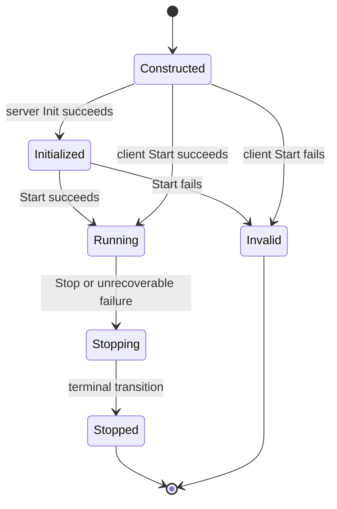

# RR Common Transport Specification

| Field | Value |
| --- | --- |
| **Component** | `Pontifex` |
| **Profile** | RR Common Transport |
| **Status** | Draft |
| **Applies to** | `RRReliable`, `RRUnreliable` |

## 1. Scope

`RRReliable` and `RRUnreliable` are two families of the same request/response
(RR) transport model. This document defines the contract they share. Its
requirements are normative for every family specification that references it.

The shared contract covers:

- the common client, server, request-handler, and response-handle contracts;
- handler binding, request ids, and cancellation;
- transport initialization, start, stop, and failure;
- request and response TTLs;
- the message model;
- callback concurrency and buffer ownership; and
- the security baseline.

Each family specification defines what this document leaves open:

- the delivery model and ordering;
- the number of responses per request;
- completion and rejection visibility;
- the observable effects of cancellation and TTL expiry;
- the family-specific send results and handler callbacks; and
- the family's terminal notifications.

A family specification **MUST** include this document by reference. Where a
family specification is more specific, the more specific rule applies and
**MUST NOT** weaken this document.

Neither this document nor a family specification defines a wire format,
interoperability between implementations, configuration syntax, discovery,
authentication, authorization, confidentiality, integrity protection, replay
protection, queue capacity, or persistence. Those concerns belong to a selected
implementation or to a protocol layered above the transport.

## 2. Normative language

The key words **MUST**, **MUST NOT**, **REQUIRED**, **SHOULD**, **SHOULD NOT**,
and **MAY** in this document are to be interpreted as described in
[RFC 2119](https://datatracker.ietf.org/doc/html/rfc2119).

## 3. Common public contract

```csharp
public interface IRRTransport : ITransport
{
    int MessageMaxByteSize { get; }
}

public interface IRRClientTransport : IRRTransport
{
    IEndPoint ServerEndPoint { get; }
    TimeSpan RequestTtl { get; }
}

public interface IRRServerTransport : IRRTransport
{
    TimeSpan ResponseTtl { get; }
}

public interface IRRRequestHandler : IHandler
{
    ushort? RequestId { get; }
    void Cancel();
}

public interface IRRResponse
{
    long RequestId { get; }
    SendResult Response(UnionDataList response);
}
```

`ITransport` supplies `Type`, `Name`, `IsValid`, `IsStarted`,
`Start(Action<StopReason>)`, `Stop(StopReason?)`, `Log`, `Memory`, and
`GetControls`. `IRRTransport` adds `MessageMaxByteSize`.

A family specification adds its own client transport, server transport,
request-handler, and response-handle interfaces, each deriving from the
corresponding common interface.

`IRRRequestHandler` and `IRRResponse` are realized through the base classes
`RRRequestHandler` and `RRResponse`:

- `RRRequestHandler` supplies `RequestId` and `Cancel` and holds the binding
  state. The transport owns the binding. Application code **MUST** derive from
  this class; a transport **MUST** throw `ArgumentException` for a handler that
  does not.
- `RRResponse` supplies the immutable `RequestId` and the abstract response
  operation. Response handles are created by the transport; applications
  **MUST NOT** implement them.

`IRRRequestHandler.RequestId` is the 16-bit client-local request id of the request
the handler is bound to, or `null` before the handler's first successful
binding. It keeps the last id after unbinding. `IRRResponse.RequestId` is the
64-bit server-global id.

## 4. Terms

| Term | Meaning |
| --- | --- |
| **client** | A client transport instance of one family. |
| **server** | A server transport instance of one family. |
| **transport** | One client or one server transport instance. |
| **request** | One `UnionDataList` passed to the family's request method. |
| **response** | One `UnionDataList` passed to a response handle. |
| **request handler** | The per-request handler bound by the family's request method. |
| **response handle** | The transport-supplied handle passed to the server callback. |
| **bound handler** | A request handler currently owning one request. |
| **client-local request id** | The 16-bit request id exposed as `IRRRequestHandler.RequestId`, or `null` before the first binding; the per-lifetime starting value is random. |
| **server-global id** | `IRRResponse.RequestId`; unique across all clients of one running server transport. |
| **pending request** | A bound handler whose request has not reached its family terminal state. |
| **open response handle** | A handle that can still answer its request. |
| **closed response handle** | A handle that no longer answers. Every later call returns `Error`, unless the family defines a terminal exception. |
| **request TTL** | `IRRClientTransport.RequestTtl`. |
| **response TTL** | `IRRServerTransport.ResponseTtl`. |
| **accepted request** | A family request call that returned `SendResult.Ok`. |
| **server route** | The `ServerEndPoint` fixed at client construction. |
| **running** | The period after a successful `Start` and before stopping begins. |

`IEndPoint` is routing metadata, not a session or security principal.

## 5. Handler binding and cancellation

The family request method **MUST** perform these checks in order before it
consumes the request payload:

1. `handler` is null → throw `ArgumentNullException`;
2. `handler` does not derive from `RRRequestHandler` → throw
   `ArgumentException`;
3. `handler` is already bound to a pending request → throw
   `InvalidOperationException`; or
4. the family-specific payload and transport checks.

The three exceptions are thrown before the request payload is consumed; the
caller retains the request and the handler keeps its previous `RequestId`.

On `Ok`:

- the transport publishes `handler.RequestId` before the first callback for the
  request and before the request becomes visible to the carrier;
- the handler is bound until the family's terminal callback returns, or until
  the request is cancelled, expires, or the transport stops; and
- `RequestId` remains readable after unbinding and reports the last request
  bound to the handler.

`RequestId` is `null` before the handler's first successful binding. A handler
that is already bound **MUST NOT** be rebound; the same handler instance
**MAY** be used for a new request only after it is unbound. An implementation
**MAY** silently unbind a handler whose request expired, so that a later
request can reuse it without an intervening cancel. Expiry never produces a
callback.

`Cancel()` is thread-safe and idempotent. It cancels only the request bound to
that handler, needs no transport reference, and is a no-op when the handler is
not bound. The family specification defines the observable effect.

## 6. Transport lifecycle

### 6.1 Initialization

A family whose server binds an application handler before start exposes
`Init(handler)`. `Init` is one-time and pre-start. Concurrent calls are safe,
and at most one call **MAY** return `true`; every later or racing call **MUST**
return `false` without changing the bound state. A successful `Init` **MUST
NOT** start carrier activity.

`Init` **MUST** throw `ArgumentNullException` for a null handler without
changing state, and **MUST** return `false` after a start has been attempted,
after the transport is invalid, or after stopping begins. A server `Start`
before a successful `Init` **MUST** return `false` and invalidate the
transport. A client transport has no `Init`; it is ready to start after
construction.

### 6.2 Start



`Start` requires a non-null `onStopped` callback; `null` **MUST** throw
`ArgumentNullException` without changing the lifecycle state.

`Start` is one-time. Concurrent calls are safe, but at most one **MAY** return
`true`; every racing or later call **MUST** return `false`. A failed initial
start **MUST** invalidate the transport, **MUST NOT** invoke `onStopped`, and
**MUST NOT** deliver any handler callback. A later `Start` call returns
`false` without changing the terminal state.

No handler callback and no server callback **MUST** begin before `Start` has
returned `true`.

### 6.3 Stop

`Stop` follows one set of rules in every RR family:

- `Stop` before a successful `Start` returns `true`, invokes no callback, and
  does not prevent a later `Init` or `Start`.
- The first `Stop` on a running transport returns `true`, clears `IsStarted`,
  and invokes `onStopped` exactly once after the family terminal notifications.
- A repeated `Stop` on a valid stopped transport returns `true` and invokes no
  additional callback.
- `Stop` on an invalid transport returns `false`.
- A null reason is replaced by a transport-created
  `Pontifex.StopReasons.Unknown` initialized with the transport `Name`; a
  supplied reason is preserved.

These rules match the Carrier-Independent Core Conformance profile, section
5.3.

A normal `Stop` does **not** invalidate the transport: `IsValid` remains
`true` while `IsStarted` becomes `false`. An unrecoverable internal or carrier
failure **MUST** invalidate it. After a successful start, stopping is terminal:
a stopped transport **MUST NOT** be restarted or reinitialized.

### 6.4 Stop ordering and failure

For each successful `Start(onStopped)`, `onStopped` **MUST** be invoked exactly
once after the terminal transition. The family terminal notifications **MUST**
be scheduled before `onStopped` begins; they need not finish before it is
invoked. No callback is delivered after a request's family terminal
notification.

An unrecoverable failure **MUST** invalidate the transport, apply the family
terminal rules to every pending request and open handle, and invoke
`onStopped` exactly once.

### 6.5 Handler lifecycle

RR handlers have no lifecycle callbacks. `onStopped` is the transport-level
stop notification, and the family terminal notifications cover pending
requests and response handles.

## 7. Request and response TTLs

Both TTLs are positive, implementation-configured durations exposed through the
transport. The abstraction defines no default value. Expiry itself is a
transport decision; a family specification defines the observable effect,
including whether a completion callback results.

`RequestTtl` starts when the family request method returns `Ok`; the time spent
inside the method is not counted. The request id must enter the pending window
before the frame is submitted, so an implementation **MAY** insert it with a
provisional deadline and re-arm the deadline before returning.

`ResponseTtl` starts when the server receives the request, before the
application callback is invoked. It bounds the whole response stream.

A request whose response TTL has already expired **SHOULD NOT** be presented to
the application callback. The family specification defines the observable
effects of both expiries and whether a completion callback is raised.

## 8. Id domains and correlation

Client-local request ids are 16-bit unsigned integers assigned by the client
transport. Each client lifetime starts from a random id chosen when the
transport starts; every request takes the next value, incremented with
unchecked 16-bit wraparound. A request id is unique until the counter wraps;
the pending window is bounded by TTLs and is expected to be far smaller than
65536 entries.

Server-global ids are 64-bit values assigned by the server transport.
They start at `1` and are strictly increasing and unique across all clients of
one running server transport. Server-global ids **MAY** have gaps: an id can be
consumed without producing a request, response, or callback.

A response that belongs to a previous client transport lifetime is stale. The
fresh random starting id bounds the probability that such a response matches a
live id to at most n / 65536 for n pending requests. Implementations **MUST**
choose a fresh random starting id on every start, **MUST NOT** use a fixed
starting id, and **MUST** document the residual risk. The family specification
defines which id travels on the wire and which id selects the bound handler.

## 9. Message model

`MessageMaxByteSize` is an inclusive limit on the serialized `UnionDataList`
payload, including list and element encoding, but excluding transport framing
and any family correlation header. The family specification states exactly what
is excluded. The limit applies to requests and responses and to received
payloads. Empty `UnionDataList` values are valid.

The transport **MUST** preserve complete-message boundaries and logical
content. It **MUST NOT** fragment one message across callbacks or merge
messages. Internal retries, reordering, and duplicate suppression are
implementation details.

An implementation **MUST NOT** invoke a handler or a server callback for
inbound data that is malformed, cannot be decoded, or exceeds
`MessageMaxByteSize`. It **MUST** release and log such data and **MUST NOT**
stop or invalidate the transport solely because of it.

A server **MUST NOT** require a prior registration, connection, or admission
exchange beyond what its carrier mandates.

## 10. Server route

`ServerEndPoint` is immutable for the client lifetime and is the route supplied
at construction.

The client **MUST** accept a response only from `ServerEndPoint`, and **MUST**
drop and release a response received from any other route. This is routing, not
authentication.

## 11. Callback concurrency and ownership

Callbacks for one request handler are serialized and non-reentrant. Callbacks
for different request handlers may run concurrently. A family specification
that binds a single server handler **MUST** serialize that handler's callbacks
and **MUST NOT** promise global serialization across transports. The transport
does not provide a global callback serialization guarantee unless its family
specification says otherwise.

A transport method, `Cancel()`, `Stop`, or a response-handle call may be invoked
from a callback. A family specification defines any additional ordering rule,
such as deferring a terminal notification until the running callback returns.

On every non-throwing call, the transport owns and eventually releases the
payload it was given, except for `InvalidMessage`, where the buffer is null or
already dead and remains with the caller. A throwing call does not consume the
payload. A handler that receives a delivered payload owns that reference and
**MUST** release it exactly once; it **MAY** retain it beyond callback return
and **MUST** release it even when it throws. The transport retains ownership of
every payload it drops.

Handlers **SHOULD** return promptly. Slow handling delays later callbacks and
may contribute to TTL expiry.

## 12. Security baseline

RR transports provide no peer authentication, authorization, confidentiality,
cryptographic integrity, tamper detection, source-spoofing protection, or
replay protection. A server callback can receive requests from any route that
reaches the carrier, and a client-side route filter is not authentication.
Applications handling sensitive, privileged, or non-idempotent operations
**MUST** add the required protection above the transport or choose a protected
transport stack.

A response handle is a capability for exactly one request. Applications
**MUST NOT** hand it to code that is not authorized to answer that request.

Request ids, endpoints, and payloads are unauthenticated input.

## 13. Family deltas

| Concern | `RRReliable` | `RRUnreliable` |
| --- | --- | --- |
| Request delivery | retried until delivered, rejected, cancelled, or failed | best effort; loss, duplication, and reordering permitted |
| Responses per request | zero or more, ordered | zero or one, unordered |
| Completion | exactly one `Finish` | none |
| Completion types | `Normal`, `Canceled`, `Rejected`, `Failed` | none |
| Rejection | explicit `Reject()`, best-effort `Rejected` | silent `false` or throw |
| Cancellation | `Finish(Canceled)` and best-effort server notification | silent, client-local |
| Request TTL expiry | `Finish(Failed)` | silent, no callback |
| Response TTL expiry | `Finish(Failed)` and closed handle | closed handle only |
| Server handler lifecycle | none | none |
| Ordering | per-request ordered | none |

## 14. Non-goals

- No wire format or cross-implementation compatibility.
- No configuration syntax, discovery, or endpoint representation.
- No connection, session, admission, or resume concept.
- No delivery, ordering, or completion guarantee beyond what a family
  specification states.
- No authentication, authorization, confidentiality, integrity, or replay
  protection.
- No durable persistence requirement.
