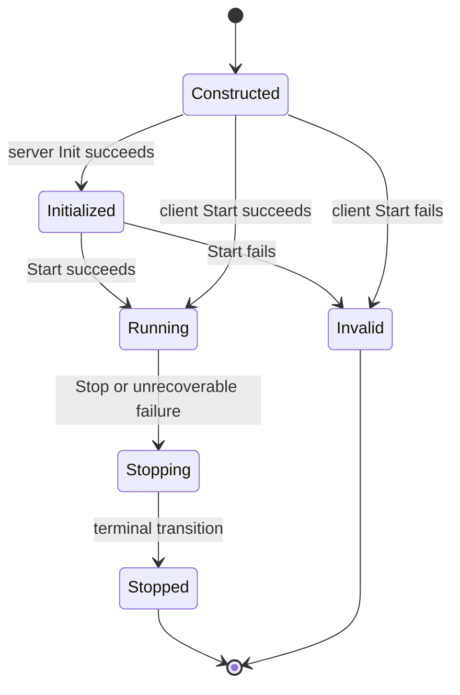

# RRUnreliable Transport Specification

## 1. Scope

`RRUnreliable` is the single unreliable request/response (RR) transport contract.
It matches each client request with at most one server response.

A client sends a `UnionDataList` request bound to a per-request handler and
receives at most one response through that handler. A server receives the
request with a response handle and the source `IEndPoint`, and may answer it
once. A client may cancel a pending request locally.

This specification defines:

- the public client/server, request-handler, server-handler, and response
  contracts;
- request-id domains and response correlation;
- the client pending window and the server response handles;
- request and response TTLs and their observable effects;
- transport and handler lifecycles;
- callback, ownership, and failure rules; and
- send-result meanings and implementation-defined behavior.

This specification does **not** define a wire format, interoperability between
implementations, configuration syntax, peer discovery, authentication,
authorization, confidentiality, integrity protection, replay protection,
acknowledgement, retry, ordering, or queue capacity. Those concerns belong to a
selected implementation or to a protocol layered above this transport.

RRUnreliable provides **no response guarantee**. A request may receive no
response. A server response may be lost, duplicated, or reordered. A server may
reject a request silently; the client only observes the request's pending
window expiry.

## 2. Normative language

The key words **MUST**, **MUST NOT**, **REQUIRED**, **SHOULD**, **SHOULD NOT**,
and **MAY** in this document are to be interpreted as described in
[RFC 2119](https://datatracker.ietf.org/doc/html/rfc2119).

## 3. Public contract

```csharp
public interface IRRTransport : ITransport
{
    int MessageMaxByteSize { get; }
}

public interface IRRUnreliableTransport : IRRTransport
{
}

public interface IRRRequestHandler : IHandler
{
    long RequestId { get; }
    void Cancel();
}

public interface IRRUnreliableRequestHandler : IRRRequestHandler
{
    void Response(UnionDataList response);
}

public interface IRRClientTransport : IRRTransport
{
    IEndPoint ServerEndPoint { get; }
    TimeSpan RequestTtl { get; }
}

public interface IRRUnreliableClientTransport : IRRClientTransport
{
    SendResult Request(UnionDataList request,
        IRRUnreliableRequestHandler handler);
}

public interface IRRResponse
{
    long RequestId { get; }
    SendResult Response(UnionDataList response);
}

public interface IRRUnreliableResponse : IRRResponse
{
}

public interface IRRUnreliableHandler : IHandler
{
    void Started();
    void Stopped();
}

public interface IRRUnreliableServerHandler : IRRUnreliableHandler
{
    bool OnRequested(IEndPoint client, UnionDataList request,
        IRRUnreliableResponse response);
}

public interface IRRServerTransport : IRRTransport
{
    TimeSpan ResponseTtl { get; }
}

public interface IRRUnreliableServerTransport : IRRServerTransport
{
    bool Init(IRRUnreliableServerHandler handler);
}
```

`ITransport` supplies `Type`, `Name`, `IsValid`, `IsStarted`,
`Start(Action<StopReason>)`, `Stop(StopReason?)`, `Log`, `Memory`, and
`GetControls`. `IRRTransport` adds `MessageMaxByteSize`.

The client binds no transport-level handler and has no `Init`; it is ready for
`Start` after construction. Each `Request` binds its own
`IRRUnreliableRequestHandler`. The server binds one
`IRRUnreliableServerHandler` through `Init`. Only the server handler has
`Started` and `Stopped` callbacks.

`IRRRequestHandler` and `IRRResponse` are the common RR contracts. A request
handler **MUST** derive from `RRRequestHandler`, which supplies `RequestId` and
`Cancel`; a transport **MUST** throw `ArgumentException` for any other handler.
A server response handle is supplied by the transport and implements
`IRRUnreliableResponse`; applications never implement it.

## 4. Terms and roles

| Term | Meaning |
| --- | --- |
| **client** | An `IRRUnreliableClientTransport` configured with one fixed server route. |
| **server** | An `IRRUnreliableServerTransport` receiving requests from any client route. |
| **transport** | One client or one server transport instance. |
| **request** | One `UnionDataList` passed to `Request`. |
| **response** | One `UnionDataList` passed to `IRRUnreliableResponse.Response` and delivered through `IRRUnreliableRequestHandler.Response`. |
| **request handler** | The per-request `IRRUnreliableRequestHandler` bound by `Request`. |
| **response handle** | The `IRRUnreliableResponse` supplied to `OnRequested`. |
| **client-local id** | `IRRRequestHandler.RequestId` while the handler is bound; unique within one client transport. |
| **server-global id** | `IRRUnreliableResponse.RequestId`; unique across all clients of one running server transport. |
| **pending request** | A bound request handler whose request has not received a response, was not cancelled, and has not expired. |
| **open response handle** | A server handle that can still answer its request. |
| **closed response handle** | A handle after `Response`, rejection, response TTL expiry, or a transport stop; every later `Response` call returns `Error`. |
| **request TTL** | `IRRUnreliableClientTransport.RequestTtl`. |
| **response TTL** | `IRRUnreliableServerTransport.ResponseTtl`. |
| **accepted request** | A `Request` call that returned `SendResult.Ok`. |
| **rejected request** | An `OnRequested` call that returned `false` or threw. |
| **running** | The period after a successful `Start` and before stopping begins. |

There is no connection, session, admission, handshake, peer
connected/disconnected callback, keep-alive, reconnection, or resume concept.
`IEndPoint` is routing metadata, not a logical session or security principal.

## 5. Responsibilities at a glance

| Topic | Guaranteed by RRUnreliable | Application responsibility | Implementation-defined |
| --- | --- | --- | --- |
| Request delivery | Preserves complete messages; loss, duplication, and reordering are permitted. | Treat requests as at-least-zero; make server operations idempotent where duplicates matter. | Carrier and retry behavior. |
| Response correlation | Delivers at most one `Response` per accepted request, through the bound handler; the first valid response wins. `Response` takes the single valid respond opportunity. | Do not expect a response; tolerate pending-window expiry. | Carrier timing, loss, and delivery order. |
| Cancellation | `Cancel()` silently stops accepting a response for the request. | Treat cancellation as local; the server is not informed. | Whether the server later wastes a response. |
| Server rejection | A rejected request closes the response handle and is never answered. | Treat rejection as silent; the client observes only TTL expiry. | Whether and when a rejection is logged. |
| Sending | `Request`/`Response` return a synchronous result; `Ok` is local acceptance only. | Handle every `SendResult`; never reuse a consumed payload. | Queue capacity, scheduling, and drain rate. |
| Handler callbacks | `Started` once before any request callback; callbacks for one request handler are serialized and non-reentrant. | Return promptly, release owned buffers, and protect state. | Callback thread and scheduler. |
| Pending windows | A response is delivered only while its request handler is bound; a response is accepted only while the handle is open. | Do not respond after the response TTL; do not expect late responses. | Clock source and expiry-check timing. |
| Transport failure | Unrecoverable failure stops and invalidates the transport and delivers the server handler terminal callbacks once. | Observe `onStopped` and `Stopped`; create a new transport after failure. | Failure detection mechanism and timing. |
| Security | No authentication, authorization, confidentiality, integrity, or replay protection. | Add protection above this layer or use a protected carrier. | Any protection outside this contract. |

## 6. Initialization and transport lifecycle

### 6.1 Initialization

Only the server has an initialization step. `Init` binds one non-null server
handler before the transport may start. Passing `null` **MUST** throw
`ArgumentNullException` without changing the transport state.

`Init` is a one-time operation. Concurrent calls are safe, and at most one
call **MAY** return `true`. Every later or racing call **MUST** return `false`
without changing the bound handler or invalidating the transport. A successful
`Init` **MUST NOT** invoke `Started`, start carrier activity, or make the
transport able to send.

`Init` **MUST** return `false` after a start has been attempted, after the
transport is invalid, or after the transport is stopping. A server `Start`
before a successful `Init` **MUST** return `false` and invalidate the
transport. The client `Start` requires no initialization.

### 6.2 Transport state



`Start` requires a non-null `onStopped` callback; `null` **MUST** throw
`ArgumentNullException` without changing the lifecycle state.

`Start` is one-time. Concurrent calls are safe, but at most one call **MAY**
return `true`; every racing or later call **MUST** return `false`. A successful
server start starts the carrier and then invokes `handler.Started()`.

If the initial `Start` attempt returns `false`, the transport **MUST** become
invalid and **MUST NOT** deliver any handler callback, including `Stopped`. It
**MUST NOT** invoke the supplied `onStopped`. A later `Start` call returns
`false` without changing the terminal state.

No callback **MUST** begin before `Start` has returned `true`.

A normal `Stop` after a successful start does **not** invalidate the
transport: `IsValid` remains `true` while `IsStarted` becomes `false`. An
unrecoverable internal or carrier failure **MUST** invalidate it.

After a successful start, stopping is terminal. A stopped transport **MUST
NOT** be restarted or reinitialized.

### 6.3 Server handler notifications

`handler.Started()` **MUST** be invoked exactly once after the carrier starts,
before `Start` returns `true`, and before any `OnRequested` may begin. The
caller therefore observes a ready handler whenever `Start` returns `true`.

If `Started()` throws, the implementation **MUST** catch and log the
exception, clean up the carrier, fail the `Start`, invalidate the transport,
and **MUST NOT** invoke `Stopped()` for that handler. A failed start delivers
no handler callbacks.

`handler.Stopped()` **MUST** be invoked exactly once, after a start whose
`Started()` returned successfully, when the transport stops or fails. It is
invoked before the transport's `onStopped` callback. The handler's `Stopped`
exception **MUST** be caught and logged without changing the stop outcome.

`Stop` **MUST** be safe from any thread, including from a handler callback.
Once transport stopping begins, no new `OnRequested` may begin. A handler
already running may finish asynchronously. Pending state is cleared; no
callback is delivered for an abandoned request.

For each successful `Start(onStopped)`, `onStopped` **MUST** be invoked exactly
once after the terminal transition. A normal stop preserves the supplied
`StopReason`; a null reason is replaced by a transport-created
`Pontifex.StopReasons.Unknown` initialized with the transport `Name`. A failed
`Start` does not invoke `onStopped`.

## 7. Client contract

### 7.1 Fixed server route

`ServerEndPoint` is immutable for the client lifetime and is the route supplied
at construction. A response frame whose source route is not equal to
`ServerEndPoint` **MUST NOT** be delivered; it is dropped. This is routing
only and does not authenticate the source.

The client **MUST** accept responses only from its configured server route. It
does not accept general messages from other routes.

### 7.2 `Request`

```csharp
SendResult Request(UnionDataList request,
    IRRUnreliableRequestHandler handler);
```

`Request` is thread-safe and may be called from any thread, including from a
response callback. Concurrent calls produce distinct ids.

The transport performs these checks in order:

1. `handler` is null → throw `ArgumentNullException`;
2. `handler` does not derive from `RRRequestHandler` → throw `ArgumentException`;
3. `handler` is already bound to a pending request → throw
   `InvalidOperationException`;
4. `request` is null or cannot be serialized → `InvalidMessage`;
5. the transport is not running → `NotConnected`;
6. the serialized payload exceeds `MessageMaxByteSize` → `MessageTooBig`; or
7. the carrier result, including `Ok`, `BufferOverflow`, `Error`, or another
   implementation-defined synchronous failure.

The three exceptions are thrown before the request payload is consumed; on
those exceptions the caller retains the request and the handler keeps its
previous `RequestId`. For every `SendResult` other than `InvalidMessage`, the
transport owns and eventually releases the request payload. The caller **MUST
NOT** read, mutate, retain, release, or retry with that `UnionDataList` after
such a call. On `InvalidMessage`, the buffer is null or already dead and
remains with the caller.

On `Ok`:

- `handler.RequestId` becomes the client-local id of the request. The first
  accepted id is `1`; ids are strictly increasing for the lifetime of the
  client transport and are never reused;
- the id enters the pending window before the frame is submitted to the
  carrier; and
- the request may still be lost. `Ok` is not a peer or response guarantee.

If the carrier call fails after the id entered the pending window, the id
**MUST** be removed, the handler **MUST** be unbound, and the call **MUST NOT**
return `Ok`.

`IRRUnreliableRequestHandler.Response` **MAY** begin before `Request` returns.
The handler already holds the id, so it must tolerate a response that arrives
before the caller has observed the return value. The handler may already be
unbound when `Request` returns.

A handler that is already bound **MUST** be rejected with
`InvalidOperationException`; the method **MUST NOT** silently rebind it. After
its request completes, is cancelled, or expires, the same handler instance
**MAY** be used for a new request. `RequestId` remains readable after
unbinding and reports the last request bound to the handler.

### 7.3 Pending window and request TTL

The client pending window contains every accepted request handler until one of
the following wins:

1. the first valid response for the request is taken for delivery;
2. the request is cancelled through `Cancel()`;
3. the request TTL expires; or
4. the transport stops or fails, which clears the pending window.

The request TTL starts when `Request` accepts the request. The value is a
positive, implementation-configured duration exposed by
`IRRUnreliableClientTransport.RequestTtl`. Expiry is silent: no callback is
raised, the handler is unbound, and the pending id is no longer eligible. A
response for an id that is unknown, expired, already answered, cancelled, or
sent by another route **MUST** be released and dropped.

An accepted request therefore receives **zero or one** `Response` call. A
duplicate response for a request whose first response was already taken is
dropped.

### 7.4 `Response` callback

`IRRUnreliableRequestHandler.Response(UnionDataList response)` is invoked at
most once per accepted request, after `Started()` returned successfully. While
it runs, `handler.RequestId` still identifies the request.

Callbacks for one request handler are serialized and non-reentrant. Callbacks
for different requests may run concurrently; an implementation may serialize
all client callbacks. A `Request` or `Stop` call from a response callback
**MUST NOT** cause a nested `Response` invocation on the same handler.

After the callback returns, the transport unbinds the handler. The handler
**MUST NOT** expect another callback for that request.

The handler owns the delivered response reference and **MUST** release it
exactly once. The transport retains ownership of every response it drops.

If `Response` throws, the transport **MUST** catch and log the exception,
suppress further processing of only that delivery, and continue running. It
**MUST NOT** stop or invalidate the transport solely because `Response` threw.
The throwing handler is responsible for releasing the response it received.

### 7.5 Cancellation

`Cancel()` is thread-safe and idempotent, uses handler identity, and accepts
any handler instance. It needs no transport reference: the handler delegates
to the transport that bound it.

For a bound request, cancellation removes it from the pending window and
unbinds the handler. No callback is raised; a response that arrives later is
released and dropped. Cancellation is local: the server is not informed and
may still produce one response that the client discards.

A completed, cancelled, expired, or unknown handler is a no-op.

## 8. Server contract

### 8.1 Handler and request ids

The server binds one `IRRUnreliableServerHandler` through `Init`.

For each valid inbound request frame, the server assigns a new server-global
id. The first id is `1`; ids are strictly increasing and unique across all
clients for the lifetime of the running server transport. Ids **MAY** have
gaps: a frame can consume an id and still be rejected or dropped. Duplicate
request frames from the same client route are independent requests and receive
distinct server-global ids.

The `IEndPoint client` passed to `OnRequested` identifies the route that sent
the request. Equal `IEndPoint` values **MUST** identify the same route while
the implementation's route values remain valid, and equal values **MUST**
return equal hash codes. The route is unauthenticated metadata.

### 8.2 `OnRequested`

```csharp
bool OnRequested(IEndPoint client, UnionDataList request,
    IRRUnreliableResponse response);
```

`OnRequested` is invoked after `Started()` returned successfully, on a running
server. Callbacks for the single server handler are serialized and
non-reentrant.

The handler owns the request reference and **MUST** release it exactly once,
including when it rejects the request or throws.

The response handle starts open and carries the server-global id. Returning
`true` accepts the request and keeps the handle open. Returning `false` rejects
it: the transport **MUST** close the handle, and a later `Response` call on it
**MUST** return `Error`. Rejection is silent to the client; the client's
pending request simply expires.

If `OnRequested` throws, the server **MUST** catch and log the exception, treat
the request as rejected, close the handle, and continue running. It **MUST
NOT** stop or invalidate the transport solely because `OnRequested` threw. A
response already accepted with `Ok` before the throw may still be delivered.

The handle stays usable after `OnRequested` returns and may be used
asynchronously. Different requests receive different handles.

### 8.3 `IRRUnreliableResponse`

`long RequestId { get; }` is the server-global id of the request and is
immutable for the handle lifetime.

`SendResult Response(UnionDataList response)` sends the single response for the
request. The result precedence is:

1. the handle is closed or the transport is not running → `Error`;
2. `InvalidMessage` — the response is null or cannot be serialized;
3. `MessageTooBig` — the serialized payload exceeds `MessageMaxByteSize`; or
4. the carrier result, including `Ok`, `BufferOverflow`, `Error`, or another
   implementation-defined synchronous failure.

On every result except `InvalidMessage`, the transport owns and eventually
releases the response payload. The caller **MUST NOT** access it afterwards.

A handle is single-use. The first call that passes validation closes the
handle before the send is attempted, so a later `Response` call returns `Error`
even when the carrier send fails. `Ok` is local acceptance only; it is not a
delivery guarantee.

Calls for one handle are serialized by the transport and may be made from any
thread.

### 8.4 Response handles and response TTL

A handle is open from the moment `OnRequested` is invoked. It is closed when
`Response` succeeds, when `OnRequested` rejects the request, when the response
TTL expires, or when the transport stops or fails.

The response TTL starts when the server receives the request, before
`OnRequested` is invoked. The value is a positive, implementation-configured
duration exposed by `IRRUnreliableServerTransport.ResponseTtl`. Expiry is
silent: the handle is closed and a later `Response` returns `Error`. No
callback is raised.

If the server never responds, the handle expires and the client pending request
eventually expires independently. Neither side receives a timeout callback.

## 9. Message model, correlation, and delivery eligibility

`MessageMaxByteSize` is an inclusive limit on the serialized `UnionDataList`
payload, including list and element encoding, but excluding transport framing
and the request-id header. The limit applies to `Request` and `Response` and to
received payloads. Empty `UnionDataList` values are valid.

Requests and responses are correlated by an opaque `long` id chosen by the
client:

- a request frame carries the client-local id;
- a response frame carries the client-local id that the server received in the
  request;
- the client delivers the response to the handler currently bound to that id;
  and
- the server-global id is a server-side bookkeeping id that is not required to
  appear on the wire and is not used for client correlation.

The wire encoding, framing, and id encoding are implementation-defined.

An implementation **MUST NOT** deliver to a handler, or open a response handle
for, inbound data that is malformed, cannot be decoded, or exceeds the
applicable limit. It **MUST** release and log such data and **MUST NOT** stop
or invalidate the transport solely because of it.

The server **MUST NOT** require a prior registration, connection, or admission
exchange from a client. Any valid request reaching a running server is
eligible for dispatch.

A message frame is never fragmented across callbacks or merged with another
frame. A delivered request or response is one complete `UnionDataList` with
the same logical payload that was sent.

## 10. Request/response path


For every accepted request the client delivers either zero or one `Response`.
The server may invoke `OnRequested` zero, one, or multiple times for the same
client id when the carrier duplicates the request. Each invocation carries a
new server-global id; only the first response that reaches the client while
its id is pending is delivered.

An implementation **MUST NOT** invoke `Response` for a response that was
accepted before the corresponding `Request` call bound the handler.

The callback for a response **MAY** begin on any scheduler after the response
frame is accepted locally. No ordering between different requests is
guaranteed.

## 11. Callback concurrency and buffer ownership

The server has one handler, and its `Started`, `OnRequested`, and `Stopped`
callbacks are serialized and non-reentrant. The client has one handler per
request; callbacks for one such handler are serialized and non-reentrant, while
callbacks for different requests may run concurrently. Callbacks for different
transports are independent.

`OnRequested` **MUST NOT** begin before `Started` returned successfully.
`Stopped` **MUST NOT** begin until an already-running `OnRequested` has
returned. After invalidation begins, no new `OnRequested` may begin.

Each delivered request and response transfers one independently owned
`UnionDataList` reference to the handler. The handler:

1. **MUST** release that reference exactly once when it no longer needs it;
2. **MAY** mutate it while it owns the reference; and
3. **MAY** retain it beyond callback return, provided it releases it exactly
   once later.

A handler that throws **MUST** still release any reference it owns, normally
with `try`/`finally`. The transport is not required to release a reference
that a throwing handler failed to release.

Handlers **SHOULD** return promptly and **MUST NOT** block indefinitely. Slow
handling delays later callbacks and may contribute to loss or TTL expiry. The
contract defines no callback timeout.

## 12. Send results

### 12.1 `Request`

| Result | Required meaning |
| --- | --- |
| `Ok` | The request was accepted; the handler is bound and holds its client-local id. |
| `InvalidMessage` | The request is null or cannot be serialized. |
| `MessageTooBig` | The serialized payload exceeds `MessageMaxByteSize`. |
| `NotConnected` | The client transport is not running. |
| `BufferOverflow` | The implementation cannot accept the request because local outbound capacity is full. |
| `Error` | Another synchronous sending failure occurred. |

`ArgumentNullException`, `ArgumentException`, and `InvalidOperationException`
are thrown before the payload is consumed.

### 12.2 `Response`

| Result | Required meaning |
| --- | --- |
| `Ok` | The response was locally accepted and the handle is closed. |
| `InvalidMessage` | The response is null or cannot be serialized. |
| `MessageTooBig` | The serialized payload exceeds `MessageMaxByteSize`. |
| `Error` | The handle is closed or the transport is not running. |
| `BufferOverflow` | The implementation cannot accept the response because local outbound capacity is full. |

`BufferOverflow` and the other non-`Ok` results carry no retry signal.
Applications choose their own retry and backpressure policy, and must obtain a
new handle for a new attempt; a handle is single-use.

Every synchronous non-`Ok` result is non-fatal and **MUST NOT** by itself stop
or invalidate the transport.

## 13. Failure, shutdown, and implementation-defined behavior

An unrecoverable internal or carrier failure after a successful start **MUST**
stop and invalidate the transport, clear all pending requests and handles,
deliver the server handler `Stopped` (if `Started` returned successfully), and
invoke `onStopped` exactly once. No callback is delivered for an abandoned
pending request. A transport may discard accepted but unsent work.

An explicit `Stop` is a normal stop: pending requests are abandoned, client
handlers are unbound, server response handles are closed, no request callback
is fabricated, and neither peer is notified. RRUnreliable has no completion
message.

The following are implementation-defined, provided they do not weaken this
specification:

- wire encoding, framing, id encoding, and interoperability;
- address configuration and endpoint representation;
- callback scheduler and execution thread;
- `onStopped` dispatch scheduler and timing after the terminal transition;
- outbound queue capacity, scheduling, and drain rate;
- carrier submission timing after `Request` or `Response` returns `Ok`;
- request TTL and response TTL values, within their positive-duration rule;
- internal logging format and sink;
- mechanisms and timing for unrecoverable failure detection; and
- any protection layered beneath this transport.

The UDP reference implementation configures `request_ttl` (default 30 seconds)
on the client and `response_ttl` (default 10 seconds) on the server. Those
values are configuration, not part of this contract.

## 14. Security considerations and conformance checklists

RRUnreliable provides no peer authentication, authorization, confidentiality,
cryptographic integrity, tamper detection, source-spoofing protection, or
replay protection. A client source-route filter is routing, not
authentication. A server handler can receive valid requests from any source
reaching its listen address.

Applications handling sensitive, privileged, or non-idempotent operations
**MUST** add the required authentication, integrity, confidentiality,
anti-replay, deduplication, ordering, and receipt mechanisms above this
transport, or choose a protected transport stack.

A response handle is a capability for exactly one request. Applications
**MUST NOT** hand it to code that is not authorized to answer that request.

### 14.1 Application-author checklist

- [ ] Call server `Init` exactly once before `Start`; the client needs no
      `Init`.
- [ ] Derive every request handler from `RRRequestHandler`.
- [ ] Use a distinct handler for each concurrently pending request; reuse only
      after the request completed, was cancelled, or expired.
- [ ] Treat every accepted request as potentially lost and every accepted
      response as potentially lost.
- [ ] Never expect more than one `Response` per accepted request.
- [ ] Treat `Ok` from `Request` or `Response` as local acceptance only.
- [ ] Never access or release a payload after passing it to `Request` or
      `Response`.
- [ ] Release each delivered payload exactly once, even when processing fails.
- [ ] Keep handlers prompt, non-blocking, and exception-safe.
- [ ] Treat rejection as silent; rely on TTLs rather than a rejection callback.
- [ ] Do not answer a request after the response TTL exposed by
      `IRRUnreliableServerTransport.ResponseTtl`.
- [ ] Treat endpoints, ids, and messages as unauthenticated input.
- [ ] Observe `onStopped` and `Stopped`; do not restart a stopped or invalid
      transport.

### 14.2 Transport-implementer checklist

- [ ] Bind one server handler with a one-time, pre-start `Init`; the client
      requires no `Init`.
- [ ] Deliver `Started` before `Start` returns `true` and before any request
      callback, and `Stopped` only after a successful `Started`.
- [ ] Keep server callbacks serialized and non-reentrant; keep each request
      handler's callbacks serialized and non-reentrant.
- [ ] Assign client-local ids and server-global ids that are unique for the
      transport lifetime, starting at `1`; server-global ids may have gaps.
- [ ] Bind the handler before submitting the request frame, and publish its
      `RequestId`.
- [ ] Deliver at most one response per request handler and drop unknown,
      expired, duplicate, cancelled, and foreign-route responses.
- [ ] Unbind the handler after its response callback returns or when the
      request is cancelled, expired, or abandoned.
- [ ] Close the response handle on success, rejection, expiry, or stop; a
      closed handle returns `Error`.
- [ ] Enforce both TTLs without fabricating callbacks for expiry.
- [ ] Enforce `MessageMaxByteSize` on sent and received payloads.
- [ ] Drop and log malformed or oversized inbound frames without stopping.
- [ ] Transfer and release buffers according to this specification.
- [ ] Treat `OnRequested`, `Response`, and `Started` exceptions as specified
      and keep unrelated transport activity running.
- [ ] Preserve stop and `onStopped` ordering and the exact supplied reason.
- [ ] Document configuration, TTLs, capacity, scheduling, and carrier failure
      behavior without weakening this contract.

## 15. Non-goals

- No completion/finish callback, streaming, or multiple responses per request.
- No server notification of cancellation, and no cancellation of a server
  response that is already in flight.
- No acknowledgement, retry, confirmation, or response receipt.
- No at-most-once, at-least-once, exactly-once, FIFO, causal, or total
  ordering guarantee.
- No connection, session, admission, or peer lifecycle.
- No authentication, authorization, confidentiality, integrity, or replay
  protection.
- No cross-implementation wire compatibility.
