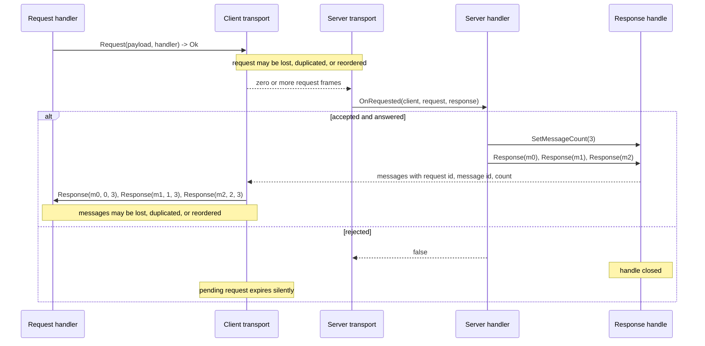

# RRUnreliable Transport Specification

## 1. Scope

`RRUnreliable` is the unreliable type of the RR transport model. This document
includes the [RR common specification](../Specification.md) by reference. Its
requirements are normative here, and this document defines only what the
unreliable type adds.

It matches each client request with zero or more server response messages. The
server declares the message count before the first message; each message carries
its zero-based id and the declared count.

The client sends a `UnionDataList` request bound to a per-request handler and
receives zero or more response messages through that handler. The server receives
the request with a response handle and the source `IEndPoint`, and may answer it
with a sequence of up to 256 messages. The client may cancel a pending request
locally.

This specification defines:

- the type interfaces;
- request delivery and response correlation;
- the client pending window;
- the server response handle and its message sequence;
- the observable effects of cancellation and TTL expiry;
- the type send results.

`RRUnreliable` provides no response guarantee. A request may receive no
response. A response message may be lost, duplicated, or reordered, and the last
message may never arrive. A server may reject a request silently; the client
observes only the pending-window expiry.

### 1.1 Applicability

| Section or topic | Included | Reason |
| --- | --- | --- |
| Client association | yes | Inherited from the shared contract. |
| Server association and routing | yes | Inherited from the shared contract; the server binds one handler. |
| Establishment and negotiation | no | The model has no handshake. |
| Rejection and timeout | no | Rejection is a silent per-request decision, defined in section 6.3. |
| Admission and handler binding | no | The server does not admit peers. |
| Request acceptance | yes | `OnRequested` accepts or rejects each request through its return value. |
| Identifiers and correlation | yes | The request id, message id, and message count travel on the wire; the server-global id is local bookkeeping. |
| Pending window and TTLs | yes | The pending window is the core of this type. |
| Responses and completion | yes | Zero or more messages with a declared count and no completion callback. |
| Cancellation | yes | Cancellation is client-local and silent. |

### 1.2 References

- [`../Specification.md`](../Specification.md) — the shared RR contract:
  interfaces, binding, identifiers, TTLs, message model, ownership, security.

## 2. Normative language

The key words **MUST**, **MUST NOT**, **REQUIRED**, **SHOULD**, **SHOULD NOT**,
and **MAY** in this document are to be interpreted as described in
[RFC 2119](https://datatracker.ietf.org/doc/html/rfc2119).

## 3. Terms

Terms of the shared contract apply as defined there. This specification adds:

| Term | Meaning |
| --- | --- |
| **pending window** | The set of client request handlers bound to requests that have not completed, been cancelled, expired, or failed. |
| **response message** | One `UnionDataList` sent by the server handle for one request. |
| **message id** | The zero-based index of a response message, from `0` to `messageCount` minus one. |
| **message count** | The number of messages a response consists of, from `1` to `256`. |
| **last message** | The response message whose id is `messageCount` minus one. |
| **bounded handle** | A response handle that accepts at most `messageCount` accepted sends and stops answering after the last message, the response TTL, a rejection, or a stop. |
| **silent rejection** | A server decision not to answer a request, delivered to the client only as pending-window expiry. |

## 4. Public contract

```csharp
public interface IRRUnreliableClientTransport : IRRClientTransport
{
    SendResult Request(UnionDataList request,
        IRRUnreliableRequestHandler handler);
}

public interface IRRUnreliableTransport : IRRTransport
{
}

public interface IRRUnreliableRequestHandler : IRRRequestHandler
{
    void Response(UnionDataList response, int messageId, int messageCount);
}

public interface IRRUnreliableServerTransport : IRRServerTransport
{
    bool Init(IRRUnreliableServerHandler handler);
}

public interface IRRUnreliableServerHandler : IHandler
{
    bool OnRequested(IEndPoint client, UnionDataList request,
        IRRUnreliableResponse response);
}

public interface IRRUnreliableResponse : IRRResponse
{
    int MessageCount { get; }
    void SetMessageCount(int messageCount);
}
```

`IRRClientTransport`, `IRRServerTransport`, `IRRRequestHandler`, `IRRResponse`,
`RRRequestHandler`, and `RRResponse` come from the shared contract.

The client binds no transport-level handler and has no `Init`; it is ready to
start after construction. Each `Request` binds its own
`IRRUnreliableRequestHandler`. The server binds one
`IRRUnreliableServerHandler` through `Init`. Neither handler has lifecycle
callbacks; readiness is `Start` returning `true`.

A response handle is supplied by the transport; applications **MUST NOT**
implement `IRRUnreliableResponse`.

`MessageCount` **MUST** default to `1`. `SetMessageCount` **MUST** accept `1` to `256`,
**MUST** be callable once before the first `Response` call, and **MUST** throw
`ArgumentOutOfRangeException` outside that range and
`InvalidOperationException` on a repeated call, after the first `Response` call,
after the handle is closed, after the response TTL expires, or after the transport
stops. The range check **MUST** precede the state checks.

A message id is zero-based and is less than the message count. The last message
id is the message count minus one.

A request frame carries a request-id header. A response frame carries the request
id, the message id, and the message count. `MessageMaxByteSize` excludes
transport framing and all of those headers.

## 5. Model

The unit of work is one request answered by a sequence of zero or more response
messages. The server declares the message count before the first message; the
client receives each message with its id and the count. There is no completion
notification: the last message is the only completion signal, and it may be
lost. The client owns a bounded pending window; the server owns a bounded handle
per request.

### 5.1 Responsibility split

| Topic | Guaranteed by RRUnreliable | Application responsibility | Implementation-defined |
| --- | --- | --- | --- |
| Delivery | Complete messages; requests and response messages may be lost, duplicated, reordered, or delayed, so a sequence may be incomplete. | Treat every accepted request and every response message as possibly lost. | Carrier and queue behavior. |
| Sending | `Ok` means local acceptance; the handler is bound and holds its request id. | Handle every `SendResult`; retry a request with a new handle and a response message with a new payload. | Queue capacity and scheduling. |
| Handlers | Per-request callbacks are serialized across the whole message sequence; the single server handler is serialized. | Return promptly, release payloads, protect shared state. | Callback thread. |
| Routing | Responses are accepted only from `ServerEndPoint` and only for a live id. | Treat the route as unauthenticated. | Addressing. |
| Failure | A stopped or failed transport clears the pending window without a callback. | Observe `onStopped`; expect no completion callback. | Failure detection and timing. |
| Security | No authentication, authorization, confidentiality, integrity, or replay protection. | Protect the response handle and add the required protection. | Protection outside this contract. |
| Lifecycle | Server `Init` is one-time and pre-start; `Start` is one-time. | Call `Init` once before `Start`. | Scheduler and timing. |

## 6. Establishment and requests

### 6.1 Client association

Inherited from [the shared contract](../Specification.md), section 6.1 (Client
association). Responses are accepted only from `ServerEndPoint`.

### 6.2 Server association and routing

Inherited from [the shared contract](../Specification.md), section 6.2 (Server
association and routing). The server binds one `IRRUnreliableServerHandler`.

### 6.3 Request acceptance

`OnRequested` is invoked on a running server. Callbacks for the single server
handler are serialized and non-reentrant.

The handler owns the request reference and **MUST** release it exactly once,
including when it rejects the request or throws.

The response handle starts open, carries the server-global id, and has a message
count that defaults to one. Returning `true` accepts the request and keeps the
handle open. Returning `false` rejects it: the transport **MUST** close the
handle, and a later `Response` call on it **MUST** return `Error`. Rejection is
silent to the client; the client's pending request simply expires.

The handler **MAY** set the message count and send messages inside or after
`OnRequested`.

If `OnRequested` throws, the server **MUST** catch and log the exception, treat
the request as rejected, close the handle, and continue running. It **MUST NOT**
stop or invalidate the transport solely because `OnRequested` threw. A message
already accepted with `Ok` before the throw may still be delivered.

The handle stays usable after `OnRequested` returns and may be used
asynchronously. Different requests receive different handles.

### 6.4 Identifiers and correlation

Inherited id domains from [the shared contract](../Specification.md), section
6.4 (Identifiers and correlation). This type defines the wire use.

A request frame carries the client-local request id. A response frame carries the
client-local request id that the server received, the zero-based message id, and
the message count. The client selects the bound handler by the request id. The
server-global id is server-side bookkeeping and is not required to appear on the
wire.

The client **MUST** fix the message count for a request from the first response
frame it accepts. A frame whose message id is not less than the count **MUST** be
released and dropped without fixing the count. A later frame for the same request
with a different count **MUST** be released and dropped.

### 6.5 Pending window and TTLs

`RequestTtl` and `ResponseTtl` start at the points defined by the
[shared contract](../Specification.md), section 6.5. This type defines their
observable effects.

The client pending window contains every bound request handler until one of the
following wins:

1. the last message is taken for delivery;
2. the request is cancelled through `Cancel()`;
3. the request TTL expires;
4. the transport stops or fails, which clears the pending window.

Expiry is silent: no callback is raised, the pending id is no longer eligible,
and the handler is unbound once any in-flight callback returns. A frame for an
id that is unknown, expired, already completed, cancelled, or sent by another
route **MUST** be released and dropped. A duplicate message id **MUST** be
released and dropped.

An accepted request therefore receives **zero or more** `Response` calls, at most
one per message id. The callback for the last message ends the request. When
several pending-window causes race, the first cause that removes the request
wins; every later cause produces no additional callback.

The response TTL bounds the whole response sequence. When it expires, the handle
stops answering: a later `Response` returns `Error` and closes it, and a later
`SetMessageCount` throws `InvalidOperationException`; no callback is raised. If the
server sends fewer messages than declared, the client pending request eventually
expires independently. Neither side receives a timeout callback.

### 6.6 Responses and completion

`Request` returns a result from section 9.

On `Ok`, `handler.RequestId` is the 16-bit client-local request id of the
request. The 64-bit `long` id belongs to `IRRResponse.RequestId` and identifies
the request on the server side.

The id enters the pending window before the frame is submitted to the carrier.
The request may still be lost; `Ok` is not a peer or response guarantee.

If the carrier call fails after the id entered the pending window, the id
**MUST** be removed, the handler **MUST** be unbound, and the call **MUST NOT**
return `Ok`.

`Response` **MAY** begin before `Request` returns. The handler already holds the
id, so it must tolerate a response that arrives before the caller has observed
the return value. The handler may already be unbound when `Request` returns.

`Response` is invoked zero or more times per accepted request, once per received
message id, after `Start` returned `true`. The message id is zero-based and is
less than the message count. While it runs, `handler.RequestId` still identifies
the request.

Callbacks for one request handler are serialized and non-reentrant across every
message of the response. Callbacks for different requests may run concurrently;
an implementation may serialize all client callbacks. A `Request` or `Stop` call
from a response callback **MUST NOT** cause a nested `Response` invocation on the
same handler.

After the callback for the last message returns, the transport unbinds the
handler. The handler **MUST NOT** expect another callback for that request.

If `Response` throws, the transport **MUST** catch and log the exception,
suppress further processing of only that delivery, and continue running. It
**MUST NOT** stop or invalidate the transport solely because `Response` threw.

There is no completion notification. A missing message or a missing last message
is observed only as pending-window expiry.

`SendResult Response(UnionDataList response)` on the server handle sends the next
message of the sequence. Its result precedence is:

1. the handle is closed or the transport is not running → `Error`;
2. `InvalidMessage` — the response is null or cannot be serialized;
3. `MessageTooBig` — the serialized payload exceeds `MessageMaxByteSize`;
4. the carrier result, including `Ok`, `BufferOverflow`, `Error`, or another
   implementation-defined synchronous failure.

The transport **MUST** assign message ids from zero in accepted-send order. An
`Ok` result **MUST** advance the next id; every other result **MUST** leave the id
unchanged. The handle **MUST** close after the `MessageCount`-th `Ok` result; a
later `Response` call **MUST** return `Error`. `Ok` is local acceptance only; it
is not a delivery guarantee.

Calls for one handle are serialized by the transport and may be made from any
thread.

### 6.7 Cancellation

`Cancel()` removes a bound request from the pending window and unbinds the
handler. No callback is raised; every response message that arrives later is
released and dropped. Cancellation is local: the server is not informed and may
still produce a sequence that the client discards.

## 7. Lifecycle and failure

Initialization, start, and stop are inherited from
[the shared contract](../Specification.md), sections 7.1 to 7.4. This type adds
the pending-window rule.

A stopped or failed transport **MUST** clear the pending window without raising a
completion callback. A request removed this way is not replayed.

A stop or failure that races a callback accepted before the stop **MAY** let
that callback begin or complete after `onStopped` begins. No callback begins for
a request that the stop removes before the callback is accepted. The handler
remains bound until the in-flight callback returns.

The transport-level `onStopped` callback **MUST** be invoked exactly once after
the terminal transition.

### 7.1 Callback matrix

| Situation | Handler callbacks |
| --- | --- |
| Transport `Start` returns false | none |
| `Start` returns true, request accepted | `OnRequested` on the server; zero or more `Response` on the client, at most one per message id |
| Last message delivered | the final `Response`; the handler is unbound after it returns |
| Request rejected by returning `false` | none; the client expires silently |
| Request cancelled | none |
| Request TTL expired | none |
| Response TTL expired | none |
| Transport stops or fails | none for a request the stop removes; a message accepted before the stop may still deliver one callback; `onStopped` runs |

## 8. Message model and limits

Inherited from [the shared contract](../Specification.md), section 8 (Message
model and limits). This type excludes transport framing, the request-id header,
and the response message headers from `MessageMaxByteSize`.

## 9. Send results

An implementation **MUST** select a `Request` result in this order: the shared
handler checks, which throw rather than return; transport state; message
validity; message size; outbound capacity; other synchronous errors.

| Result | Required meaning |
| --- | --- |
| `Ok` | The request was accepted; the handler is bound and holds its client-local request id. |
| `InvalidMessage` | The request is null or cannot be serialized. |
| `MessageTooBig` | The serialized payload exceeds `MessageMaxByteSize`. |
| `InvalidAddress` | The client route is fixed at construction, so this transport never returns it. |
| `NotConnected` | The client transport is not running. |
| `BufferOverflow` | The implementation cannot accept the request because local outbound capacity is full. |
| `Error` | Another synchronous sending failure occurred. |
| `Unknown` | Reserved enumeration value. `Request` never returns it. |

`Response` results are defined in section 6.6. Every synchronous non-`Ok` result
is non-fatal and **MUST NOT** by itself stop or invalidate the transport.

`BufferOverflow` and the other non-`Ok` results carry no retry signal.
Applications choose their own retry and backpressure policy. A failed request
needs a new handle and a new payload. A failed response send keeps the handle
open and the message id unchanged, so the application may retry it with a new
payload.

## 10. Delivery guarantees

`RRUnreliable` preserves complete messages but gives no delivery guarantee.
Requests and response messages may be lost, duplicated, reordered, or delayed.

For each accepted request:

- the request may never reach the server;
- the server may invoke `OnRequested` zero, one, or multiple times when the
  carrier duplicates the request;
- the client delivers each message id at most once;
- a response message may never reach the client;
- the last message may never reach the client, so the sequence may never
  complete;
- no ordering is guaranteed between different requests or between response
  messages of one request.

The client **MUST** deliver each message with a valid id and count at most once
and **MUST** drop every duplicate, out-of-range, count-mismatched, or unknown
frame.

An implementation **MUST NOT** invoke `Response` for a message that was accepted
before the corresponding `Request` call bound the handler. The callback for a
message **MAY** begin on any scheduler after the frame is accepted locally.



There is no acknowledgement, retry, confirmation, response receipt, or
completion callback.

## 11. Concurrency and buffer ownership

Inherited from [the shared contract](../Specification.md), section 11
(Concurrency and buffer ownership). This type adds:

- callbacks for one request handler are serialized and non-reentrant across every
  message of one response;
- calls for one response handle are serialized by the transport;
- the server's single handler callbacks are serialized.

## 12. Implementation-defined choices

Inherited areas apply. This type leaves open:

| Area | Left open | Invariant that remains binding |
| --- | --- | --- |
| Wire correlation | How the request id, message id, and message count are encoded. | Responses select the bound handler by the client-local id; the first frame fixes the count. |
| TTL values | The configured `RequestTtl` and `ResponseTtl`. | Both are positive durations exposed by the transport. |
| Pending-window storage | The data structure and capacity of the window. | Each message id is delivered at most once; the last id completes the request. |
| Message limit | The encoding of the count and the maximum of 256 messages. | No response exceeds the declared count. |
| Capacity | Queue size and scheduling. | `BufferOverflow` is reported, not hidden. |

An implementation-defined choice **MUST NOT** weaken any requirement of this
specification, and the implementation **MUST** document it.

## 13. Security boundary

Inherited from [the shared contract](../Specification.md), section 13 (Security
boundary). A response handle is a capability for exactly one request and may send
up to the declared count. The application **MUST NOT** expose it to code that is
not authorized to answer that request.

## 14. Conformance controls

No conformance controls are defined.

## 15. Transport-implementer checklist

- [ ] Bind one server handler with a one-time, pre-start `Init`.
- [ ] Keep server callbacks serialized and non-reentrant.
- [ ] Keep each request handler's callbacks serialized and non-reentrant across
      every message.
- [ ] Default `MessageCount` to `1` when the application does not set it.
- [ ] Assign server-global ids unique for the transport lifetime, starting at
      `1`.
- [ ] Start client-local ids from a fresh random value on every start and
      increment them with 16-bit wraparound.
- [ ] Throw `ArgumentNullException` for a null handler before consuming the
      payload.
- [ ] Throw `InvalidOperationException` for an already-bound handler before
      consuming the payload.
- [ ] Bind the handler before submitting the request frame and publish its
      `RequestId`.
- [ ] Select the `Request` result in the order of section 9.
- [ ] Do not deliver a response message that was accepted before the request
      bound the handler.
- [ ] Deliver each message id at most once per request.
- [ ] Drop unknown, expired, duplicate, cancelled, foreign-route, out-of-range,
      and count-mismatched response frames.
- [ ] Fix the message count from the first response frame and drop a later frame
      with a different count.
- [ ] Unbind the handler after the last message callback returns, or when the
      request is cancelled, expires, or is abandoned.
- [ ] Throw `ArgumentOutOfRangeException` for a message count outside `1..256`.
- [ ] Validate the message count range before checking the handle state.
- [ ] Throw `InvalidOperationException` for a second `SetMessageCount` call,
      after the first `Response` call, after close, after expiry, or after stop.
- [ ] Keep every synchronous non-`Ok` result non-fatal.
- [ ] Clear the pending window on stop or failure without raising a completion
      callback.
- [ ] Assign message ids from zero in accepted-send order and advance the id only
      on `Ok`.
- [ ] Close the response handle after the declared number of accepted sends, on
      rejection, expiry, or stop; a closed handle returns `Error`.
- [ ] Enforce both TTLs without fabricating callbacks for expiry.
- [ ] Enforce `MessageMaxByteSize` on sent and received payloads.
- [ ] Drop and log malformed or oversized inbound frames without stopping.
- [ ] Transfer and release buffers according to the shared contract.
- [ ] Treat `OnRequested` and `Response` exceptions as specified and keep
      unrelated activity running.
- [ ] Preserve stop and `onStopped` ordering and the exact supplied reason.
- [ ] Document every implementation-defined choice of section 12.

## 16. Application-author checklist

- [ ] Call server `Init` exactly once before `Start`.
- [ ] Derive every request handler from `RRRequestHandler`.
- [ ] Use a distinct handler for each concurrently pending request; reuse only
      after the request completed, was cancelled, or expired.
- [ ] Do not implement `IRRUnreliableResponse`.
- [ ] After a stop or failure, reuse a handler only after any in-flight callback
      has returned.
- [ ] Reuse an expired handler only after any late callback has returned; a reuse
      attempt while it runs throws `InvalidOperationException`.
- [ ] Treat every accepted request and every response message as potentially
      lost.
- [ ] Never expect more than the `messageCount` argument's `Response` calls per
      accepted request.
- [ ] Treat the last message as the only completion signal, and expect that it
      may be lost.
- [ ] Set the message count once before the first send when more than one message
      is needed.
- [ ] Use `messageId` and `messageCount` to detect gaps and fragments.
- [ ] Treat `Ok` from `Request` or `Response` as local acceptance only.
- [ ] Never access or release a payload after passing it to `Request` or
      `Response`.
- [ ] Release each delivered payload exactly once, even when processing fails.
- [ ] Keep handlers prompt, non-blocking, and exception-safe.
- [ ] Treat rejection as silent; rely on TTLs rather than a rejection callback.
- [ ] Retry a failed response send on the same handle with a new payload; the id
      does not advance.
- [ ] Do not answer a request after the response TTL exposed by
      `IRRUnreliableServerTransport.ResponseTtl`.
- [ ] Observe `onStopped`; do not restart a stopped or invalid transport.
