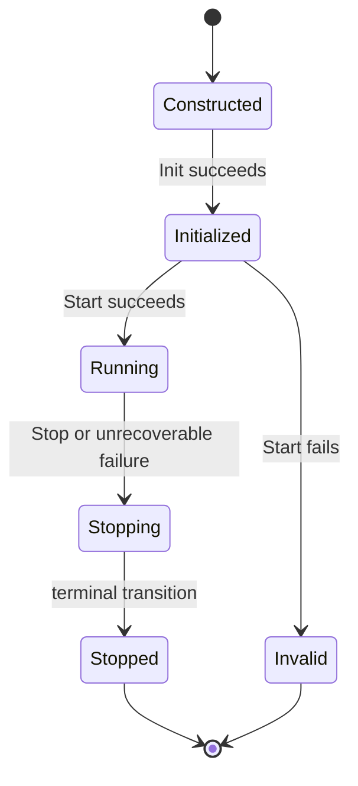
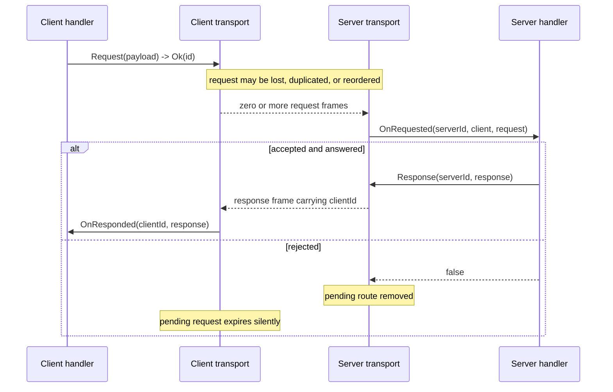

# RRUnreliable Transport Specification

## 1. Scope

`RRUnreliable` is the single unreliable request/response (RR) transport contract.
It matches each client request with at most one server response.

A client sends a `UnionDataList` request and receives a client-local request id.
A server receives the request with a server-global request id and the source
`IEndPoint`, and may send at most one response for that id. A client receives a
response only when its id matches a request that is still inside the client's
pending window.

This specification defines:

- the public client/server and handler contracts;
- request-id domains and response correlation;
- the client pending window and the server pending-response routes;
- request and response TTLs and their observable effects;
- transport and handler lifecycles;
- callback, ownership, and failure rules; and
- send-result meanings and implementation-defined behavior.

This specification does **not** define a wire format, interoperability between
implementations, configuration syntax, peer discovery, authentication,
authorization, confidentiality, integrity protection, replay protection,
acknowledgement, retry, ordering, or queue capacity. Those concerns belong to a
selected implementation or to a protocol layered above this transport.

RRUnreliable provides **no response guarantee**. A request may receive no
response. A server response may be lost, duplicated, or reordered. A server
may reject a request silently; the client only observes the request's pending
window expiry.

## 2. Normative language

The key words **MUST**, **MUST NOT**, **REQUIRED**, **SHOULD**, **SHOULD NOT**,
and **MAY** in this document are to be interpreted as described in
[RFC 2119](https://datatracker.ietf.org/doc/html/rfc2119).

## 3. Public contract

```csharp
public interface IRRTransport : ITransport
{
    int MessageMaxByteSize { get; }
}

public interface IRRUnreliableTransport : IRRTransport
{
}

public interface IRRUnreliableClientTransport : IRRUnreliableTransport
{
    IEndPoint ServerEndPoint { get; }
    TimeSpan RequestTtl { get; }
    bool Init(IRRUnreliableClientHandler handler);
    SendResult Request(UnionDataList request, out long requestId);
}

public interface IRRUnreliableHandler : IHandler
{
    void Started();
    void Stopped();
}

public interface IRRUnreliableClientHandler : IRRUnreliableHandler
{
    void OnResponded(long requestId, UnionDataList response);
}

public interface IRRUnreliableServerTransport : IRRUnreliableTransport
{
    TimeSpan ResponseTtl { get; }
    bool Init(IRRUnreliableServerHandler handler);
    SendResult Response(long requestId, UnionDataList response);
}

public interface IRRUnreliableServerHandler : IRRUnreliableHandler
{
    bool OnRequested(long requestId, IEndPoint client, UnionDataList request);
}
```

`ITransport` supplies `Type`, `Name`, `IsValid`, `IsStarted`,
`Start(Action<StopReason>)`, `Stop(StopReason?)`, `Log`, `Memory`, and
`GetControls`. `IRRTransport` adds `MessageMaxByteSize`.

The client and server expose no transport-level receive callback and no
transport-level send operation other than `Request` and `Response`. The client
handler is bound with `Init`; the server handler is bound with `Init`.

## 4. Terms and roles

| Term | Meaning |
| --- | --- |
| **client** | An `IRRUnreliableClientTransport` configured with one fixed server route. |
| **server** | An `IRRUnreliableServerTransport` receiving requests from any client route. |
| **transport** | One client or one server transport instance. |
| **request** | One `UnionDataList` passed to `Request`. |
| **response** | One `UnionDataList` passed to `Response`. |
| **client-local id** | The id returned by `Request`; it is unique within one client transport. |
| **server-global id** | The id passed to `OnRequested` and later to `Response`; it is unique across all clients of one running server transport. |
| **pending request** | A client-local id that the client still accepts a response for. |
| **pending route** | A server-global id that the server can still answer. |
| **request TTL** | How long a client accepts a response after `Request` accepted the request; exposed as `IRRUnreliableClientTransport.RequestTtl`. |
| **response TTL** | How long a server accepts `Response` after it received the request; exposed as `IRRUnreliableServerTransport.ResponseTtl`. |
| **accepted request** | A `Request` call that returned `SendResult.Ok`. |
| **rejected request** | An `OnRequested` call that returned `false` or threw. |
| **running** | The period after a successful `Start` and before stopping begins. |

There is no connection, session, admission, handshake, peer
connected/disconnected callback, keep-alive, reconnection, or resume concept.
`IEndPoint` is routing metadata, not a logical session or security principal.

## 5. Responsibilities at a glance

| Topic | Guaranteed by RRUnreliable | Application responsibility | Implementation-defined |
| --- | --- | --- | --- |
| Request delivery | Preserves complete messages; loss, duplication, and reordering are permitted. | Treat requests as at-least-zero; make server operations idempotent where duplicates matter. | Carrier and retry behavior. |
| Response correlation | Delivers at most one `OnResponded` per accepted client-local id; the first valid response wins. | Do not expect a response; tolerate pending-window expiry. | Carrier timing, loss, and delivery order. |
| Server rejection | A rejected request is removed from the server pending routes and is never answered. | Treat rejection as silent; the client observes only TTL expiry. | Whether and when a rejection is logged. |
| Sending | `Request`/`Response` return a synchronous result; `Ok` is local acceptance only. | Handle every `SendResult`; never reuse a consumed payload. | Queue capacity, scheduling, and drain rate. |
| Handler callbacks | Started once before any request/response callback; callbacks serialized and non-reentrant. | Return promptly, release owned buffers, and protect state. | Callback thread and scheduler. |
| Pending windows | A response is delivered only while its client-local id is pending; a response is accepted only while its server-global id has a route. | Do not respond after the server TTL; do not expect late responses. | Clock source and expiry-check timing. |
| Transport failure | Unrecoverable failure stops and invalidates the transport and delivers terminal callbacks once. | Observe `onStopped` and `Stopped`; create a new transport after failure. | Failure detection mechanism and timing. |
| Security | No authentication, authorization, confidentiality, integrity, or replay protection. | Add protection above this layer or use a protected carrier. | Any protection outside this contract. |

## 6. Initialization and transport lifecycle

### 6.1 Initialization

`Init` binds one non-null role handler before a transport may start. Passing
`null` **MUST** throw `ArgumentNullException` without changing the transport
state.

`Init` is a one-time operation. Concurrent calls are safe, and at most one
call **MAY** return `true`. Every later or racing call **MUST** return `false`
without changing the bound handler or invalidating the transport. A successful
`Init` **MUST NOT** invoke `Started`, start carrier activity, or make the
transport able to send.

`Init` **MUST** return `false` after a start has been attempted, after the
transport is invalid, or after the transport is stopping. `Start` before a
successful `Init` **MUST** return `false` and invalidate the transport.

### 6.2 Transport state



`Start` requires a non-null `onStopped` callback; `null` **MUST** throw
`ArgumentNullException` without changing the lifecycle state.

`Start` is one-time. Concurrent calls are safe, but at most one call **MAY**
return `true`; every racing or later call **MUST** return `false`. A successful
start starts the carrier and then invokes `handler.Started()`.

If the initial `Start` attempt returns `false`, the transport **MUST** become
invalid and **MUST NOT** deliver any handler callback, including `Stopped`. It
**MUST NOT** invoke the supplied `onStopped`. A later `Start` call returns
`false` without changing the terminal state.

A normal `Stop` after a successful start does **not** invalidate the
transport: `IsValid` remains `true` while `IsStarted` becomes `false`. An
unrecoverable internal or carrier failure **MUST** invalidate it.

After a successful start, stopping is terminal. A stopped transport **MUST
NOT** be restarted or reinitialized.

### 6.3 Handler notifications

`handler.Started()` **MUST** be invoked exactly once after the carrier starts,
before `Start` returns `true`, and before any `OnResponded` or `OnRequested`
may begin. The caller therefore observes a ready handler whenever `Start`
returns `true`.

If `Started()` throws, the implementation **MUST** catch and log the
exception, clean up the carrier, fail the `Start`, invalidate the transport,
and **MUST NOT** invoke `Stopped()` for that handler. A failed start delivers
no handler callbacks.

`handler.Stopped()` **MUST** be invoked exactly once, after a start whose
`Started()` returned successfully, when the transport stops or fails. It is
invoked before the transport's `onStopped` callback. The handler's `Stopped`
exception **MUST** be caught and logged without changing the stop outcome.

`Stop` **MUST** be safe from any thread, including from a handler callback.
Once transport stopping begins, no new `OnResponded` or `OnRequested` may
begin. A handler already running may finish asynchronously. Pending state is
cleared; no callback is delivered for an abandoned pending request or route.

For each successful `Start(onStopped)`, `onStopped` **MUST** be invoked exactly
once after the terminal transition. A normal stop preserves the supplied
`StopReason`; a null reason is replaced by a transport-created
`Pontifex.StopReasons.Unknown` initialized with the transport `Name`. A failed
`Start` does not invoke `onStopped`.

## 7. Client contract

### 7.1 Fixed server route

`ServerEndPoint` is immutable for the client lifetime and is the route supplied
at construction. A response frame whose source route is not equal to
`ServerEndPoint` **MUST NOT** be delivered; it is dropped. This is routing
only and does not authenticate the source.

The client **MUST** accept responses only from its configured server route. It
does not accept general messages from other routes.

### 7.2 `Request`

```csharp
SendResult Request(UnionDataList request, out long requestId);
```

`Request` is thread-safe and may be called from any thread, including from
`OnResponded` or `Stopped`. Concurrent calls produce distinct ids.

The result precedence is:

1. `InvalidMessage` — `request` is null or cannot be serialized;
2. `NotConnected` — the transport is not running;
3. `MessageTooBig` — the serialized payload exceeds `MessageMaxByteSize`; or
4. the carrier result, including `Ok`, `BufferOverflow`, `Error`, or another
   implementation-defined synchronous failure.

On every result except `InvalidMessage`, the transport owns and eventually
releases the request payload. The caller **MUST NOT** read, mutate, retain,
release, or retry with that `UnionDataList` after the call. On
`InvalidMessage`, the buffer is null or already dead and remains with the
caller.

`requestId` is `-1` whenever the call does not return `Ok`.

On `Ok`:

- a client-local id is assigned. The first accepted id is `1`; ids are
  strictly increasing for the lifetime of the client transport and are never
  reused;
- the id enters the pending window before the frame is submitted to the
  carrier; and
- the request may still be lost. `Ok` is not a peer or response guarantee.

If the carrier call fails after the id entered the pending window, the id
**MUST** be removed and `requestId` **MUST** be `-1`.

`OnResponded` **MAY** begin before the `Request` call returns. The handler
receives the id, so it must tolerate a response that arrives before the caller
has observed the returned id.

### 7.3 Pending window and request TTL

The client pending window contains every accepted client-local id until one of
the following wins:

1. the first valid response for that id is taken for delivery;
2. the request TTL expires; or
3. the transport stops or fails, which clears the pending window.

The request TTL starts when `Request` accepts the request. The value is a
positive, implementation-configured duration exposed by
`IRRUnreliableClientTransport.RequestTtl`. Expiry is silent: no callback is
raised and the pending id is simply no longer eligible. A response for an id
that is unknown, expired, already answered, or sent by another route **MUST**
be released and dropped.

An accepted request therefore receives **zero or one** `OnResponded` call. A
duplicate response for an id whose first response was already taken is
dropped.

### 7.4 `OnResponded`

`OnResponded(long requestId, UnionDataList response)` is invoked at most once
per accepted request, after `Started()` returned successfully.

Callbacks for the single client handler are serialized and non-reentrant. A
`Request` or `Stop` call from `OnResponded` **MUST NOT** cause a nested
`OnResponded` invocation on the same handler.

The handler owns the delivered response reference and **MUST** release it
exactly once. The transport retains ownership of every response it drops.

If `OnResponded` throws, the transport **MUST** catch and log the exception,
suppress further processing of only that delivery, and continue running. It
**MUST NOT** stop or invalidate the transport solely because `OnResponded`
threw. The throwing handler is responsible for releasing the response it
received.

## 8. Server contract

### 8.1 Handler and request ids

The server binds one `IRRUnreliableServerHandler` through `Init`.

For each valid inbound request frame, the server assigns a new server-global
id. The first id is `1`; ids are strictly increasing and unique across all
clients for the lifetime of the running server transport. Ids **MAY** have
gaps: a frame can consume an id and still be rejected or dropped. Duplicate
request frames from the same client route are independent requests and receive
distinct server-global ids.

The `IEndPoint client` passed to `OnRequested` identifies the route that sent
the request. Equal `IEndPoint` values **MUST** identify the same route while
the implementation's route values remain valid, and equal values **MUST**
return equal hash codes. The route is unauthenticated metadata.

### 8.2 `OnRequested`

```csharp
bool OnRequested(long requestId, IEndPoint client, UnionDataList request);
```

`OnRequested` is invoked after `Started()` returned successfully, on a running
server. Callbacks for the single server handler are serialized and
non-reentrant.

The handler owns the request reference and **MUST** release it exactly once,
including when it rejects the request or throws.

Returning `true` accepts the request and installs a pending route for
`requestId`.

Returning `false` rejects it. The server **MUST** remove any pending route for
that id and **MUST NOT** send any response for it. Rejection is silent to the
client; the client's pending request simply expires. A later `Response` with
that id **MUST** return `InvalidAddress`.

If `OnRequested` throws, the server **MUST** catch and log the exception, treat
the request as rejected, and continue running. It **MUST NOT** stop or
invalidate the transport solely because `OnRequested` threw.

### 8.3 `Response`

```csharp
SendResult Response(long requestId, UnionDataList response);
```

`Response` is thread-safe and may be called from `OnRequested` or later, from
any thread. The server handler may answer synchronously inside `OnRequested`.

The result precedence is:

1. `InvalidMessage` — `response` is null or cannot be serialized;
2. `Error` — the transport is not running;
3. `MessageTooBig` — the serialized payload exceeds `MessageMaxByteSize`;
4. `InvalidAddress` — `requestId` is unknown, expired, already answered, or
   belongs to a rejected request; or
5. the carrier result, including `Ok`, `BufferOverflow`, `Error`, or another
   implementation-defined synchronous failure.

On every result except `InvalidMessage`, the transport owns and eventually
releases the response payload. The caller **MUST NOT** access it afterwards.

A pending route is single-use. A successful lookup removes it before the send
is attempted, so a later `Response` with the same id returns `InvalidAddress`
even when the carrier send fails. `Ok` is local acceptance only; it is not a
delivery guarantee.

A rejected request has no pending route, so `Response` for its id returns
`InvalidAddress`.

### 8.4 Pending routes and response TTL

A pending route is created when `OnRequested` accepts a request and is removed
when the response TTL expires, when the transport stops or fails, when
`Response` takes it, or when the handler rejects the request.

The response TTL starts when the server receives the request, before
`OnRequested` is invoked. The value is a positive, implementation-configured
duration exposed by `IRRUnreliableServerTransport.ResponseTtl`. Expiry is
silent: the route is no longer eligible and a later `Response` returns
`InvalidAddress`. No callback is raised.

If the server never responds, the route expires and the client pending request
eventually expires independently. Neither side receives a timeout callback.

## 9. Message model, correlation, and delivery eligibility

`MessageMaxByteSize` is an inclusive limit on the serialized `UnionDataList`
payload, including list and element encoding, but excluding transport framing
and the request-id header. The limit applies to `Request` and `Response` and to
received payloads. Empty `UnionDataList` values are valid.

Requests and responses are correlated by an opaque `long` id chosen by the
sending side:

- a request frame carries the client-local id;
- a response frame carries the client-local id that the server received in the
  request; and
- the server-global id is a server-side bookkeeping id and is not required to
  appear on the wire.

The wire encoding, framing, and id encoding are implementation-defined.

An implementation **MUST NOT** deliver to a handler, or install a pending
route for, inbound data that is malformed, cannot be decoded, or exceeds the
applicable limit. It **MUST** release and log such data and **MUST NOT** stop
or invalidate the transport solely because of it.

The server **MUST NOT** require a prior registration, connection, or admission
exchange from a client. Any valid request reaching a running server is
eligible for dispatch.

A message frame is never fragmented across callbacks or merged with another
frame. A delivered request or response is one complete `UnionDataList` with
the same logical payload that was sent.

## 10. Request/response path



For every accepted request the client delivers either zero or one
`OnResponded`. The server may invoke `OnRequested` zero, one, or multiple
times for the same client-local id when the carrier duplicates the request.
Each invocation carries a new server-global id; only the first response that
reaches the client while its id is pending is delivered.

An implementation **MUST NOT** invoke `OnResponded` for a response that was
accepted before the corresponding `Request` call entered the pending window.

The callback for a response **MAY** begin on any scheduler after the response
frame is accepted locally. No ordering between different requests is
guaranteed.

## 11. Callback concurrency and buffer ownership

The client has one handler, and its `Started`, `OnResponded`, and `Stopped`
callbacks are serialized and non-reentrant. The server has one handler, and
its `Started`, `OnRequested`, and `Stopped` callbacks are serialized and
non-reentrant. Callbacks for different transports are independent.

`OnResponded` and `OnRequested` **MUST NOT** begin before `Started` returned
successfully. `Stopped` **MUST NOT** begin until an already-running callback
for that handler has returned. After invalidation begins, no new
`OnResponded` or `OnRequested` may begin.

Each delivered request and response transfers one independently owned
`UnionDataList` reference to the handler. The handler:

1. **MUST** release that reference exactly once when it no longer needs it;
2. **MAY** mutate it while it owns the reference; and
3. **MAY** retain it beyond callback return, provided it releases it exactly
   once later.

A handler that throws **MUST** still release any reference it owns, normally
with `try`/`finally`. The transport is not required to release a reference
that a throwing handler failed to release.

Handlers **SHOULD** return promptly and **MUST NOT** block indefinitely. Slow
handling delays later callbacks and may contribute to loss or TTL expiry. The
contract defines no callback timeout.

## 12. Send results

### 12.1 `Request`

| Result | Required meaning |
| --- | --- |
| `Ok` | The request was accepted; an id was assigned and entered the pending window. |
| `InvalidMessage` | The request is null or cannot be serialized. |
| `MessageTooBig` | The serialized payload exceeds `MessageMaxByteSize`. |
| `NotConnected` | The client transport is not running. |
| `BufferOverflow` | The implementation cannot accept the request because local outbound capacity is full. |
| `Error` | Another synchronous sending failure occurred. |

Every synchronous non-`Ok` result is non-fatal and **MUST NOT** by itself stop
or invalidate the transport.

### 12.2 `Response`

| Result | Required meaning |
| --- | --- |
| `Ok` | The response was locally accepted for the pending route. |
| `InvalidMessage` | The response is null or cannot be serialized. |
| `MessageTooBig` | The serialized payload exceeds `MessageMaxByteSize`. |
| `InvalidAddress` | The id has no pending route: unknown, expired, already answered, or rejected. |
| `Error` | The transport is not running or another synchronous failure occurred. |
| `BufferOverflow` | The implementation cannot accept the response because local outbound capacity is full. |

`BufferOverflow` and the other non-`Ok` results carry no retry signal.
Applications choose their own retry and backpressure policy, using a new
payload buffer for each retry.

## 13. Failure, shutdown, and implementation-defined behavior

An unrecoverable internal or carrier failure after a successful start **MUST**
stop and invalidate the transport, clear all pending requests and routes,
deliver the handler `Stopped` (if `Started` returned successfully), and invoke
`onStopped` exactly once. No callback is delivered for an abandoned pending
request or route. A transport may discard accepted but unsent work.

An explicit `Stop` is a normal stop: pending requests and routes are
abandoned, no response or request callback is fabricated, and neither peer is
notified. RRUnreliable has no cancellation or finish message.

The following are implementation-defined, provided they do not weaken this
specification:

- wire encoding, framing, id encoding, and interoperability;
- address configuration and endpoint representation;
- callback scheduler and execution thread;
- `onStopped` dispatch scheduler and timing after the terminal transition;
- outbound queue capacity, scheduling, and drain rate;
- carrier submission timing after `Request` or `Response` returns `Ok`;
- request TTL and response TTL values, within their positive-duration rule;
- internal logging format and sink;
- mechanisms and timing for unrecoverable failure detection; and
- any protection layered beneath this transport.

The UDP reference implementation configures `request_ttl` (default 30 seconds)
on the client and `response_ttl` (default 10 seconds) on the server. Those
values are configuration, not part of this contract.

## 14. Security considerations and conformance checklists

RRUnreliable provides no peer authentication, authorization,
confidentiality, cryptographic integrity, tamper detection, source-spoofing
protection, or replay protection. A client source-route filter is routing, not
authentication. A server handler can receive valid requests from any source
reaching its listen address.

Applications handling sensitive, privileged, or non-idempotent operations
**MUST** add the required authentication, integrity, confidentiality,
anti-replay, deduplication, ordering, and receipt mechanisms above this
transport, or choose a protected transport stack.

### 14.1 Application-author checklist

- [ ] Call `Init` exactly once before `Start`.
- [ ] Treat every accepted request as potentially lost and every accepted
      response as potentially lost.
- [ ] Never expect more than one `OnResponded` per accepted request.
- [ ] Treat `Ok` from `Request` or `Response` as local acceptance only.
- [ ] Never access or release a payload after passing it to `Request` or
      `Response`.
- [ ] Release each delivered payload exactly once, even when processing fails.
- [ ] Keep handlers prompt, non-blocking, and exception-safe.
- [ ] Treat rejection as silent; rely on TTLs rather than a rejection callback.
- [ ] Do not answer a request after the response TTL exposed by
      `IRRUnreliableServerTransport.ResponseTtl`.
- [ ] Treat endpoints, ids, and messages as unauthenticated input.
- [ ] Observe `onStopped` and `Stopped`; do not restart a stopped or invalid
      transport.

### 14.2 Transport-implementer checklist

- [ ] Bind one handler with a one-time, pre-start `Init`.
- [ ] Deliver `Started` before any request/response callback and `Stopped`
      only after a successful `Started`.
- [ ] Keep client and server callback sequences serialized and non-reentrant.
- [ ] Assign client-local ids and server-global ids that are unique for the
      transport lifetime, starting at `1`; server-global ids may have gaps.
- [ ] Install the client pending id before submitting the request frame.
- [ ] Deliver at most one response per client-local id and drop unknown,
      expired, duplicate, and foreign-route responses.
- [ ] Remove the server route on rejection and make the route single-use on
      `Response`.
- [ ] Enforce both TTLs without fabricating callbacks for expiry.
- [ ] Enforce `MessageMaxByteSize` on sent and received payloads.
- [ ] Drop and log malformed or oversized inbound frames without stopping.
- [ ] Transfer and release buffers according to this specification.
- [ ] Treat `OnRequested` and `Started` exceptions as specified and keep
      unrelated transport activity running.
- [ ] Preserve stop and `onStopped` ordering and the exact supplied reason.
- [ ] Document configuration, TTLs, capacity, scheduling, and carrier failure
      behavior without weakening this contract.

## 15. Non-goals

- No cancellation, finish, streaming, or multiple responses per request.
- No acknowledgement, retry, confirmation, or response receipt.
- No at-most-once, at-least-once, exactly-once, FIFO, causal, or total
  ordering guarantee.
- No connection, session, admission, or peer lifecycle.
- No authentication, authorization, confidentiality, integrity, or replay
  protection.
- No cross-implementation wire compatibility.
