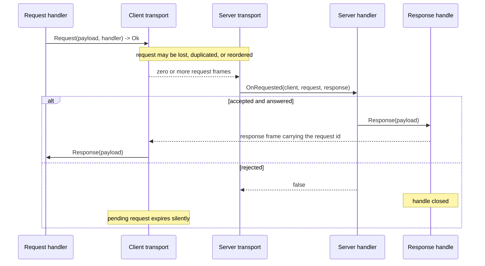

# RRUnreliable Transport Specification

## 1. Scope

`RRUnreliable` is the unreliable family of the RR transport model. This document
includes the [RR Common Transport Specification](../Specification.md) by
reference. Requirements in the common specification are normative here; this
document defines only what the unreliable family adds.

It matches each client request with at most one server response.

A client sends a `UnionDataList` request bound to a per-request handler and
receives at most one response through that handler. A server receives the
request with a response handle and the source `IEndPoint`, and may answer it
once. A client may cancel a pending request locally.

This specification defines:

- the family interfaces;
- request delivery and response correlation;
- the client pending window;
- the server response handle and its single-use rule;
- the observable effects of cancellation and TTL expiry; and
- the family send results.

The common specification defines handler binding, transport lifecycle, TTL
start points, id domains, the message model, server routing, callback
concurrency, buffer ownership, and the security baseline.

Neither document defines a wire format, interoperability between
implementations, configuration syntax, peer discovery, authentication,
authorization, confidentiality, integrity protection, replay protection,
acknowledgement, retry, ordering, or queue capacity.

RRUnreliable provides **no response guarantee**. A request may receive no
response. A server response may be lost, duplicated, or reordered. A server may
reject a request silently; the client only observes the request's pending
window expiry.

## 2. Family contract

```csharp
public interface IRRUnreliableClientTransport : IRRClientTransport
{
    SendResult Request(UnionDataList request,
        IRRUnreliableRequestHandler handler);
}

public interface IRRUnreliableRequestHandler : IRRRequestHandler
{
    void Response(UnionDataList response);
}

public interface IRRUnreliableServerTransport : IRRServerTransport
{
    bool Init(IRRUnreliableServerHandler handler);
}

public interface IRRUnreliableServerHandler : IHandler
{
    bool OnRequested(IEndPoint client, UnionDataList request,
        IRRUnreliableResponse response);
}

public interface IRRUnreliableResponse : IRRResponse
{
}
```

`IRRClientTransport`, `IRRServerTransport`, `IRRRequestHandler`,
`IRRResponse`, `RRRequestHandler`, and `RRResponse` come from the common
specification.

The client binds no transport-level handler and has no `Init`; it is ready to
start after construction. Each `Request` binds its own
`IRRUnreliableRequestHandler`. The server binds one
`IRRUnreliableServerHandler` through `Init`. Neither handler has lifecycle
callbacks; readiness is `Start` returning `true`.

A server response handle is supplied by the transport; applications never
implement `IRRUnreliableResponse`.

A request frame carries a request-id header. `MessageMaxByteSize` excludes
transport framing and that header.

## 3. Delivery model

RRUnreliable preserves complete messages but gives no delivery guarantee.
Requests and responses may be lost, duplicated, reordered, or delayed.

For each accepted request:

- the request may never reach the server;
- the server may invoke `OnRequested` zero, one, or multiple times when the
  carrier duplicates the request;
- the client delivers at most one `Response`;
- the response may never reach the client; and
- no ordering is guaranteed between different requests.

The client delivers the first valid response for a pending request and drops
every later or unknown response.

A request frame carries the client-local request id. A response frame carries the
client-local request id that the server received, so the client can select the bound
handler. The server-global id is server-side bookkeeping and is not required to
appear on the wire.

## 4. Client request and pending window

### 4.1 `Request`

After the shared handler checks of the common specification, `Request` returns:

| Result | Required meaning |
| --- | --- |
| `Ok` | The request was accepted; the handler is bound and holds its client-local request id. |
| `InvalidMessage` | The request is null or cannot be serialized. |
| `MessageTooBig` | The serialized payload exceeds `MessageMaxByteSize`. |
| `NotConnected` | The client transport is not running. |
| `BufferOverflow` | The implementation cannot accept the request because local outbound capacity is full. |
| `Error` | Another synchronous sending failure occurred. |

On `Ok`, `handler.RequestId` is the 16-bit client-local request id of the request,
widened to `long`. The id enters the pending window before the frame is
submitted to the carrier. The request may still be lost; `Ok` is not a peer or
response guarantee.

If the carrier call fails after the id entered the pending window, the id
**MUST** be removed, the handler **MUST** be unbound, and the call **MUST NOT**
return `Ok`.

`Response` **MAY** begin before `Request` returns. The handler already holds
the id, so it must tolerate a response that arrives before the caller has
observed the return value. The handler may already be unbound when `Request`
returns.

### 4.2 Pending window

The client pending window contains every bound request handler until one of the
following wins:

1. the first valid response for the request is taken for delivery;
2. the request is cancelled through `Cancel()`;
3. the request TTL expires; or
4. the transport stops or fails, which clears the pending window.

Expiry is silent: no callback is raised, the handler is unbound, and the pending
id is no longer eligible. A response for an id that is unknown, expired, already
answered, cancelled, or sent by another route **MUST** be released and dropped.

An accepted request therefore receives **zero or one** `Response` call. A
duplicate response for a request whose first response was already taken is
dropped. When several pending-window causes race, the first cause that removes
the request wins; every later cause produces no additional callback.

### 4.3 `Response` callback

`IRRUnreliableRequestHandler.Response(UnionDataList response)` is invoked at
most once per accepted request, after `Start` returned `true`. While it runs,
`handler.RequestId` still identifies the request.

Callbacks for one request handler are serialized and non-reentrant. Callbacks
for different requests may run concurrently; an implementation may serialize
all client callbacks. A `Request` or `Stop` call from a response callback
**MUST NOT** cause a nested `Response` invocation on the same handler.

After the callback returns, the transport unbinds the handler. The handler
**MUST NOT** expect another callback for that request.

If `Response` throws, the transport **MUST** catch and log the exception,
suppress further processing of only that delivery, and continue running. It
**MUST NOT** stop or invalidate the transport solely because `Response` threw.

### 4.4 Cancellation

`Cancel()` removes a bound request from the pending window and unbinds the
handler. No callback is raised; a response that arrives later is released and
dropped. Cancellation is local: the server is not informed and may still
produce one response that the client discards.

## 5. Server request and response handle

### 5.1 `OnRequested`

`OnRequested` is invoked on a running server. Callbacks for the single server
handler are serialized and non-reentrant.

The handler owns the request reference and **MUST** release it exactly once,
including when it rejects the request or throws.

The response handle starts open and carries the server-global id. Returning
`true` accepts the request and keeps the handle open. Returning `false` rejects
it: the transport **MUST** close the handle, and a later `Response` call on it
**MUST** return `Error`. Rejection is silent to the client; the client's
pending request simply expires.

If `OnRequested` throws, the server **MUST** catch and log the exception, treat
the request as rejected, close the handle, and continue running. It **MUST
NOT** stop or invalidate the transport solely because `OnRequested` threw. A
response already accepted with `Ok` before the throw may still be delivered.

The handle stays usable after `OnRequested` returns and may be used
asynchronously. Different requests receive different handles.

### 5.2 `IRRUnreliableResponse`

`SendResult Response(UnionDataList response)` sends the single response for the
request. The result precedence is:

1. the handle is closed or the transport is not running → `Error`;
2. `InvalidMessage` — the response is null or cannot be serialized;
3. `MessageTooBig` — the serialized payload exceeds `MessageMaxByteSize`; or
4. the carrier result, including `Ok`, `BufferOverflow`, `Error`, or another
   implementation-defined synchronous failure.

A handle is single-use. The first call that passes validation closes the
handle before the send is attempted, so a later `Response` call returns `Error`
even when the carrier send fails. `Ok` is local acceptance only; it is not a
delivery guarantee.

Calls for one handle are serialized by the transport and may be made from any
thread.

The response TTL follows the common start point. When it expires, the handle is
closed and a later `Response` returns `Error`; no callback is raised. If the
server never responds, the client pending request eventually expires
independently. Neither side receives a timeout callback.

## 6. Request/response path



Each `OnRequested` invocation carries a new server-global id; only the first
response that reaches the client while its id is pending is delivered.

An implementation **MUST NOT** invoke `Response` for a response that was
accepted before the corresponding `Request` call bound the handler.

The callback for a response **MAY** begin on any scheduler after the response
frame is accepted locally.

## 7. Send results

`Request` results are defined in section 4.1. `Response` results are defined in
section 5.2. Every synchronous non-`Ok` result is non-fatal and **MUST NOT** by
itself stop or invalidate the transport.

`BufferOverflow` and the other non-`Ok` results carry no retry signal.
Applications choose their own retry and backpressure policy, and must obtain a
new handle for a new attempt; a handle is single-use.

The UDP reference implementation configures `request_ttl` (default 30 seconds)
on the client and `response_ttl` (default 10 seconds) on the server. Those
values are configuration, not part of this contract.

## 8. Application-author checklist

- [ ] Call server `Init` exactly once before `Start`; the client needs no
      `Init`.
- [ ] Derive every request handler from `RRRequestHandler`.
- [ ] Use a distinct handler for each concurrently pending request; reuse only
      after the request completed, was cancelled, or expired.
- [ ] Treat every accepted request as potentially lost and every accepted
      response as potentially lost.
- [ ] Never expect more than one `Response` per accepted request.
- [ ] Treat `Ok` from `Request` or `Response` as local acceptance only.
- [ ] Never access or release a payload after passing it to `Request` or
      `Response`.
- [ ] Release each delivered payload exactly once, even when processing fails.
- [ ] Keep handlers prompt, non-blocking, and exception-safe.
- [ ] Treat rejection as silent; rely on TTLs rather than a rejection callback.
- [ ] Do not answer a request after the response TTL exposed by
      `IRRUnreliableServerTransport.ResponseTtl`.
- [ ] Observe `onStopped`; do not restart a stopped or invalid transport.

## 9. Transport-implementer checklist

- [ ] Bind one server handler with a one-time, pre-start `Init`; the client
      requires no `Init`.
- [ ] Keep server callbacks serialized and non-reentrant; keep each request
      handler's callbacks serialized and non-reentrant.
- [ ] Assign client-local request ids and server-global ids that are unique for the
      transport lifetime, starting at `1`; server-global ids may have gaps.
- [ ] Bind the handler before submitting the request frame, and publish its
      `RequestId`.
- [ ] Deliver at most one response per request handler and drop unknown,
      expired, duplicate, cancelled, and foreign-route responses.
- [ ] Unbind the handler after its response callback returns or when the
      request is cancelled, expired, or abandoned.
- [ ] Close the response handle on success, rejection, expiry, or stop; a
      closed handle returns `Error`.
- [ ] Enforce both TTLs without fabricating callbacks for expiry.
- [ ] Enforce `MessageMaxByteSize` on sent and received payloads.
- [ ] Drop and log malformed or oversized inbound frames without stopping.
- [ ] Transfer and release buffers according to the common specification.
- [ ] Treat `OnRequested` and `Response` exceptions as specified and keep
      unrelated transport activity running.
- [ ] Preserve stop and `onStopped` ordering and the exact supplied reason.
- [ ] Document configuration, TTLs, capacity, scheduling, and carrier failure
      behavior without weakening this contract.

## 10. Non-goals

- No completion/finish callback, streaming, or multiple responses per request.
- No server notification of cancellation, and no cancellation of a server
  response that is already in flight.
- No acknowledgement, retry, confirmation, or response receipt.
- No at-most-once, at-least-once, exactly-once, FIFO, causal, or total
  ordering guarantee.
- No connection, session, admission, or peer lifecycle.
- No cross-implementation wire compatibility.
- No authentication, authorization, confidentiality, integrity, or replay
  protection; see the common specification.

## 11. Known limitations (non-normative)

The UDP reference implementation selects a request for dispatch by reading the
dispatch gate and then invoking `OnRequested`; the check is not synchronized
with the stop transition. A frame that passes the check just before `Stop` may
therefore reach `OnRequested` while the transport is stopping, and it may even
run after `onStopped` has been invoked.

The deviation is bounded. The response handle already returns `Error`, no
second callback is delivered for the request, and no other handler callback
overlaps it. A handler that releases its own state in `onStopped` must
nevertheless tolerate one late request and release its payload.

Closing this window requires a callback dispatcher that serializes dispatch
with the stop transition; that work is deferred with the reliable
implementation.
