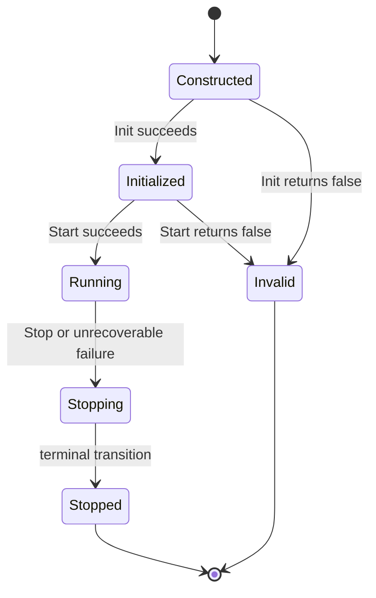

# RawReliable Transport Specification

## 1. Scope

`RawReliable` is a bidirectional, connection-oriented transport for opaque
`UnionDataList` messages. It guarantees in-order, duplicate-free delivery within
a live logical connection.

This specification defines:

- the client, server, handler, and endpoint contracts;
- the transport handshake, rejection, timeout, and capacity agreement;
- per-connection endpoint and callback lifecycles;
- ordered delivery and buffer ownership;
- admission and the server handler factory;
- failure, shutdown, and terminal notification ordering.

The transport does not provide authentication, authorization, confidentiality,
integrity, or replay protection. Those concerns belong to the application or to
a protocol layered above `RawReliable`. Wire format, interoperability,
configuration syntax, discovery, and queue capacity lie outside this
specification.

### 1.1 Applicability

| Section or topic | Included | Reason |
| --- | --- | --- |
| Client association | yes | The client owns one logical connection to its configured destination. |
| Server association and routing | yes | The server admits one session per connection and creates one handler per session. |
| Establishment and negotiation | yes | Every carrier performs a mandatory handshake. |
| Rejection and timeout | yes | The handshake can reject a connection and can expire. |
| Admission and handler binding | yes | The server factory decides admission and creates a session handler. |
| Request acceptance | no | There is no request or response unit. |
| Identifiers and correlation | no | A connection is identified by the transport, not by a message identifier. |
| Pending window and TTLs | no | Connection establishment has a deadline; no accepted work has a TTL. |
| Responses and completion | no | A message has no response or per-message terminal notification. |
| Cancellation | no | Logical disconnect replaces cancellation and is defined in section 6.1. |

### 1.2 References

- [`ConformanceSpecification.md`](../../ConformanceSpecification.md) — the
  profile and result classification served by the controls of section 14.

## 2. Normative language

The key words **MUST**, **MUST NOT**, **REQUIRED**, **SHOULD**, **SHOULD NOT**,
and **MAY** in this document are to be interpreted as described in
[RFC 2119](https://datatracker.ietf.org/doc/html/rfc2119).

## 3. Terms

| Term | Meaning |
| --- | --- |
| **client** | A transport that initiates one logical connection to a configured server destination. |
| **server** | A transport that accepts connections at its configured listen address and creates one session per admitted connection. |
| **transport** | One client or one server transport instance. |
| **session** | One admitted logical connection between a client and a server. |
| **endpoint** | An `IRawReliableEndpoint` representing one session, usable by application code for sending and disconnecting. It is not an `IEndPoint`. |
| **handler** | An application-implemented `IRawReliableHandler` bound to one session. |
| **handshake** | The mandatory transport-level exchange that precedes `OnConnected`. |
| **admission** | The server decision, through the handler factory, that a handshake-accepted connection becomes a session. |
| **message** | One logical `UnionDataList` supplied to `Send` or delivered to `OnReceived`. |
| **accepted send** | A `Send` call that returned `SendResult.Ok`. It has been accepted for local processing only. |
| **delivery** | One `OnReceived` invocation for one message. |
| **running** | The period after a successful `Start` and before stopping begins. |

## 4. Public contract

```csharp
public interface IRawReliableClient
    : IRawReliableClientTransport<IRawReliableClientHandler>
{
}

public interface IRawReliableClientTransport<in TClientHandler>
    : IRawReliableTransport
    where TClientHandler : class, IRawReliableClientHandler
{
    bool Init(TClientHandler handler);
}

public interface IRawReliableClientHandler : IRawReliableHandler
{
    void OnConnected(IRawReliableEndpoint endPoint);
}

public interface IRawReliableServer : IRawReliableTransport
{
    bool Init(IRawReliableServerHandlerFactory<IRawReliableServerHandler> factory);
}

public interface IRawReliableServerHandlerFactory<out THandler>
    where THandler : IRawReliableServerHandler
{
    THandler? TryCreate(IEndPoint remote);
}

public interface IRawReliableServerHandler : IRawReliableHandler
{
    void OnConnected(IRawReliableEndpoint endPoint);
}

public interface IRawReliableHandler : IRawHandler
{
    void OnDisconnected(StopReason reason);
}

public interface IRawReliableTransport : IRawTransport
{
}

public interface IRawReliableEndpoint : IRawEndpoint
{
    bool IsConnected { get; }
    bool Disconnect(StopReason reason);
}

public interface IRawReliableClientEndpoint : IRawReliableEndpoint
{
}

public interface IRawReliableServerEndpoint : IRawReliableEndpoint
{
}
```

`IRawHandler` supplies `OnReceived(UnionDataList)` and `OnStopped(StopReason)`.
`IRawEndpoint` supplies `RemoteEndPoint`, `MessageMaxByteSize`, and
`Send(UnionDataList)`; `IBaseEndpoint` supplies `GetControls`.
`IRawTransport` extends `ITransport` and supplies `Name`,
`IsValid`, `IsStarted`, `Start(Action<StopReason>)`, `Stop(StopReason?)`, `Log`,
`Memory`, `MessageMaxByteSize`, and `GetControls`.

Client and server endpoints of one session report the same `MessageMaxByteSize`.

The application implements the handlers and the server factory. The transport
supplies every endpoint. Clients and servers expose neither a transport-level
receive event nor a transport-level send operation. A handler receives an
`IRawReliableEndpoint` through `OnConnected` and uses it for both sending and
logical disconnection.

## 5. Model

The transport is connection-oriented. The unit of work is a session: one logical
connection between one client and one server, established by a transport
handshake and admitted by the server.

The transport provides peer lifecycle callbacks and admission. It does not
provide request/response correlation, per-message completion, or application
acknowledgement.

### 5.1 Responsibility split

| Topic | Guaranteed by RawReliable | Application responsibility | Implementation-defined |
| --- | --- | --- | --- |
| Delivery | In-order, duplicate-free delivery within one live session. Messages are never fragmented or merged. | Treat delivery as confirmed only for messages the transport delivered; handle size limits. | Carrier buffering and scheduling inside a session. |
| Sending | `Ok` means local acceptance. A synchronous failure is returned as a non-`Ok` result and does not affect the connection. | Handle every `SendResult`; recreate a message buffer for a retry. | Queue capacity and drain rate. |
| Handlers | Per-session callbacks are serialized and non-reentrant. Different sessions may run concurrently. | Return promptly, release received buffers, protect shared state. | Callback thread or scheduler. |
| Routing | One client route per transport; one server endpoint per admitted connection. | Validate the remote identity in the factory; treat metadata as unauthenticated. | Endpoint representation and addressing. |
| Failure | A failed session raises `OnDisconnected` and then `OnStopped`; an unrecoverable transport failure invalidates the transport. | Observe every terminal callback; do not reuse a terminated session. | Failure detection mechanism and timing. |
| Security | No authentication, authorization, confidentiality, integrity, or replay protection. | Add the required protection above this transport. | Any implementation-specific protection outside this contract. |
| Lifecycle | `Init` and `Start` are one-time and pre-start; a failed start invalidates the transport. | Call `Init` once before `Start`; observe `onStopped`. | Scheduler and timing of `onStopped`. |

## 6. Establishment and requests

### 6.1 Client association

The client transport owns one logical connection attempt to its configured
server destination. The handshake is performed by the transport, not by the
application. The application first learns about the session through
`OnConnected`, which supplies the client endpoint.

The endpoint's `RemoteEndPoint` is the server destination supplied at
construction and is immutable. `IsConnected` is true while the session is live
and is false from the moment `OnDisconnected` is invoked.

`Disconnect(reason)` initiates logical disconnection. The endpoint is not usable
for sends after disconnection.

### 6.2 Server association and routing

The server transport accepts connections at its configured listen address. It
creates one session and one server endpoint per admitted connection. The server
endpoint's `RemoteEndPoint` is the connecting client's remote endpoint.

Routing is per session. Equal `IEndPoint` values identify the same remote
address for display and factory purposes; a session is not shared between
connections.

A server endpoint is stopped with its session and with the transport.

### 6.3 Establishment and negotiation

The handshake is a flat `UnionDataList` dataset with an explicit frame type, not
a DTO.

1. The client sends, as its first outbound frame after the low-level connection
   is up, a `HandshakeRequestMessage` carrying
   `[version (short), name (string), messageMaxByteSize (int)]`.
2. The server reads the length-prefixed frame, enforces `HandshakeMaxByteSize`
   (default 128 bytes), deserializes it, and verifies that the leading frame type
   is `HandshakeRequestMessage` before parsing the body.
3. The server validates the version and then the name, using UTF-8 content
   equality. A version mismatch or a name mismatch rejects the connection.
4. The requested maximum **MUST** be at least 1 and at least
   `HandshakeMaxByteSize`; otherwise the server rejects with `CapacityExceeded`.
5. Only after these checks does the server call the application factory. A
   `null` return, an exception, or a stopped transport rejects the connection.
6. On acceptance the server computes
   `agreedMax = min(request.messageMaxByteSize, server.MessageMaxByteSize)` and
   replies with a `HandshakeResponseMessage` carrying `[version, name, agreedMax]`.
7. The client validates the response version, name, and maximum, then applies
   `min(local, server)` as its `MessageMaxByteSize`. Only then does the handler
   observe `OnConnected`.
8. `MessageMaxByteSize` is applied once and is read-only afterwards. It is the
   value enforced by `Send` on both peers.

The handshake request, response, and reject buffers **MUST** be kept within
`HandshakeMaxByteSize`; the length prefix is validated before the body is
allocated. Handshake frames are transport-internal and are never delivered
through `OnReceived`.

The client handshake deadline defaults to 10 seconds and is configurable. The
server handshake deadline defaults to 10 seconds. Both are positive durations
with a unit of seconds.

### 6.4 Rejection and timeout

A rejected connection receives a `HandshakeRejectMessage` carrying
`[serverVersion, serverName, status, text?]`, where `status` is one of
`Accepted`, `Rejected`, `VersionMismatch`, `NameMismatch`, `CapacityExceeded`,
or `Timeout`.

| Rejection status | Client-observable cause |
| --- | --- |
| `VersionMismatch` | `ProtocolMismatch` |
| `NameMismatch` | `ProtocolMismatch` |
| `Rejected` | `HandshakeRejected` |
| `CapacityExceeded` | `HandshakeRejected` |
| `Timeout` | `TimeOut` |

A rejected connection delivers no `OnConnected`. A client whose `Start`
succeeded and that never connected receives exactly one `OnStopped`.

Handshake expiry stops the connection with `TimeOut`; the timer is stopped and
disposed when the response, the reject, or the disconnect wins the race.

After writing a reject frame, the carrier **SHOULD** keep the connection open
long enough for the client to observe the reject before the peer closes. The
linger duration is implementation-defined.

### 6.5 Admission and handler binding

1. The server **MUST** invoke `TryCreate(remote)` for each admitted connection
   attempt, and only after the handshake version and name are accepted.
2. Calls to `TryCreate` on a server **MUST NOT** overlap concurrently.
3. `TryCreate` **MUST** return a fresh handler for each admitted session. A
   handler instance **MUST NOT** serve multiple sessions.
4. Returning `null` rejects the connection attempt. The server **MUST NOT**
   cache a null return: a later connection attempt from the same source is
   eligible to invoke `TryCreate` again.
5. An exception thrown by `TryCreate` is a rejection of that attempt. The server
   **MUST** catch and log it and **MUST NOT** stop or invalidate the transport
   solely because of it.
6. Every handler returned by the factory is wrapped in a stop-once gate, so the
   carrier, the session endpoint, and the admission fallback share one stop latch
   and the application observes at most one `OnStopped`.

Regular messages **MUST NOT** be exposed to a handler before that handler's
`OnConnected` has completed. For an admitted session, the server creates and
starts the session endpoint and invokes `OnConnected` only after the handshake
response is scheduled successfully and the endpoint is usable.

## 7. Lifecycle and failure

### 7.1 Initialization

`Init` binds the application callback object before a transport may start. A
client binds one non-null client handler. A server binds one non-null server
handler factory.

Passing null to `Init` **MUST** throw `ArgumentNullException` without changing
the transport state.

`Init` is one-time and pre-start. Concurrent calls are safe, but at most one call
**MUST** return true; every racing or later call **MUST** return false. A
successful `Init` **MUST NOT** start carrier activity or invoke a handler
callback.

`Init` **MUST** return false after a start has been attempted, after the
transport is invalid, or after stopping begins.

### 7.2 Transport state



`Start` requires a non-null `onStopped` callback; null **MUST** throw
`ArgumentNullException` without changing the lifecycle state.

`Start` is one-time. Concurrent calls are safe, but at most one **MAY** return
true; every racing or later call **MUST** return false. A successful `Start`
makes the server able to accept connections and makes the client able to begin a
connection attempt. It does not imply a completed handshake or an admitted
session.

A failed initial `Start` **MUST** invalidate the transport, **MUST NOT** invoke
`onStopped`, and **MUST NOT** invoke any handler callback. A later `Start` call
returns false without changing the terminal state.

A normal `Stop` does not invalidate the transport: `IsValid` remains true while
`IsStarted` becomes false. An unrecoverable failure **MUST** invalidate it. A
stopped transport **MUST NOT** be restarted or reinitialized. A `Stop` before a
successful `Start` is a no-op and returns true.

For each successful `Start(onStopped)`, `onStopped` **MUST** be invoked exactly
once after the terminal transition. The supplied `StopReason` instance **MUST**
be preserved exactly; a null reason supplies a newly created
`Pontifex.StopReasons.Unknown` initialized with the transport `Name`.

`Stop` is thread-safe and may be called from a handler. Once it returns, no new
handler callback may begin. A running callback may finish asynchronously.

`IsValid` and `IsStarted` **MUST** be safe for concurrent reads.

### 7.3 Session lifecycle and callback matrix

| Situation | Handler callbacks |
| --- | --- |
| Transport `Start` returns false | none |
| `Start` returns true, connection fails before `OnConnected` | exactly one `OnStopped` |
| `OnConnected` delivered | `OnConnected`, then `OnDisconnected`, then `OnStopped`, each once |
| Server handler created, but session endpoint creation, start, or admission fails | exactly one `OnStopped` |
| Handshake rejected or timed out | exactly one `OnStopped` |
| Transport stops while sessions are live | `OnDisconnected` then `OnStopped` per session |

```text
client, successful connection: OnConnected -> OnDisconnected -> OnStopped
client, failed establishment:  OnStopped
server, successful session:    OnConnected -> OnDisconnected -> OnStopped
server, failed session:        OnStopped
```

A `Start` that returns false **MUST NOT** invoke handler callbacks. A client
whose `Start` returned true and that terminates before `OnConnected` **MUST**
receive exactly one `OnStopped` and no `OnDisconnected`.

For one session, `OnConnected`, `OnReceived`, `OnDisconnected`, and `OnStopped`
are serialized and non-reentrant. `OnReceived` is never invoked after
`OnDisconnected`. During and after `OnDisconnected`, `IsConnected` is false.
`RemoteEndPoint` remains the immutable route metadata supplied at creation;
callers use `IsConnected`, not a null remote endpoint, to determine liveness.

### 7.4 Failure and terminal notifications

A server transport stop disconnects every active session. The transport
**MUST** schedule each session handler's terminal notification before invoking
its own `onStopped` callback. Endpoint callbacks for different sessions may still
complete asynchronously; this ordering requires notification scheduling, not
completion.

An unrecoverable internal or carrier failure after a successful start **MUST**
stop and invalidate the transport, discard work that has not begun delivery,
terminate every session with `OnDisconnected` and `OnStopped`, and invoke
`onStopped` exactly once.

Failure **MUST NOT** fabricate data-plane activity or handler callbacks. A
transport in the invalid state **MUST NOT** be restarted.

## 8. Message model and limits

`MessageMaxByteSize` is an inclusive limit on the serialized `UnionDataList`
representation, including list and element encoding but excluding transport
framing. It applies to sent and received messages, and to the agreed value of
section 6.3. It **MUST** admit an empty `UnionDataList`. Empty messages are
valid.

The value is fixed at session establishment and is immutable afterwards. It is
safe for concurrent reads. Client and server endpoints of one session report the
same value, and `Send` enforces it on both peers.

An implementation **MUST NOT** invoke a handler or create a session for inbound
data that is malformed, cannot be decoded as a `UnionDataList`, or exceeds
`MessageMaxByteSize`. It **MUST** discard and log that data, and **MUST NOT** stop
or invalidate the transport solely because of it.

The transport **MUST** preserve complete-message boundaries and logical content.
It **MUST NOT** fragment one message across callbacks or merge messages.

## 9. Send results

`Send` is thread-safe and may run concurrently with `Stop`, `Disconnect`, and
other sends. The outcome is determined by operation ordering.

An implementation **MUST** select a result in this order: endpoint and transport
state, message validity and serializability, message size, outbound capacity,
then other synchronous errors.

| Result | Required meaning |
| --- | --- |
| `Ok` | The message was accepted for local processing. It is not a peer receipt or an application acknowledgement. |
| `InvalidMessage` | The message is null, malformed, or cannot be serialized. |
| `MessageTooBig` | The serialized message exceeds `MessageMaxByteSize`. |
| `InvalidAddress` | The endpoint's underlying route is synchronously invalid. |
| `BufferOverflow` | The implementation cannot accept the message because its finite outbound capacity is full. |
| `NotConnected` | The session is not established or no longer live. |
| `Error` | The endpoint or transport is unavailable, or another synchronous error occurred. |
| `Unknown` | Reserved enumeration value. `RawReliable` never returns it. |

A synchronous non-`Ok` result **MUST NOT** by itself stop or invalidate the
endpoint or transport. A failure detected after `Send` returned `Ok` **MUST**
terminate the session and raise `OnDisconnected`.

`BufferOverflow` is not a delivery failure notification and carries no writable
signal. Capacity, scheduling, and drain rate are implementation-defined.
Applications **MUST** choose their own retry and backpressure policy.

## 10. Delivery guarantees

Within one live session, the transport provides exactly-once, ordered delivery:
every message accepted with `Ok` is delivered to the peer handler exactly once,
in the order the `Send` calls returned `Ok`, unless the session terminates first.

`Ok` means local acceptance only. It is not a peer receipt and not an
application-level acknowledgement.

Reliability applies only to a live session. After `OnDisconnected`, accepted but
undelivered messages may be discarded. The transport **MUST NOT** claim
exactly-once delivery across a transport restart, a reconnect, or a persistence
boundary it does not support.

There is no application acknowledgement payload, acknowledgement response,
acknowledger, or `ack(...)` scheme. Reliability is a property of the transport
contract; the handshake establishes compatibility, identity, and capacity only.

## 11. Concurrency and buffer ownership

`OnConnected`, `OnReceived`, `OnDisconnected`, and `OnStopped` are serialized and
non-reentrant for one session. Callbacks for different server sessions **MAY**
run concurrently; the application **MUST** protect shared state.

`TryCreate` calls **MUST NOT** overlap concurrently on one server, including
calls for different connections.

Callbacks are non-reentrant: a `Send`, `Disconnect`, or `Stop` from a handler
**MUST NOT** cause a nested callback on that session. The contract gives no
thread affinity.

Every `Send` transfers ownership of its message to the transport except on
`InvalidMessage`, where the buffer is null or dead and stays with the caller. For
every other result the caller **MUST NOT** read, mutate, retain, release, or
retry with that buffer; a retry requires a new buffer. The transport **MAY**
modify an outbound buffer before admission, including on a send that later
fails.

Each `OnReceived` delivers one independently owned `UnionDataList` reference.
The handler **MUST** release it exactly once, **MAY** mutate it while owned, and
**MAY** retain it beyond the callback provided it releases it exactly once later.
A handler that throws **MUST** still release the reference it owns.

The transport **MUST** catch and log a throwing handler and **MUST NOT** stop a
session, an endpoint, or the transport solely because a handler threw.

Handlers and factories **MUST** return promptly and **MUST NOT** block. The
contract defines no callback timeout.

## 12. Implementation-defined choices

| Area | Left open | Invariant that remains binding |
| --- | --- | --- |
| Carrier and wire encoding | Physical carrier, framing, and interoperability. | Frame type precedes body; handshake buffers stay within `HandshakeMaxByteSize`. |
| Addressing | Endpoint representation and address configuration. | The agreed `MessageMaxByteSize` is identical on both peers. |
| Callback scheduler | Thread or scheduler of handler callbacks. | Per-session callbacks are serialized. |
| Queue capacity and drain rate | Outbound capacity and scheduling. | A full queue yields `BufferOverflow`, never loss after `Ok`. |
| Reject linger | How long a rejected connection stays open. | The client can observe the reject. |
| Failure detection | How and when an unrecoverable failure or disconnect is detected. | Failure raises the terminal sequence exactly once. |
| Logging | Format and sink. | Malformed and oversized inbound data is logged. |
| Protection | Protection layered beneath the transport. | It does not weaken this specification. |

An implementation-defined choice **MUST NOT** weaken any requirement of this
specification, and the implementation **MUST** document it.

## 13. Security boundary

`RawReliable` provides no peer authentication, authorization, confidentiality,
cryptographic integrity, tamper detection, source-spoofing protection, or replay
protection. The handshake name and version identify compatibility, not identity.
`RemoteEndPoint` is unauthenticated routing metadata.

An application handling sensitive, privileged, or non-idempotent operations
**MUST** add authentication, integrity, confidentiality, and replay protection
above this transport.

## 14. Conformance controls

A conformance adapter obtains the transport control through
`ITransport.GetControls` before starting the transport.

The control is `IRawReliableConformanceControl`, which extends
`IRawConformanceControl` and `IConformanceControl` and adds no members. It
exposes `BeforeStopStateTransitionGate`, `BeforeStoppedCallbackGate`,
`FailNextStart()`, and `InjectUnrecoverableFailure()`. The contract defines no
transport-specific checkpoint and no endpoint control.

| Control or checkpoint | Hit when | Not hit for |
| --- | --- | --- |
| `BeforeStopStateTransitionGate` | A running transport is about to leave the running state. | A transport that never started. |
| `BeforeStoppedCallbackGate` | The transport is about to invoke `onStopped`. | A failed `Start`. |
| `FailNextStart()` | Armed before `Start`; makes the next `Start` fail and invalidate the transport. | A transport that has begun starting. |
| `InjectUnrecoverableFailure()` | Armed on a running transport; drives the ordinary failure path. | A stopped or invalid transport. |

Implementations **MAY** expose the control only from instances constructed by a
conformance adapter. Ordinary production instances **MUST NOT** incur
conformance-control hot-path overhead. The control **MUST NOT** inject packets,
invoke application callbacks, or fabricate `SendResult` values. Every gate
**MUST** be safe for concurrent use and inactive until armed.

These controls serve the Carrier-Independent Core Conformance profile of
[`ConformanceSpecification.md`](../../ConformanceSpecification.md).

## 15. Transport-implementer checklist

- [ ] Provide one-time, pre-start `Init` and one-time `Start`.
- [ ] Invalidate the transport on a failed `Init` or `Start` and invoke no
      handler callback in that case.
- [ ] Perform the handshake before delivering `OnConnected`.
- [ ] Validate frame type, version, and name in the order of section 6.3.
- [ ] Enforce `HandshakeMaxByteSize` before allocating a body.
- [ ] Reject a request maximum below `HandshakeMaxByteSize` with
      `CapacityExceeded`.
- [ ] Agree `MessageMaxByteSize` as the minimum of both peers and keep it
      immutable.
- [ ] Map every rejection status to the client-observable cause of section 6.4.
- [ ] Call `TryCreate` only after version and name are accepted, and never
      concurrently.
- [ ] Return a fresh handler per session and reject a null return without
      caching it.
- [ ] Wrap every handler in a single stop latch.
- [ ] Deliver regular messages only after `OnConnected` completes.
- [ ] Preserve per-session callback order and non-reentrancy.
- [ ] Raise `OnDisconnected` before `OnStopped` and never deliver a message after
      `OnDisconnected`.
- [ ] Set `IsConnected` to false by the time `OnDisconnected` is invoked.
- [ ] Schedule session terminal notifications before the transport `onStopped`.
- [ ] Invoke `onStopped` exactly once and preserve the supplied `StopReason`.
- [ ] Return `NotConnected` when the session is not live, and never `Ok` for
      undeliverable work.
- [ ] Transfer and release buffers according to section 11.
- [ ] Drop and log malformed or oversized inbound data without stopping.
- [ ] Catch and log factory, handler, and callback exceptions without stopping
      unrelated sessions.
- [ ] Keep `IsConnected`, `IsValid`, `IsStarted`, and `MessageMaxByteSize` safe
      for concurrent reads.
- [ ] Document every implementation-defined choice of section 12.
- [ ] Expose the conformance control only from conformance adapters.

## 16. Application-author checklist

- [ ] Call `Init` exactly once before `Start`.
- [ ] Validate the remote identity in the server factory; the handshake does not
      authenticate the peer.
- [ ] Return a distinct handler for every admitted session.
- [ ] Never reuse a handler across sessions.
- [ ] Expect `OnConnected`, then messages, then `OnDisconnected`, then
      `OnStopped`.
- [ ] Treat `SendResult.Ok` as local acceptance only.
- [ ] Never access or release a message after passing it to `Send`.
- [ ] Release each received message exactly once, even when handling throws.
- [ ] Keep handlers and the factory prompt and non-blocking.
- [ ] Protect state shared between concurrent sessions.
- [ ] Use `IsConnected` rather than `RemoteEndPoint` to test session liveness.
- [ ] Treat `RemoteEndPoint` and messages as unauthenticated input.
- [ ] Observe `onStopped`; do not restart a stopped or invalid transport.
