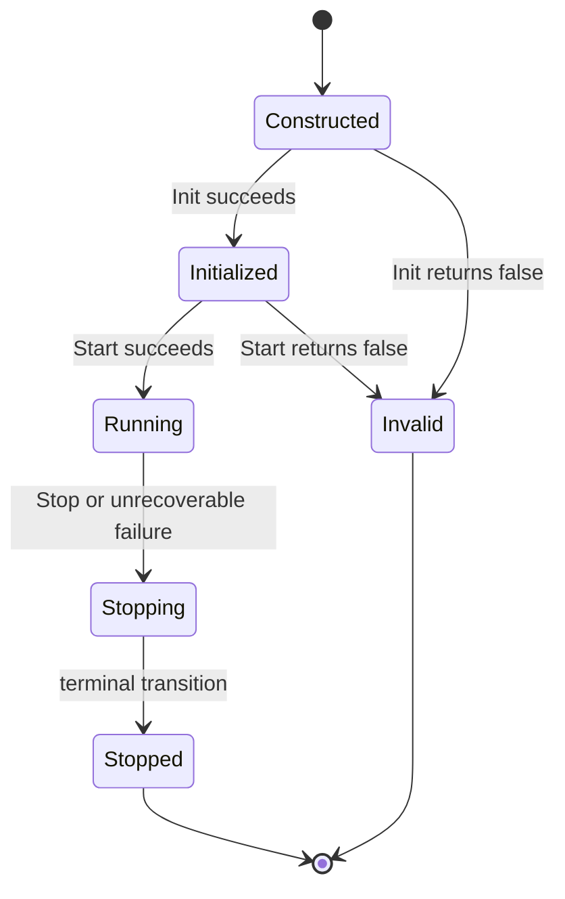

# RawUnreliable Transport Specification

## 1. Scope

`RawUnreliable` is a bidirectional, connectionless transport for opaque
`UnionDataList` messages.

This specification defines:

- client-to-server and server-to-client message exchange;
- complete-message boundaries and the maximum message size;
- intentionally unreliable delivery semantics;
- endpoint-based receive handling, lifecycle, and buffer ownership;
- server source-route creation and routing;
- transport and endpoint failure and shutdown.

The transport does not provide a connection, session, admission exchange,
handshake, peer lifecycle callback, keep-alive, reconnection, or resume
operation. An endpoint is a local application handle for a routing path. An
`IEndPoint` is routing metadata, not a session and not a security principal.

Wire format, interoperability, configuration syntax, discovery, authentication,
authorization, confidentiality, integrity, replay protection, acknowledgement,
retry, timeout, and queue capacity lie outside this specification. They belong
to a selected implementation or to a protocol layered above this transport.

### 1.1 Applicability

| Section or topic | Included | Reason |
| --- | --- | --- |
| Client association | yes | The client owns one route to its configured destination. |
| Server association and routing | yes | The server creates one endpoint per source route. |
| Establishment and negotiation | no | The transport has no handshake or negotiation exchange. |
| Rejection and timeout | no | There is no admission exchange to reject or time out. |
| Admission and handler binding | no | The server handler factory is driven by routing, not by admission. |
| Request acceptance | no | There is no request or response unit. |
| Identifiers and correlation | no | No message carries a correlation identifier. |
| Pending window and TTLs | no | Accepted work is never pending; there is no expiry. |
| Responses and completion | no | A message has no response or terminal notification. |
| Cancellation | no | Only endpoint `Stop` exists, defined in section 7. |

### 1.2 References

- [`ConformanceSpecification.md`](../../ConformanceSpecification.md) — the
  profile and result classification served by the controls of section 14.

## 2. Normative language

The key words **MUST**, **MUST NOT**, **REQUIRED**, **SHOULD**, **SHOULD NOT**,
and **MAY** in this document are to be interpreted as described in
[RFC 2119](https://datatracker.ietf.org/doc/html/rfc2119).

## 3. Terms

| Term | Meaning |
| --- | --- |
| **client** | A transport configured with one remote server destination. It owns one client endpoint while running. |
| **server** | A transport that receives messages addressed to its configured listen address. It creates an endpoint and handler for each accepted source route. |
| **transport** | One `IRawUnreliableClient` or one `IRawUnreliableServer` instance. |
| **endpoint** | An `IRawUnreliableEndpoint` representing one route usable by application code for sending and receiving. It is not an `IEndPoint`. |
| **source route** | A server-side route identified by an `IEndPoint` supplied to the server handler factory from an inbound message source. |
| **handler** | An application-implemented `IRawUnreliableHandler` bound to one endpoint. |
| **message** | One logical `UnionDataList` supplied to `Send` or delivered to `OnReceived`. |
| **accepted send** | A `Send` call that returned `SendResult.Ok`. It has been accepted for local transport processing only. |
| **delivery** | One `OnReceived` invocation for one message. A delivered duplicate is a separate delivery. |
| **running** | The period after a successful `Start` and before stopping begins. |
| **valid endpoint** | An endpoint for which `IsValid` is true and which may accept sends. |

## 4. Public contract

```csharp
public interface IRawUnreliableClient : IRawUnreliableTransport
{
    bool Init(IRawUnreliableHandler handler);
}

public interface IRawUnreliableEndpoint : IRawEndpoint
{
    bool IsValid { get; }
    bool Stop(StopReason? reason = null);
}

public interface IRawUnreliableHandler : IRawHandler
{
    void OnStarted(IRawUnreliableEndpoint endpoint);
}

public interface IRawUnreliableServer : IRawUnreliableTransport
{
    bool Init(Func<IEndPoint, IRawUnreliableHandler?> handlerFactory);
}
```

`IRawHandler` supplies `OnReceived(UnionDataList receivedBuffer)` and
`OnStopped(StopReason reason)`. `IRawEndpoint` supplies `RemoteEndPoint`,
`MessageMaxByteSize`, and `Send(UnionDataList bufferToSend)`.

`IRawUnreliableTransport` extends `IRawTransport`, which extends `ITransport` and
supplies `Name`, `IsValid`, `IsStarted`, `Start(Action<StopReason>)`,
`Stop(StopReason?)`, `Log`, `Memory`, `MessageMaxByteSize`, and `GetControls`.

The application implements `IRawUnreliableHandler`. The transport supplies every
endpoint. Clients and servers expose neither a transport-level receive event nor
a transport-level send operation. A handler receives an
`IRawUnreliableEndpoint` through `OnStarted` and uses that endpoint for both
sending and endpoint-local stopping.

The server factory receives only the source route. A response to `Send` is a
local acceptance decision, never a delivery confirmation.

## 5. Model

The transport is connectionless. A client is locally ready after its endpoint
has successfully started; it does not establish or await a connection. A server
does not admit clients or create sessions. Each valid inbound message is
independently eligible for delivery or for source-route handler selection.

### 5.1 Responsibility split

| Topic | Guaranteed by RawUnreliable | Application responsibility | Implementation-defined |
| --- | --- | --- | --- |
| Delivery | Preserves each delivered message's boundary and logical content. Loss, duplication, and reordering are all permitted. | Make operations idempotent; add sequence numbers, deduplication, receipts, retries, or ordering above this layer when required. | Carrier and queue behavior that causes a particular delivery outcome. |
| Sending | `Ok` means local acceptance only, never peer receipt. Every call consumes its non-null, live message buffer; an `InvalidMessage` result leaves a null or dead buffer with the caller. | Handle every `SendResult`; retry only with a newly created logical message. | Queue capacity, drain rate, and scheduling. |
| Handlers | Each endpoint's callbacks are serialized and non-reentrant. Server endpoints may invoke callbacks concurrently with other server endpoints. | Return promptly, release received buffers, and protect state shared between handlers. | Callback thread or scheduler. |
| Routing | A client has one configured route. A server creates endpoint routes from valid inbound sources and binds each endpoint to one equal source route while valid. | Return null from the factory to decline a source message; treat endpoint metadata as unauthenticated. | Endpoint representation and carrier addressing. |
| Failure | A stopped or internally invalidated endpoint stops its handler callbacks. A server can later create a new endpoint for the same source route. | Observe `OnStopped`; retain no expectation that an invalid endpoint will become valid again. | Failure detection mechanism and timing. |
| Security | No authentication, authorization, confidentiality, integrity, or replay protection. | Implement required protection above this layer or select an appropriately protected carrier. | Any implementation-specific protection outside this contract. |
| Lifecycle | `Init` and `Start` are one-time and pre-start; a failed start invalidates the transport. | Call `Init` once before `Start`, and observe `onStopped`. | Scheduler and timing of `onStopped` dispatch. |

## 6. Establishment and requests

### 6.1 Client association

A client is configured with one remote server destination. After
`client.Start` returns `true`, the client transport creates its single endpoint.
The endpoint's `RemoteEndPoint` is that configured destination and is immutable
for the endpoint lifetime.

A client **MUST** expose through its handler only messages accepted as
originating from its configured remote destination. This filter is routing only;
it supplies no proof that a message actually originated with a trusted peer.

### 6.2 Server association and routing

For every valid bounded inbound message addressed to a running server, the
server identifies its source route using an `IEndPoint`.

Equal `IEndPoint` values identify the same route while a corresponding server
endpoint is valid, and equal values **MUST** return the same `GetHashCode` value
during that lifetime. Equality and hash code are the only route-binding keys. A
binding **MUST NOT** depend on the object identity, retention, or cache lifetime
of a particular source-endpoint representation.

When an inbound message has no valid server endpoint for its equal source route,
the server **MUST** invoke the configured factory as
`handlerFactory(source)`, supplying only the source route. The factory **MUST
NOT** receive or observe the triggering message.

Route creation is atomic for equal sources: concurrent first messages from one
equal source **MUST NOT** cause multiple concurrent factory calls or multiple
endpoints.

When the factory returns a handler, the server creates one endpoint for the
route whose `RemoteEndPoint` compares equal to the supplied source. The
triggering message is placed in the new endpoint's inbox ahead of every later
message, then the route is published, then the endpoint is started. The endpoint
invokes `handler.OnStarted(endpoint)` when its start completes and, after that
notification returns successfully, delivers the triggering message through
`handler.OnReceived`.

While the factory or `OnStarted` is in progress for a source route, the server
**MUST** queue later valid inbound messages from that same equal source. It
**MUST NOT** invoke another factory for those pending messages. After
`OnStarted` returns successfully, the server **MUST** bind the queued messages
to the created endpoint and make them eligible for serialized delivery after the
triggering message, subject only to ordinary transport loss and inbound capacity
behavior. This adds no general delivery-order guarantee.

If the factory returns `null`, the server **MUST** release and drop the
triggering message. It **MUST NOT** cache that decline: every later valid
message from the same source is eligible to invoke the factory again. Pending
messages from the same route **MUST** be processed in turn as later source
messages.

If the factory throws, the server **MUST** catch and log the exception, release
and drop the triggering message, and leave no endpoint binding for that source.
Pending messages from the same route **MUST** be processed in turn as later
source messages.

If a newly created handler throws from `OnStarted`, the implementation **MUST**
catch and log the exception, invalidate that endpoint, and release and drop the
triggering message. It **MUST NOT** invoke `OnStopped` for that handler, stop the
server, or retain the failed binding. A later valid message from the same source
is eligible to create a new endpoint and handler.

After a valid server endpoint stops or is internally invalidated, the server
**MUST** remove its route binding. A later valid message from the same source
**MUST** be processed as a new route and is eligible to create a new endpoint
through the factory.

Every valid bounded message addressed to the listen address is eligible for
route selection, without a prior registration, connection, or admission exchange
from its source.

## 7. Lifecycle and failure

### 7.1 Initialization

`Init` binds the application callback object before a transport may start. A
client binds one non-null `IRawUnreliableHandler`. A server binds one non-null
server handler factory with the signature of section 4.

Passing null to `Init` **MUST** throw `ArgumentNullException` without changing
the transport state. A server factory returning null is valid and is not an
`Init` failure.

`Init` is a one-time operation. Concurrent calls are safe, but at most one call
may return `true`. Every racing or later call **MUST** return `false`. A
successful `Init` does not invoke `OnStarted`, create a server endpoint, or start
carrier activity.

The initial eligible `Init` attempt either succeeds or terminally invalidates the
transport. If it returns `false`, `IsValid` **MUST** become false, no later `Init`
or `Start` may succeed, and no `onStopped` callback is invoked. Calling `Init`
after a successful `Start`, after stopping begins, or after the transport is
invalid **MUST** return `false`.

`Start` requires a successful `Init`. Calling `Start` before successful
initialization **MUST** return `false` and terminally invalidate the transport.

### 7.2 Transport state



`Start` requires a non-null `onStopped` callback. Passing null **MUST** throw
`ArgumentNullException` without changing the lifecycle state.

`Start` is a one-time operation. Concurrent calls are safe, but at most one call
**MAY** return true; every racing or later call **MUST** return false. A
successful `Start` makes the server able to receive at its configured address and
makes the client locally able to send and receive from its configured remote
destination. It does not imply peer reachability or establish a session.

If the initial `Start` attempt returns false, the instance **MUST** become
invalid, **MUST NOT** invoke the supplied `onStopped` callback, and **MUST NOT**
be restarted. A later or racing `Start` call returns false without changing the
terminal state.

After a successful start, stopping is terminal: a stopped transport **MUST NOT**
be restarted or reinitialized. A normal transport stop does not invalidate the
instance: `IsValid` remains true while `IsStarted` becomes false. An
unrecoverable internal or carrier failure **MUST** invalidate the transport. A
`Stop` call before a successful `Start` is a no-op and returns true.

For each successful `Start(onStopped)`, `onStopped` **MUST** be invoked exactly
once after the terminal state transition, whether the stop comes from `Stop`, an
endpoint action, or an unrecoverable failure. The callback MAY be invoked
synchronously or asynchronously; `Stop` is not required to wait for it.

An explicit `Stop(reason)` call **MUST** preserve the supplied `StopReason`
instance exactly: that same instance is supplied to the local handler teardown
callbacks and to `onStopped`. A `Stop` call with a null reason supplies a newly
created `Pontifex.StopReasons.Unknown` reason initialized with the owning
transport's `Name`.

`Stop` is thread-safe and may be called from a handler. Once it returns, no new
`OnReceived` invocation may begin on any endpoint of that transport. A handler
already running may finish asynchronously.

`IsValid` and `IsStarted` **MUST** be safe for concurrent reads. `IsStarted` is
true only while the transport is running. `IsValid` becomes false after a failed
initialization, a failed start, or an unrecoverable transport failure.

### 7.3 Client endpoint startup

After `client.Start` has successfully returned true, the client creates its
single endpoint and starts it. The endpoint's start completion makes it valid
and invokes `handler.OnStarted(endpoint)`; the endpoint is usable from
`OnStarted`.

The client **MUST NOT** deliver `OnReceived` before `OnStarted` returns
successfully.

If client `OnStarted` throws, the implementation **MUST** catch and log the
exception, invalidate the client endpoint, stop the client transport, and invoke
the transport-level `onStopped` callback exactly once. The throwing handler
**MUST NOT** receive `OnStopped`. This is a stop after successful transport
startup, not a failed `Start`.

### 7.4 Endpoint lifecycle and termination

`IsValid` is safe for concurrent reads. It is true when the endpoint has started
successfully and remains usable. It becomes false when endpoint stopping begins
and never becomes true again.

`RemoteEndPoint` identifies the endpoint's immutable route metadata: the
configured server destination for a client endpoint, and the accepted source
route for a server endpoint. It **MUST** remain available after invalidation;
callers use `IsValid`, not a null remote endpoint, to determine usability.

`MessageMaxByteSize` is immutable and safe for concurrent reads. It has the same
value and meaning as the owning transport's `MessageMaxByteSize`.

An endpoint may stop because the application calls `endpoint.Stop`, because the
implementation detects an endpoint-local internal change, or because its owning
transport stops. An implementation **MAY** invalidate a server endpoint for
implementation-defined endpoint-local reasons without stopping the server. It
**MUST NOT** invalidate a server endpoint solely because its handler throws from
`OnReceived` or `OnStopped`.

`Stop(StopReason? reason = null)` is thread-safe and may be called from any
endpoint callback. The call that begins stopping a valid endpoint **MUST** return
true. Every call after invalidation, including a racing call that loses the stop
transition, **MUST** return false. The method need not wait for a running
callback or for `OnStopped`. A successful call with a null reason **MUST** use a
newly created `Pontifex.StopReasons.Unknown` initialized with the owning
transport's `Name`.

An endpoint whose `OnStarted` returned successfully **MUST** invoke `OnStopped`
exactly once after invalidation. During and after `OnStopped`, `IsValid` **MUST**
be false. A handler whose `OnStarted` threw **MUST NOT** receive `OnStopped`.

If `OnStopped` throws, the transport **MUST** catch and log the exception and
continue its already-determined teardown.

Stopping or internally invalidating the client endpoint **MUST** stop the client
transport. If `OnStarted` completed successfully, the client **MUST** invalidate
the endpoint and schedule `handler.OnStopped(reason)` before invoking the
callback supplied to `Start(onStopped)`.

An explicit endpoint stop is a normal client transport stop unless an
unrecoverable failure independently applies.

When a server transport stops, it **MUST** invalidate all valid server endpoints
and schedule `OnStopped` for every handler whose `OnStarted` completed
successfully before invoking the server transport's `onStopped` callback.
Endpoint callbacks for different routes may still complete asynchronously; this
ordering requires notification scheduling, not completion.

### 7.5 Failure and terminal notifications

An unrecoverable internal or carrier failure after successful start **MUST**
stop and invalidate the transport, discard work that has not begun delivery,
invalidate all valid endpoints, and invoke `onStopped` exactly once. For a
server, endpoint `OnStopped` notifications are scheduled first.

Failure **MUST NOT** fabricate data-plane activity or handler callbacks. A
transport in the invalid state **MUST NOT** be restarted.

### 7.6 Callback matrix

| Situation | Handler callbacks |
| --- | --- |
| Transport `Start` returns false | none |
| `Start` returns true, client `OnStarted` returns | `OnStarted`, then zero or more `OnReceived`, then one `OnStopped` |
| Client `OnStarted` throws | none for that handler; transport `onStopped` runs |
| Server factory returns null | none; the triggering message is dropped |
| Server factory throws | none; the triggering message is dropped |
| Server `OnStarted` throws | none; the endpoint is invalidated and the message is dropped |
| Endpoint stops or is invalidated | one `OnStopped` |
| Unrecoverable failure | one `OnStopped` per started handler, then `onStopped` |

A failed `Start` **MUST NOT** invoke any handler callback.

## 8. Message model and limits

`MessageMaxByteSize` is an inclusive limit on the serialized `UnionDataList`
representation, including list and element encoding but excluding carrier
framing. The limit applies to sent and received messages. It **MUST** be large
enough to admit an empty `UnionDataList`. `UnionDataList.GetDataSize()` defines
the serialized size. Empty messages are valid. `MessageMaxByteSize` is
immutable.

An implementation **MUST NOT** invoke a handler, invoke a server factory, or
create a server endpoint for inbound data that is malformed, cannot be decoded as
a `UnionDataList`, or exceeds `MessageMaxByteSize`. It **MUST** discard and log
that data, and **MUST NOT** stop or invalidate the transport solely because of
it.

When the transport delivers a message, it **MUST** invoke `OnReceived` exactly
once for that delivery with one complete `UnionDataList` containing the same
logical content. The transport **MUST NOT** fragment one message across
callbacks, merge messages into one callback, or alter a message's logical
content.

## 9. Send results

`Send` is thread-safe. It may run concurrently with `Stop` and with other sends;
the outcome is determined by operation ordering. A call made before its endpoint
starts, while its endpoint is stopping, after endpoint stopping, or while the
owning transport is not running **MUST** return `Error`.

`RawUnreliable` **MUST NOT** return `NotConnected`.

An implementation **MUST** select a result using this precedence: endpoint and
transport state, message validity and serializability, message size, route
validity, outbound capacity, then other synchronous errors.

| Result | Required meaning |
| --- | --- |
| `Ok` | The transport accepted the message for local processing. It is not a carrier submission guarantee, peer receipt, or delivery guarantee. |
| `InvalidMessage` | The message is null, malformed, or cannot be serialized. |
| `MessageTooBig` | The serialized message exceeds `MessageMaxByteSize`. |
| `InvalidAddress` | The endpoint's underlying route is synchronously determined to be invalid. |
| `BufferOverflow` | The implementation cannot accept the message because its finite outbound capacity is full. |
| `NotConnected` | Defined by the shared enum for connection-oriented contracts. `RawUnreliable` never returns it. |
| `Error` | The endpoint or transport is unavailable, or another unclassified synchronous error occurred. |
| `Unknown` | Reserved enumeration value. `RawUnreliable` never returns it. |

Every synchronous non-`Ok` result is non-fatal: it **MUST NOT** by itself stop or
invalidate the endpoint or transport. `BufferOverflow` is not a delivery failure
notification and carries no writable signal. Capacity, scheduling, and drain
rate are implementation-defined. Applications **MUST** choose their own retry and
backpressure policy.

## 10. Delivery guarantees

`RawUnreliable` provides no delivery guarantee. For each accepted send, in
either direction, all of the following outcomes are permitted:

1. no delivery;
2. one delivery;
3. multiple deliveries;
4. delivery in any order relative to any other message.

There is no at-most-once, at-least-once, exactly-once, FIFO, causal, or total
ordering guarantee. A sender **MUST NOT** infer a delivery outcome from
`SendResult.Ok`. An application requiring confirmation **MUST** define a receipt
protocol above this transport.

The callback for a message accepted by `Send` **MUST NOT** begin before that
`Send` call returns. Delivery may otherwise occur on any implementation-selected
scheduler after local acceptance. Duplicate deliveries each provide their own
independently owned message reference.

## 11. Concurrency and buffer ownership

For one endpoint, `OnStarted`, every `OnReceived`, and `OnStopped` **MUST** be
serialized and non-reentrant. `OnReceived` **MUST NOT** begin until `OnStarted`
has returned successfully. `OnStopped` **MUST NOT** begin until a running
callback for that endpoint has returned. Once invalidation begins, no new
`OnReceived` may begin for that endpoint.

Callbacks for different server endpoints **MAY** run concurrently. The
application **MUST** protect state shared across handlers or endpoints. A client
has one endpoint, so its handler callbacks are serialized.

A server **MUST** serialize factory invocations globally: two factory calls,
including calls for unequal source routes, **MUST NOT** overlap.

Callbacks are non-reentrant for one endpoint: a `Send` or `Stop` from a handler
**MUST NOT** cause a nested callback invocation on that same endpoint. The
contract gives no thread affinity.

Every `Send` invocation transfers ownership of its message argument to the
transport for every result except `InvalidMessage`. For every other result,
including a synchronous rejection, the caller **MUST NOT** read, mutate, retain,
release, or retry with that `UnionDataList`; the transport **MUST** eventually
release it. On `InvalidMessage` the buffer is null or no longer alive, so the
caller retains ownership, and a retry requires a new buffer.

Each `OnReceived` delivery transfers one independently owned `UnionDataList`
reference to the handler. The handler:

1. **MUST** release that reference exactly once when it no longer needs it;
2. **MAY** mutate it while it owns the reference;
3. **MAY** retain it beyond callback return without acquiring another reference,
   provided it releases the reference exactly once later.

A handler that throws **MUST** still release any message reference it owns,
normally with `try`/`finally`. The transport **MUST** catch an `OnReceived`
exception, suppress further processing of only that delivery, and continue
running. The transport **MUST NOT** stop or invalidate an endpoint or transport
solely because `OnReceived` threw.

Handlers and factories **MUST** return promptly and **MUST NOT** perform
blocking or long-running work. The contract defines no callback timeout or
automatic penalty.

## 12. Implementation-defined choices

| Area | Left open | Invariant that remains binding |
| --- | --- | --- |
| Carrier and wire encoding | The physical carrier, framing, and interoperability with other implementations. | Complete-message boundaries and logical content are preserved. |
| Addressing and endpoint representation | How a route is encoded and how a source filter is applied. | Equality and hash code are the only route keys. |
| Callback scheduler | The thread or scheduler that invokes handler callbacks. | Callbacks for one endpoint are serialized and non-reentrant. |
| Queue capacity and drain rate | Outbound and inbound capacity, ordering, and scheduling. | A full queue yields `BufferOverflow`, never silent loss of an accepted message's ownership. |
| Dispatch timing | When an accepted message reaches the carrier and when `onStopped` is dispatched. | No delivery callback begins before `Send` returns; `onStopped` is invoked once. |
| Failure detection | How and when an unrecoverable transport failure is detected. | Failure invalidates the transport and invokes `onStopped` once. |
| Logging | The log format and sink. | Malformed and oversized inbound data is logged. |
| Protection | Any protection layered beneath this transport. | It does not weaken the rules of this specification. |

An implementation-defined choice **MUST NOT** weaken any requirement of this
specification, and the implementation **MUST** document it.

## 13. Security boundary

`RawUnreliable` provides no peer authentication, authorization, confidentiality,
cryptographic integrity, tamper detection, source-spoofing protection, or replay
protection. A server factory and a server handler can receive valid messages
from any source reaching the listen address, and a client-side source filter does
not authenticate that source.

Routes, messages, and endpoint metadata are unauthenticated input.

An application handling sensitive, privileged, or non-idempotent operations
**MUST** add the required authentication, integrity, confidentiality, anti-replay,
deduplication, ordering, and receipt mechanisms above this transport, or choose a
protected transport stack.

## 14. Conformance controls

A conformance adapter obtains a transport control through `ITransport.GetControls`
before starting the transport. A handler obtains an endpoint control through
`IRawUnreliableEndpoint.GetControls` after receiving that endpoint in
`OnStarted`.

Implementations MAY expose these controls only from instances constructed by a
conformance adapter. Ordinary production instances MUST NOT incur
conformance-control hot-path overhead. Controls MUST NOT inject packets,
intercept application messages, fabricate `SendResult` values, or directly
invoke application callbacks.

All checkpoint controls are inactive until armed by a test. When armed, a
checkpoint hit invokes `ICheckPoint.Hit` and blocks according to its
`ICheckPointCtl`. Every returned control and getter **MUST** be safe for
concurrent use.

The transport control is `IRawUnreliableTransportConformanceControl`, which
extends `IRawUnreliableConformanceControl` and retains `BeforeStopStateTransitionGate`,
`BeforeStoppedCallbackGate`, `FailNextStart()`, and
`InjectUnrecoverableFailure()` from `IConformanceControl`. It adds:

```csharp
ICheckPointCtl BeforeHandlerFactoryGate { get; }
ICheckPointCtl BeforeHandlerStartedGate { get; }
bool TryMakeReliable();
```

| Control or checkpoint | Hit when | Not hit for |
| --- | --- | --- |
| `BeforeStopStateTransitionGate` | A running transport is about to leave the running state. | A transport that was never started. |
| `BeforeStoppedCallbackGate` | The transport is about to invoke `onStopped`. | A failed `Start`. |
| `BeforeHandlerFactoryGate` | The server is about to call the factory, under the admission lock. | Malformed, oversized, or discarded inbound data; a client transport. |
| `BeforeHandlerStartedGate` | A created server endpoint is about to start, after route publication. | A missing handler or a route that created no endpoint; a client endpoint. |
| `TryMakeReliable()` | Armed before `Start`; makes every route deliver `Ok` messages exactly once in FIFO order per direction. | A transport that has begun starting. |

`FailNextStart()` and `InjectUnrecoverableFailure()` follow the ordinary
lifecycle rules. Injected failure **MUST NOT** fabricate data-plane or handler
activity.

The endpoint control is `IRawUnreliableEndpointConformanceControl`, which
extends `IControl`:

```csharp
ICheckPointCtl BeforeEndpointStopStateTransitionGate { get; }
ICheckPointCtl BeforeHandlerStoppedGate { get; }
ICheckPointCtl BeforeSendCommitGate { get; }
ICheckPointCtl AfterSendCommitGate { get; }
ICheckPointCtl AfterReceivedGate { get; }
```

| Control or checkpoint | Hit when | Not hit for |
| --- | --- | --- |
| `BeforeEndpointStopStateTransitionGate` | An endpoint stop transition begins; the endpoint is already invalid. | An endpoint that never started. |
| `BeforeHandlerStoppedGate` | The stop transition is about to invoke `OnStopped`. | A handler whose `OnStarted` threw. |
| `BeforeSendCommitGate` | An accepted message is about to reach an underlying IO commit attempt. | Synchronously rejected or discarded messages. |
| `AfterSendCommitGate` | An endpoint message completes an IO commit attempt. | Messages that never reached a commit. |
| `AfterReceivedGate` | An `OnReceived` delivery is impending. | Malformed, oversized, discarded, or pending-startup messages; `OnStarted` and `OnStopped`. |

These controls serve the Carrier-Independent Core Conformance profile of
[`ConformanceSpecification.md`](../../ConformanceSpecification.md). A passing
result is named Carrier-Independent Core Conformant.

## 15. Transport-implementer checklist

- [ ] Provide one-time, pre-start `Init` and terminal invalidation on a failed
      `Init` or `Start`.
- [ ] Provide connectionless operation without admission, handshake, sessions, or
      peer lifecycle callbacks.
- [ ] Create server endpoints atomically per equal source route.
- [ ] Queue same-route messages during factory and handler startup.
- [ ] Recreate a server endpoint after the previous endpoint for the same source
      terminates.
- [ ] Serialize all factory invocations globally.
- [ ] Preserve complete-message boundaries and logical content for every
      delivery.
- [ ] Permit loss, duplication, and reordering without claiming a stronger
      property.
- [ ] Defer a delivery callback until after the sending `Send` returns.
- [ ] Serialize callbacks per endpoint and prevent reentrancy.
- [ ] Transfer and release sent buffers according to section 11.
- [ ] Release each received buffer exactly once, and catch a throwing handler
      without stopping the transport.
- [ ] Drop and log malformed or oversized inbound data without stopping.
- [ ] Apply the null-factory, factory-exception, and `OnStarted` failure rules of
      section 6.2.
- [ ] Invoke `OnStopped` once per started handler and `onStopped` once per
      transport, in the order of section 7.4.
- [ ] Invalidate the transport on unrecoverable failure and keep unrelated
      endpoint activity independent.
- [ ] Preserve the supplied `StopReason` instance and generate `Unknown` for a
      null reason.
- [ ] Expose the transport and endpoint conformance controls from conformance
      adapters only.
- [ ] Implement `TryMakeReliable()` when the Carrier-Independent Core profile is
      claimed.
- [ ] Keep `IsValid`, `IsStarted`, `IsValid` on the endpoint, and
      `MessageMaxByteSize` safe for concurrent reads.
- [ ] Document every implementation-defined choice of section 12.

## 16. Application-author checklist

- [ ] Call `Init` exactly once before `Start`.
- [ ] Treat every accepted send as potentially lost, duplicated, and reordered.
- [ ] Implement idempotency, sequence handling, acknowledgements, retries, and
      receipts when the application needs them.
- [ ] Treat `SendResult.Ok` only as local acceptance.
- [ ] Never access or release a message after passing it to `Send`.
- [ ] Release each received message exactly once, even if processing fails.
- [ ] Keep handlers and server factories prompt, non-blocking, and
      exception-safe.
- [ ] Protect state shared by multiple server endpoint handlers.
- [ ] Treat a null factory result as a one-message decline, not a permanent
      block.
- [ ] Treat endpoint metadata and messages as unauthenticated input.
- [ ] Observe endpoint `OnStopped` and transport `onStopped`; do not expect an
      invalid endpoint or stopped transport to restart.
